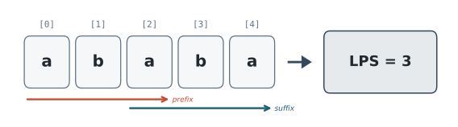
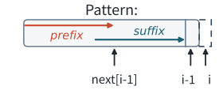
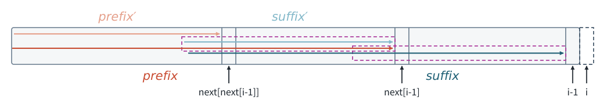
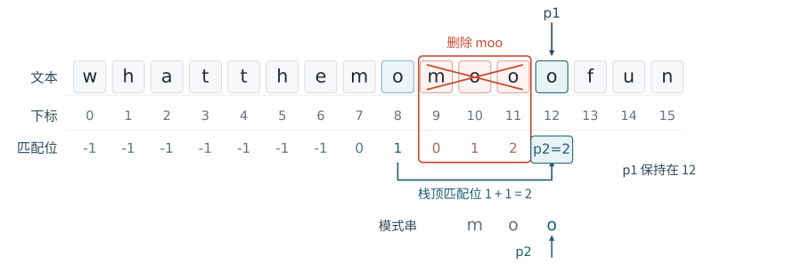

# KMP

> Author：玖沐 (Jura)  |  Last Updated：2026/10/26

- [左程云 - 算法100 KMP原理](https://www.bilibili.com/video/BV19Q4y1c7ko)；
- [左程云 - 算法101 KMP题目](https://www.bilibili.com/video/BV13m41197tS)；

## Theory

##### LPS

1. 字符串的`最大匹配真前后缀`；

   $\text{Longest Proper Prefix which is also Suffix}$，简称 $\text{LPS}$，例：

   

   必须是真前后缀，不然任意字符串的LPS都是自身，没有意义；

2. `next`数组：

   $\text{next}[i]=$ 模式串 $P[0 \dots i-1]$ 的LPS长度；并规定 $\text{next}[0]=-1$；

   例如对于 `P = "ababa"`，`next` = `[-1, 0, 0, 1, 2]`；

   索引是0-based的，所以` next`值还是prefix下一个位置的索引；

---

##### Pattern Matching

1. 朴素方法：枚举所有 $\text{Pattern}$ 在 $\text{Text}$ 中的起始位置；设二者长度分别为 $n$ 和 $m$，显然复杂度为 $O(n\times m)$；

   ```cpp
   int patternMatch(const string& text, const string& pattern) {
       for (int i = 0; i + pattern.size() <= text.size(); ++i) {
           int j = 0;
           while (j < pattern.size() && text[i + j] == pattern[j]) {
               ++j;
           }
           if (j == pattern.size()) {
               return i;
           }
       }
       return -1;
   }
   ```

2. 利用`next`跳过不可能匹配的索引：

   ![失配后 Pattern 按 next[p2] 滑动，并跳过已匹配的 Text 区段](assets/kmp_mismatch_shift_and_skip_matched_text.svg)

   这部分能被直接跳过：[原因](https://www.bilibili.com/video/BV19Q4y1c7ko?t=1822.3)；

3. Code：

   ```cpp
   int kmp(const string& text, const string& pattern, const vector<int>& next) {
       if (pattern.empty()) return 0;
       int p1 = 0, p2 = 0;
   
       while (p1 < text.size() && p2 < pattern.size()) {
           // 这个while就是上图，只要配不上p2就沿着next跳
          	while (p2 >= 0 && text[p1] != pattern[p2]) {
               p2 = next[p2]; // 啰唆一句，p2是可以跳到-1的
           }
           
           // text是线性的，只有一个匹配方向，递增即可
           // Practice的LC1367展示了多匹配方向的情形
           p1++;
           p2++;
       }
   
       return p2 == pattern.size() ? p1 - p2 : -1;
   }
   ```

---

##### Next Array

- 回顾`next`定义：$\text{next}[i]=$ 模式串 $P[0 \dots i-1]$ 的LPS长度；并规定 $\text{next}[0]=-1$；

  同时由于索引是0-based的，所以` next`值还是prefix下一个位置的索引；

- 已知`next[0]`到`next[i - 1]`，求`next[i]` ($i\ge1$)；

  

1. 若`pattern[next[i - 1]] == pattern[i - 1]`：

   看图，此时prefix和suffix都可延长一个字符，则`next[i] = next[i - 1] + 1`；

   `next[i]`不可能更长：[原因](https://www.bilibili.com/video/BV19Q4y1c7ko?t=3050.7)；

2. 若`pattern[next[i - 1]] != pattern[i - 1]`：

   

   看图，两个紫色方框一致，所以可尝试延长`next[i - 1]`对应的`suffix'`，即若`pattern[next[next[i - 1]]] == pattern[i -1]`，则`next[i] = next[next[i - 1]] + 1`；

   若仍无法延长，继续缩短，重复上述过程；

   `suffix`延长不了只能去尝试延长`suffix'`，没有中间值：[原因](https://www.bilibili.com/video/BV19Q4y1c7ko?t=3664.3)；

3. 完整逻辑链：

   将这个不断缩短的`suffix`长度用变量`preLPSLen`记录，初始化为`next[i - 1]`；

   只要`pattern[preLPSLen] != pattern[i - 1] && preLPSLen != -1`，就不断缩短`preLPSLen = next[preLPSLen]`，结束后，`next[i] = preLPSLen + 1`；

   所以为啥规定`next[0] = -1`，当`preLPSLen`一路缩短到`next[1] == 0`发现`pattern[0]`仍不等于`patter[i - 1]`，还是延长不了，于是缩短到`next[0] == -1`退出缩短，显然此时`next[i]`只能为 $0$，可复用`+1`逻辑；

4. Code：

   ```cpp
   vector<int> generateNext(const string& pattern) {
       int m = pattern.size();
       if (m == 0) return {};
   
       vector<int> next(m);
       next[0] = -1;
   
       for (int i = 1; i < m; i++) {
           int preLPSLen = next[i - 1];
   
           while (preLPSLen != -1 && pattern[preLPSLen] != pattern[i - 1]) {
               preLPSLen = next[preLPSLen]; // 缩短
           }
   
           next[i] = preLPSLen + 1; // 取next[0] = -1可复用+1计算逻辑
       }
   
       return next;
   }
   ```

- 有时候需要算到`next[m]`，即整个`pattern`的LPS长度；

  > `next[n]`与循环字符串：`next[n]`是整个字符串的LPS长度，设为L，假设p = n - L，则`s[i] == s[i - p]`$(p\le i < n)$，意味着这p个字符不断重复出现；
  >
  > 有两点需要注意：1. p为0时代表没有循环节；2. 末尾的这p个字符不一定完整出现一轮才结束；
  >
  > 见Practice的LG - P4391和LC459；

---

##### Performance

- 设文本长 $n$、模式串长 $m$：KMP 建`next`用 $O(m)$，匹配用 $O(n)$，总计 $O(n+m)$；`std::string::find`不保证线性时间，最坏可到 $O(nm)$；
- 普通字符串只找一次，直接用`find`；需要最坏线性保证、同一模式串反复匹配，或匹配其他序列时，再考虑KMP；
- KMP常慢一些，是因为要先建`next`，逐字符比较还有分支和回退开销；`find`可以用标准库优化过的查找与比较，短串和普通输入上往往更快；


## Practice

##### LC572

- 题目：[LeetCode - 572. 另一棵树的子树](https://leetcode.cn/problems/subtree-of-another-tree/)；

  方法一：暴力递归，没啥好说的，看Code；

  ```cpp
  bool isSubtree(TreeNode* root, TreeNode* subRoot) {
  	if (!root) return false;
      if (!subRoot) return true;
      
      return isSame(root, subRoot) || isSubtree(root->left, subRoot) || isSubtree(root->right, subRoot);
  }
  
  bool isSame(TreeNode* a, TreeNode* b) {
      if (!a && !b) return true;
      
      if (a && b) {
          return a->val == b->val && isSame(a->left, b->left) && isSame(a->right, b->right);
      }
      
      return false;
  }
  ```

  方法二：转先序序列然后看是不是子串；

  ```cpp
  bool isSubtree(TreeNode* root, TreeNode* subRoot) {
      vector<string> T, P;
      topreorder(root, T);
      topreorder(subRoot, P);
      
      return kmp(T, P) != -1;
  }
  
  // 本来是想用vector<int>模拟字符串的，但是实在不知道用什么数字代表空指针，所以用vector<string>
  void topreorder(TreeNode* root, vector<string>& ans) {
      if (root == nullptr) {
          ans.push_back("#"); // 空指针要放进来，让序列同时记录节点值和树形结构
          return;
      } else {
          ans.push_back(to_string(root->val));
      }
      
      topreorder(root->left, ans);
      topreorder(root->right, ans);
      return;
  }
  
  int kmp(const vector<string>& T, const vector<string>& P) {
      int n = T.size(), m = P.size();
      if (m == 0) return 0;
      
      vector<int> next(m);
      next[0] = -1;
      
      for (int i = 1; i < m; i++) {
          int preLPSLen = next[i - 1];
          while (preLPSLen != -1 && P[preLPSLen] != P[i - 1]) {
              preLPSLen = next[preLPSLen];
          }
          next[i] = preLPSLen + 1;
      }
      
      int p1 = 0, p2 = 0;
      while (p1 < n && p2 < m) {
  		while (p2 != -1 && T[p1] != P[p2]) {
              p2 = next[p2];
          }
          p1++;
          p2++;
      }
      
      return p2 == m ? p1 - p2 : -1;
  }
  ```
  
  > 这里也可看出KMP不要求元素必须是字符；只要序列支持按下标取元素、元素之间能判断相等就行；哪怕元素本身也是string；

---

##### LG4391

- 题目：[洛谷 - P4391 无线传输](https://www.luogu.com.cn/problem/P4391)；

  `next[n]`与循环字符串：`next[n]`是整个字符串的LPS长度，设为L，假设p = n - L，则`s[i] == s[i - p]`$(p\le i < n)$，意味着这p个字符不断重复出现；
  
  有两点需要注意：1. p为0时代表没有循环节；2. 末尾的这p个字符不一定完整出现一轮才结束；
  
  ```cpp
  #include <iostream>
  #include <vector>
  using namespace std;
  
  int main() {
      int n;
      string s;
      cin >> n >> s;
  
      vector<int> next(n + 1);
      next[0] = -1;
  
      for (int i = 1; i < n + 1; i++) {
          int preLPSLen = next[i - 1];
          while (preLPSLen != -1 && s[preLPSLen] != s[i - 1]) {
              preLPSLen = next[preLPSLen];
          }
          next[i] = preLPSLen + 1;
      }
  
      cout << n - next[n] << "\n"; // 循环节长度
      return 0;
  }
  ```

---

##### LC459

- 题目：[LeetCode - 459. 重复的子字符串](https://leetcode.cn/problems/repeated-substring-pattern/)；

  ```cpp
  bool repeatedSubstringPattern(string s) {
      int n = s.length();
      vector<int> next(n + 1);
      next[0] = -1;
      for (int i = 1; i < n + 1; i++) {
          int pll = next[i - 1];
          while (pll != -1 && s[pll] != s[i - 1]) {
              pll = next[pll];
          }
          next[i] = pll + 1;
      }
  
      return next[n] > 0 && n % (n - next[n]) == 0; // 有循环节 且 字符串长度是循环节长度的整数倍
  }
  ```

----

##### LG4824

- 题目：[洛谷 - P4824](https://www.luogu.com.cn/problem/P4824)；

  消消乐，比如从`whatthemomooofun`中消去`moo`，过程为`whatthemomooofun`$\to$`whatthemoofun`$\to$`whatthefun`；
  
  用栈记录匹配信息；
  
  
  
  ```cpp
  int main() {
      string t, p;
      cin >> t >> p;
  
      int n = t.length(), m = p.length();
      vector<int> next(m, -1);
      for (int i = 1; i < m; i++) {
          int pll = next[i - 1];
          while (pll != -1 && p[pll] != p[i - 1]) {
              pll = next[pll];
          }
          next[i] = pll + 1;
      }
  
      int p1 = 0, p2 = 0;
      int ssize = 0;
      vector<pair<int, int>> s(n);
  
      while (p1 < n) {
          while (p2 != -1 && t[p1] != p[p2]) {
              p2 = next[p2];
          }
  		
          s[ssize++] = {p1, p2}; // p2要么跳到匹配的位置，要么跳到-1代表该位置失配
  
          p1++;
          p2++;
  
          if (p2 == m) { // 完全配上了
             	ssize -= m; // 从栈中删除完全配上的，这样栈中最后剩下的都是配不上的
          
              if (ssize == 0) {
                  p2 = 0; // 特判栈被清空，防止访问栈顶ssize - 1越界
              } else {
                  p2 = s[ssize - 1].second + 1; // 如果栈顶是-1,即失配时压入的，-1+1=0，也是对的
              }
              // p1 保持不变，继续处理 t[p1] 即可
          }
      }
  
      string ans;
     	for (int i = 0; i < ssize; i++) {
          ans.push_back(t[s[i].first]);
      }
  
      cout << ans << "\n";
  
      return 0;
  }
  ```
  
  > 用栈记录匹配信息，在完全配上后能复用之前的匹配信息；

---

##### LC1367

- 题目：[LeetCode - 1367. 二叉树中的链表](https://leetcode.cn/problems/linked-list-in-binary-tree/)；

  多匹配分支KMP；

  ```cpp
  bool isSubPath(ListNode* head, TreeNode* root) {
  	vector<int> p;
      for (ListNode* temp = head; temp != nullptr; temp = temp->next) {
          p.push_back(temp->val);
      }
      int m = p.size();
      
      vector<int> next(m, -1);
      for (int i = 1; i < m; i++) {
          int pll = next[i - 1];
          while (pll != -1 && p[pll] != p[i - 1]) {
              pll = next[pll];
          }
          next[i] = pll + 1;
      }
      
      return dfs(next, p, root, 0);
  }
  
  bool dfs(vector<int>& next, vector<int>& p, TreeNode* p1, int p2) {
      if (p2 == p.size()) return true;
      if (p1 == nullptr) return false;
      
      while (p2 >= 0 && p1->val != p[p2]) {
          p2 = next[p2];
      }
      
      // 多分支匹配
      // Theory给出的模板代码中，由于只有一个匹配方向，那么p1++, p2++即可
      // 这里要兼顾两个分支，一个满足即可，取或
      return dfs(next, p, p1->left, p2 + 1) || dfs(next, p, p1->right, p2 + 1);
  }
  ```

---

##### LC1397

- 题目：[LeetCode - 1397. 找到所有好字符串](https://leetcode.cn/problems/find-all-good-strings/)；

  需要前置知识，数位DP，搁置；
  
  ```cpp
  int findGoodStrings(int n, string s1, string s2, string evil) {
  
  }
  ```

---

##### LC214

- 题目：[LeetCode - 214. 最短回文串](https://leetcode.cn/problems/shortest-palindrome/)；

  利用`next`求字符串`s`的最长回文前缀 / 后缀：设`r = reverse(s);`

  - 设`P = s + "#" + r`：且`P`长度为 $n$，则`P`的`next[n]` 为`s`的最长回文前缀；
  - 设`P = r + "#" + s`：同理有`next[n]`是`s`的最长回文后缀；

  注意`#`不能出现在`s`中；

  然后最长回文前 / 后缀长度等于`s`自身，那么`s`就是回文串；

  对于此题，就是求出`s`的最长回文前缀，把剩余的字符反转一下拼在前面，就可以花最少代价让`s`成为回文串；

  ```cpp
  string shortestPalindrome(string s) {
  	string r = s;
      reverse(r.begin(), r.end());
      
      string p = s + "#" + r;
      int m = p.size();
      
      vector<int> next(m + 1 ,-1);
      for (int i = 1; i <= m; i++) {
          int pll = next[i - 1];
          while (pll != -1 && p[pll] != p[i - 1]) {
              pll = next[pll];
          }
          next[i] = pll + 1;
      }
      
      return r.substr(0, s.size() - next[m]) + s;
  }
  ```

---

##### LC686

- 题目：[LeetCode - 686. 重复叠加字符串匹配](https://leetcode.cn/problems/repeated-string-match/)；

  首先将`a`重复到长度超过`b` (才有子串可谈)；假设重复了k次，设`t`是`a`重复k次后的字符串；
  
  然后运行KMP，看看`b`是不是`t`的子串，是的话答案就是k；
  
  如果不是的话，再往`t`后面追加一次`a`然后运行KMP；
  
  追加一次`a`就够了，首先`b`的起点肯定落在第一份`a`内，起点最多偏移 `a.length()−1` 位，所以在已达到 `b.length()` 的基础上，再加一份 `a` 就一定够检查了；
  
  然后在实现上，不用真的运行两次KMP，直接重复k+1次a然后看匹配成功后的终点有没有落在最后一份a内，落在了就返回k+1，没有就返回k；
  
  ```cpp
  int repeatedStringMatch(string a, string b) {
      string t = "";
      int k = 0;
      while (t.length() < b.length()) {
          t += a;
          ++k;
      }
      t += a; // 重复k+1次a
  
      int n = t.length(), m = b.length();
      vector<int> next(m, -1);
      for (int i = 1; i < m; i++) {
          int pll = next[i - 1];
          while (pll != -1 && b[pll] != b[i - 1]) {
              pll = next[pll];
          }
          next[i] = pll + 1;
      }
  
      int p1 = 0, p2 = 0;
      while (p1 < n && p2 < m) {
          while (p2 >= 0 && t[p1] != b[p2]) {
              p2 = next[p2];
          }
          p1++;
          p2++;
      }
  
      if (p2 == m) {
          // 区间端点比较都要小心，p1是右开端点，最后一份a的范围是[n-a.length, n)
          // 所以是p1小于等于n-a.length就说明匹配没有用到最后一份a
          if (p1 <= n - a.length()) return k;
          else return k + 1;
      }
  
      return -1;
  }
  ```
  
  > 此题难点只有一个，想清楚为何只追加一份a就足够就行了；

---

##### LC1392

- 题目：[LeetCode - 1392. 最长快乐前缀](https://leetcode.cn/problems/longest-happy-prefix/)；

  就是求`next[n]`；

  ```cpp
  string longestPrefix(string s) {
      int n = s.length();
      vector<int> next(n + 1, -1);
  
      for (int i = 1; i <= n; i++) {
          int pll = next[i - 1];
          while (pll != -1 && s[pll] != s[i - 1]) {
              pll = next[pll];
          }
          next[i] = pll + 1;
      }
  
      return s.substr(0, next[n]);
  }
  ```

---

