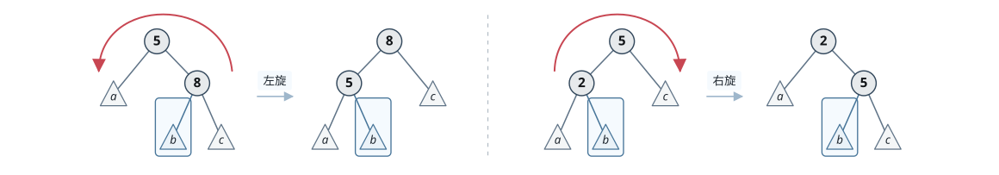
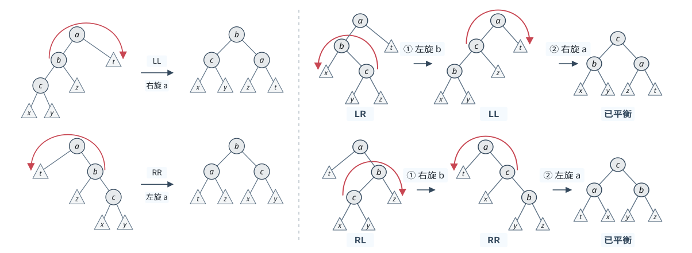

#  Ordered Map

> Author：玖沐 (Jura)  |  Last Updated：2026/10/27

- [左程云 - 算法148 AVL树](https://www.bilibili.com/video/BV1h5yXYJE6t)；
- [左程云 - 算法149 跳表](https://www.bilibili.com/video/BV1HZ1jYMEt3)；
- [左程云 - 算法150 替罪羊树](https://www.bilibili.com/video/BV1GqDSYbEPR)；
- [左程云 - 算法151 笛卡尔树、Treap树](https://www.bilibili.com/video/BV16eUFY8EXH)；
- [左程云 - 算法152 FHQ Treap](https://www.bilibili.com/video/BV1rYBiY6E87)；
- [左程云 - 算法153 Splay树](https://www.bilibili.com/video/BV1xPioYPEXZ)；

## Theory

- 有序表 (ordered_map)是一种抽象数据类型，其元素**按键保持有序**，并支持增删改查等操作；
  - AVL树，跳表，替罪羊树....是有序表最常见的实现方式，能让增删改查保持高效 ($O(\log n)$)；
  - GCC的`std::map`用红黑树实现；

### 1. AVL Tree

- AVL树是一种**自平衡的二叉搜索树**，在维持排序性的基础上**所有**节点的左右子树高度差 $\le1$，整棵树高保持在 $O(\log n)$；

##### Rotation & Violation

- 旋转：

  - 旋转操作是针对 某棵子树的根节点 进行的；旋转后还要把新根接回原来的父节点；

  - 左右旋**不会**破坏二叉搜索树的有序性，只会调整左右子树高度差；】

  

- 违规：

  插入删除可能破坏平衡性，需要通过旋转调整；

  - LL / RR：右旋 / 左旋 失衡节点即可；
  - LR / RL：LR 先对失衡节点的左孩子做一次左旋，使它变成 LL 形态，再对失衡节点右旋；RL同理；

  

  > 如何分辨`LL / LR / RL / RR`？
  >
  > - 第一个字母：失衡节点的哪侧子树更高；
  > - 第二个字母：这侧孩子的哪侧子树更高；
  >
  > 如果孩子的两侧子树等高只可能出现在`remove`，此时必须归入单旋的LL/RR：[原因](https://www.bilibili.com/video/BV1h5yXYJE6t?t=5235.7)；

---

##### Class

- `AVL`类：

  只展示最基本的AVL，只存储`key`且不允许重复，只实现`insert`和`remove`，无查询API；
  
  ```cpp
  class AVL {
  private:
      struct Node {   // 节点
          int key;    // 要存储的键值
          int height; // 以该节点为根的树高度，避免每次计算树高的开销
          Node *left, *right;
          Node(int x) : key(x), height(1), left(nullptr), right(nullptr) {}
      };
      Node* root = nullptr; 
      
      int height(Node* p) { return p == nullptr ? 0 : p->height; } // 返回以p为根的树高度
      
      void update(Node* p) { // 更新树p的环境信息，这里只有树高，P3369会添加更多环境信息
          p->height = max(height(p->left), height(p->right)) + 1; 
      }
      
      void destroy(Node* p) { // 销毁树p，由析构调用，这样写是为了方便递归
          if (p == nullptr) return;
          destroy(p->left);
          destroy(p->right);
          delete p;
      }
      
  	// 辅助函数
  	Node* rightRotate(Node* p); // 右旋p并返回新根
      Node* leftRotate(Node* p);  // 左旋p并返回新根
      Node* maintain(Node* p);    // 调整节点p处的平衡并返回新根
      Node* extractMin(Node* p, Node*& minNode); // 挖出树p中最小的节点并返回新根
      
      // 由公共方法调用，这样写是为了方便递归
      Node* insert(Node* p, int x); // 将键值x插入到树p中
      Node* remove(Node* p, int x); // 从树p中移除键值x  
      
  public:
      AVL() = default;
      AVL(const AVL&) = delete; // 禁止浅拷贝，否则两个对象会共享同一批节点
      AVL& operator=(const AVL&) = delete;
      ~AVL() { destroy(root); } // 析构
  	// 对外的公共方法
      // 啰唆一句，参数个数不同函数签名不同，编译器能区分
      void insert(int x) { root = insert(root, x); }
      void remove(int x) { root = remove(root, x); }
  };
  ```


- 首先看看最基本的两个旋转操作如何实现

  ```cpp
  // 调用者保证p不空，p->left不空
  AVL::Node* AVL::rightRotate(Node* p) {
      // 三步旋转
      Node* temp = p->left;
      p->left = temp->right;
      temp->right = p;
      // 从下往上更新高度
      update(p);
      update(temp);
      // 返回新根
      return temp;
  }
  
  // 调用者保证p不空，p->right不空
  AVL::Node* AVL::leftRotate(Node* p) {
      Node* temp = p->right;
      p->right = temp->left;
      temp->left = p;
      update(p);
      update(temp);
      return temp;
  }
  ```

- 然后是`maintain`，对应之前提到的 $4$ 种违规情况：

  ```cpp
  // 调用者保证p非空、孩子子树已平衡且高度正确(递归返回是自底向上，这是能够被保证的)
  // 调整p处的平衡并返回新根
  AVL::Node* AVL::maintain(Node* p) {
      int lh = height(p->left), rh = height(p->right);
      
      if (lh - rh > 1) { // 左子树至少比右高2,p->left必定非空
          if (height(p->left->left) < height(p->left->right)) { // 不能写为<=，子树的孩子等高只能按照LL处理，原因见上
              p->left = leftRotate(p->left); // LR，左旋左子变成LL
          }
          return rightRotate(p); // LL
      }
      
      if (rh - lh > 1) { // p->right必定非空
          if (height(p->right->left) > height(p->right->right)) {
              p->right = rightRotate(p->right); // RL，右旋右子变RR
          }
          return leftRotate(p); // RR
      }
      
      return p; // 不需要调整
  }
  ```

- 现在可以实现`insert`了：

  插到叶子；保持中序遍历有序即可；

  ```cpp
  // 将键值x插到树p中，并返回新根
  // 仍然是编写递归函数的黄金法则：牢牢抓住函数语义
  // 同时由于递归从叶节点开始返回，自下而上，也保证了update和maintain的调用者约定
  AVL::Node* AVL::insert(Node* p, int x) {
      if (p == nullptr) return new Node(x); // 到叶子了
      
      if (x < p->key) {
          p->left = insert(p->left, x); // 往左子树插
      } else if (x > p->key) {
          p->right = insert(p->right, x); // 往右子树插
      } else {
          return p; // 基础模板只存不同的键，重复插入不改变树
      }
      
      // 更改了树p的环境，必须要做的两件事
      update(p); // 更新p的树高
      return maintain(p); // 调整树p
  }
  ```

- 最后是`remove`：

  ```cpp
  // 首先需要实现一个辅助函数
  // 从树p中挖出key最小的节点；
  // minNode接收被挖出的节点，返回挖出后的子树根；
  AVL::Node* AVL::extractMin(Node* p, Node*& minNode) {
      if (p->left == nullptr) {
          minNode = p;
          return p->right;
      }
      p->left = extractMin(p->left, minNode); // 去左子树挖
      
      // 更改环境后必须要做的两件事
      update(p);
      return maintain(p);
  }
  
  // 从树p中删除一个x并返回新根
  AVL::Node* AVL::remove(Node* p, int x) {
      if (p == nullptr) return nullptr;
      
      if (x < p->key) {
          p->left = remove(p->left, x); // 去左子树中删
      } else if (x > p->key) {
          p->right = remove(p->right, x); // 去右子树中删
          
      // 找到要删除的节点了，开始分类讨论
      // 不能单起一个if，否则上面返回时这里会被执行
      } else if (p->left == nullptr || p->right == nullptr) {
          // 至多有一个孩子，把p删了直接返回这个孩子就行
          // 没有改动这个孩子的环境，可以直接返回，不需要做最后那两步
          Node* child = p->left ? p->left : p->right;
          delete p;
          return child;
      } else {
          // 有两个孩子，都需要保留
          // 由于不能破坏树p的排序性质，所以要用右子树中最小的节点来替代它
          // 也就是中序遍历的下一个节点
          Node* min_right = nullptr;
          p->right = extractMin(p->right, min_right);
          min_right->left = p->left;
          min_right->right = p->right;
          delete p;
          p = min_right; // 不能直接返回，动环境了
      }
      
      // 由于递归是自下而上，保证了update和maintain的调用者约定
      // 从p开始即可，extractMin的语义保证了p下方都是良好的
      update(p);
      return maintain(p);
  }
  ```

- 自此，最基础的类实现`AVL`结构已完备，可根据具体应用场景添加查询的`API`，见 **P3369**；

---

##### Adjacency List

- 邻接表实现；

  ```cpp
  
  ```

---

**End of AVL Tree**


### 2. Skip List

- 节点的`height`表示它参与的层数，`next[i]`指向第 $i$ 层的后继；节点只为自己的层数动态分配指针；
- 跳表用`first[i]`保存第 $i$ 层的第一个节点，`levels`记录当前实际使用的层数；查找每层的前驱时，前驱为`nullptr`就表示应从`first[i]`开始；
- 下面只存不同的`int`键；插入重复键、删除不存在的键时不改变跳表；不维护跨度，也不提供公共查询方法；

##### Class

```cpp
#include <random>

class SkipList {
private:
    static constexpr int MAX_LEVEL = 32;

    struct Node {
        int key;
        int height; // next数组的长度
        Node** next;

        Node(int x, int h) : key(x), height(h), next(new Node*[h]{}) {}
        ~Node() { delete[] next; }
    };

    Node* first[MAX_LEVEL]{}; // 各层的第一个节点
    int levels = 1;          // 当前实际使用的层数
    std::mt19937 rng{std::random_device{}()};

    int randomHeight() {
        int h = 1;
        // 每次以1/4的概率再升一层
        while (h < MAX_LEVEL && (rng() & 3u) == 0) ++h;
        return h;
    }

    // prev[i]接收第i层中严格小于x的最后一个节点；没有则为nullptr
    void findPrev(int x, Node* prev[MAX_LEVEL]) const {
        Node* p = nullptr;
        for (int i = levels - 1; i >= 0; --i) {
            Node* next = p == nullptr ? first[i] : p->next[i];
            while (next != nullptr && next->key < x) {
                p = next;
                next = p->next[i];
            }
            prev[i] = p;
        }
    }

public:
    SkipList() = default;
    SkipList(const SkipList&) = delete;
    SkipList& operator=(const SkipList&) = delete;

    ~SkipList() {
        Node* p = first[0];
        while (p != nullptr) {
            Node* next = p->next[0];
            delete p;
            p = next;
        }
    }

    void insert(int x) {
        Node* prev[MAX_LEVEL]{};
        findPrev(x, prev);
        Node* p = prev[0] == nullptr ? first[0] : prev[0]->next[0];
        if (p != nullptr && p->key == x) return; // 不插入重复键

        int h = randomHeight();
        Node* node = new Node(x, h);
        if (h > levels) levels = h; // 新层的前驱仍为nullptr

        for (int i = 0; i < h; ++i) {
            Node*& link = prev[i] == nullptr ? first[i] : prev[i]->next[i];
            node->next[i] = link;
            link = node;
        }
    }

    void remove(int x) {
        Node* prev[MAX_LEVEL]{};
        findPrev(x, prev);
        Node* p = prev[0] == nullptr ? first[0] : prev[0]->next[0];
        if (p == nullptr || p->key != x) return;

        for (int i = 0; i < p->height; ++i) {
            Node*& link = prev[i] == nullptr ? first[i] : prev[i]->next[i];
            link = p->next[i];
        }
        delete p;

        while (levels > 1 && first[levels - 1] == nullptr) --levels;
    }
};
```


## Practice

##### LG3369

- 题目：[洛谷 - P3369 [模板] 普通平衡二叉树](https://www.luogu.com.cn/problem/P3369)；

  这就是在Theory的AVL模板之上添加重复值计数、子树元素数和查询API；题目除了插入和删除还需要：

  - 查询 x 的排名；
  - 查询第 k 小；
  - 查询 x 的前驱；
  - 查询 x 的后继；

  节点需要添加`count`和`size`字段，分别表示当前键的出现次数、以当前节点为根的子树元素总数，后者包含重复值；构造函数和`update`也要改；

  基础模板的`insert`遇到相同键时直接返回，P3369中改为`++p->count`，然后继续执行末尾的`update(p)`和`maintain(p)`；`remove`找到目标节点时，要先判断`p->count > 1`，若成立则`--p->count`并继续执行末尾两步，否则按基础模板删除节点；

  然后按需提供公共方法即可；完整代码就不展示了；

  ```cpp
  // 节点增加count、size字段并修改构造函数和update，然后提供查询size的私有方法
  int count;
  int size;
  Node(int x) : key(x), height(1), count(1), size(1), left(nullptr), right(nullptr) {}
  void update(Node* p) {
      p->height = max(height(p->left), height(p->right)) + 1;
      p->size = size(p->left) + p->count + size(p->right);
  }
  int size(Node* p) {
      return p == nullptr ? 0 : p->size;
  }
  
  // 提供4个公共方法
  public:
  	int rank(int x) { return small(root, x) + 1; }
  	int index(int k) { return index(root, k - 1); } // 1-based = 0-based +1
  	int pre(int x) { return pre(root, x); }
  	int post(int x) { return post(root, x); }
  
  // 1. 返回树p中有多少个元素比x严格小
  int AVL::small(Node* p, int x) {
      if (p == nullptr) return 0;
      if (x <= p->key) return small(p->left, x);
      else return size(p->left) + p->count + small(p->right, x);
  }
  
  // 2. 返回树p中索引为k(0-based)的元素值，题目保证存在
  int AVL::index(Node* p, int k) {
      // 左闭右开
      if (k < size(p->left)) 
          return index(p->left, k);
      else if (k >= size(p->left) + p->count)
          return index(p->right, k - size(p->left) - p->count);
      
      return p->key;
  }
  
  // 3. 返回树p小于x的最大值，题目保证存在
  int AVL::pre(Node* p, int x) {
      if (p == nullptr) return INT_MIN;
      
      if (x <= p->key) 
          return pre(p->left, x);
      else
          return max(p->key, pre(p->right, x));
      // 看起来最后这个max没有意义，右子树不全部大于等于p->key吗？
      // 右子树中如果存在答案，它一定大于p->key；
  	// 但右子树可能找不到答案并返回INT_MIN，所以仍要和p->key比较；
  }
  
  // 4. 返回树p中大于x的最小值，题目保证存在
  int AVL::post(Node* p, int x) {
      if (p == nullptr) return INT_MAX;
      
      if (x >= p->key)
          return post(p->right, x);
      else
          return min(p->key, post(p->left, x));
  }
  ```
  
  > 查询中涉及到索引和范围，要注意两点：
  >
  > 1. 看清是1-based还是0-based，尽量都转化为0-based；
  > 2. 对于0-based，牢牢把握范围的左闭右开特性，写准边界；
  >
  > 例如对于当前节点：
  >
  > ```
  > 左子树：  [0, leftSize)
  > 当前节点：[leftSize, leftSize + count)
  > 右子树：  [leftSize + count, size)
  > ```
  >
  > 因此：
  >
  > ```
  > if (k < leftSize)                         // 左子树
  > else if (k >= leftSize + p->count)        // 右子树
  > else                                      // 当前节点
  > ```

---

##### LC406

- 题目：[LeetCode - 406. 根据身高重建队列](https://leetcode.cn/problems/queue-reconstruction-by-height/)；

  简述一下题意：`people[i][0]`表示第 $i$ 个人的身高，`people[i][1]`表示第 $i$ 个人的要求；比如`{3,4}`表示这个人身高为3，且他要求前面恰好有4个人身高 $\ge$ 他；

  现在给你打乱的`people`数组，要求你重排序使得每个人的要求都被满足；题目保证结果存在；

  思路是先满足比较高的人，再满足比较矮的人，因为满足矮个子不会影响高个子；

  具体讲述见：[视频](https://www.bilibili.com/video/BV1h5yXYJE6t?t=6477.2)；

  ```cpp
  vector<vector<int>> reconstructQueue(vector<vector<int>>& people) {
  	sort(people.begin(), people.end(), 
          [](const vector<int>& p1, const vector<int>& p2) {
  			if (p1[0] != p2[0]) return p1[0] > p2[0];
              else return p1[1] < p2[1];
          });	
      
      vector<vector<int>> ans;
      for (const auto& p : people) {
          ans.insert(ans.begin() + p[1], p);
      }
      
      return ans;
  }
  ```

  - 建立`ans`的过程是 保持所有元素有序时进行插入操作，不就可以用AVL实现的有序表吗？只不过这里不是按`key`排序而是直接插入到具体索引上；
  - 因此可以搞一棵按位置维护的AVL；

  ```cpp
  class AVL {
  private:
      struct Node {
          int pIndex, size, height;
          Node *left, *right;
          Node(int pi) : pIndex(pi), size(1), height(1), left(nullptr), right(nullptr) {}
      };
      Node* root = nullptr;
      
      int size(Node* p) { return p == nullptr ? 0 : p->size; }
      int height(Node* p) { return p == nullptr ? 0 : p->height; }
      void update(Node* p) {
          p->size = size(p->left) + size(p->right) + 1;
          p->height = max(height(p->left), height(p->right)) + 1;
      }
      
      // 以下三个函数与前面的基础AVL模板相同
      Node* rightRotate(Node* p);
      Node* leftRotate(Node* p);
      Node* maintain(Node* p);
      
      // 将第pi个人插到树p的位置i上
      // "树p的位置i"是指将树p中序排列后的索引i
      // 还是插到空叶子上，后面节点的中序索引自动+1
      Node* insert(Node* p, int pi, int i) {
          if (p == nullptr) return new Node(pi);
          
  		int left_size = size(p->left);
          // 左[0, left_size)，自己[left_size, left_size+1)，右[left_size+1, size)
          // 当i==left_size时，插入节点要排在p前面，所以往左插
          if (i <= left_size) p->left = insert(p->left, pi, i);
          else p->right = insert(p->right, pi, i - left_size - 1);
          
          update(p);
          return maintain(p);
      }
      
      // 按中序顺序将树p中的人加入答案
      void inorder(Node* p, const vector<vector<int>>& people, vector<vector<int>>& ans) {
          if (p == nullptr) return;
          inorder(p->left, people, ans);
          ans.push_back(people[p->pIndex]);
          inorder(p->right, people, ans);
      }
  
      void destroy(Node* p) {
          if (p == nullptr) return;
          destroy(p->left);
          destroy(p->right);
          delete p;
      }
      
  public:
      AVL() = default;
      ~AVL() { destroy(root); }
      void insert(int pi, int i) { root = insert(root, pi, i); }
      void inorder(const vector<vector<int>>& people, vector<vector<int>>& ans) {
          inorder(root, people, ans);
      }
  };
  
  vector<vector<int>> reconstructQueue(vector<vector<int>>& people) {
  	sort(people.begin(), people.end(), 
          [](const vector<int>& p1, const vector<int>& p2) {
  			if (p1[0] != p2[0]) return p1[0] > p2[0];
              else return p1[1] < p2[1];
          });	
      
      AVL a;
      for (int pi = 0, n = static_cast<int>(people.size()); pi < n; pi++) {
          a.insert(pi, people[pi][1]);
      }
      
      vector<vector<int>> ans;
      ans.reserve(people.size());
      a.inorder(people, ans);
      
      return ans;
  }
  ```


---

