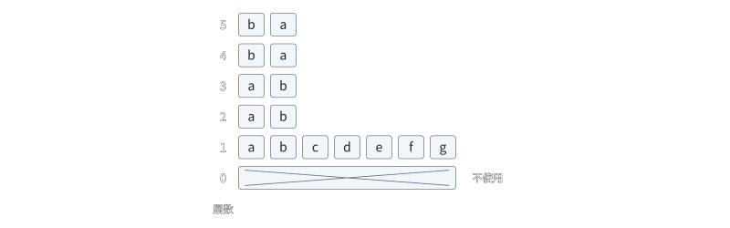

# Design Data Structure

> Author：玖沐 (Jura)  |  Last Updated：2026/11/15

- 讲解：[左程云 - 算法035](https://www.bilibili.com/video/BV1nF411y7rD)；

## Theory

- 根据所需操作及其时间复杂度要求，组合基础数据结构，并维护它们之间的对应关系，使各自的优势互补；


## Practice

##### LC146

- 题目：[LeetCode - 146. LRU 缓存](https://leetcode.cn/problems/lru-cache/)；

  LRU，Last Recently Used，最近最少使用，满了就逐出最久未使用的；

  存储键值对 `{int key, int value}`；`key`不允许重复，直接覆盖；需要提供`get`和`put`方法；

  哈希表：给定`key`快速找到数据；

  双向链表：快速调整新旧关系，头最老，尾最新；

  思路是哈希表存储`key`与双向链表节点指针的对应关系，然后节点存`value`并再存一次`key`；节点再存一个`key`是为了方便哈希表的删除；

  - 先实现双向链表：

  ```cpp
  struct DoubleNode {
  	DoubleNode *prev = nullptr, *next = nullptr;
  	int key, value;
  	DoubleNode(int _key, int _value) : key(_key), value(_value) {}
  };
  
  class DoubleList {
  private:
  	DoubleNode *head = nullptr, *tail = nullptr;
  
  public:
  	// 双向链表提供三个公共方法：
  	// 1. 添加新的key，追加到链表尾 
  	// 2. 访问/修改 已有key后，移动到链表尾
  	// 3. 容量满时需要逐出链表头，要返回这个节点，因为要根据其中的key去哈希表上删除
  
  	// 公共方法一
  	void addToTail(DoubleNode* node) {
  		// 分链表为不为空讨论，tail = node可以提出来
  		if (!head) {
  			head = node;
  			tail = node;
  		} else {
  			tail->next = node;
  			node->prev = tail;
  			tail = node;
  		}
  	}
  
  	// 公共方法二
  	void moveToTail(DoubleNode* node) {
  		if (node == tail) return;
  		
  		// 1. 从原位置摘下，调整前驱的next，后继的prev，然后node脱链就行
  		// 开头判断过了node是不是尾，故只需判断node是不是head
  		if (node->prev) node->prev->next = node->next;
  		else head = node->next;
  
  		node->next->prev = node->prev;
  
  		node->next = nullptr;
  		node->prev = nullptr;
  
  		// 2. 移动到尾部
  		addToTail(node);
  	}
  
  	// 公共方法三
  	DoubleNode* removeHead() {
  		if (!head) return nullptr; // 空
  
  		DoubleNode* temp = head;
  
  		if (head == tail) { // 单
  			head = nullptr;
  			tail = nullptr;
  			return temp;
  		}
  		
  		head = temp->next;
  		temp->next->prev = nullptr;
  		temp->next = nullptr;
  		return temp;
  	}
  };
  ```

  - 然后就是`LRUCache`类：

  ```cpp
  class LRUCache {
  private:
  	unordered_map<int, DoubleNode*> um;
  	DoubleList dl;
  	int capacity;
  
  public:
  	LRUCache(int _cap) : capacity(_cap) {}
  	~LRUCache() {
  		while (DoubleNode* node = dl.removedHead()) {
  			delete node;
  		}
  	}
  
  	// 实现题目要求的两个公共方法即可
  	int get(int key) {
  		auto it = um.find(key);
  		if (it == um.end()) return -1;
  
  		DoubleNode* node = it->second;
  		dl.moveToTail(node); // 变成最新的了
  		return node->value;
  	}
  
  	void put(int key, int value) {
  		auto it = um.find(key);
  
  		if (it != um.end()) { // 已有，直接更新
  			DoubleNode* node = it->second;
  			node->value = value;
  			dl.moveToTail(node);
  			return;
  		}
  
  		if (um.size() == capacity) { // 如果满了就逐出最老的
  			DoubleNode* oldest = dl.removedHead();
  			um.erase(oldest->key);
  			delete oldest;
  		}
  
  		// 添加即可
  		DoubleNode* node = new DoubleNode(key, value);
  		dl.addToTail(node);
  		um[key] = node;
  	}
  };
  
  ```

---

##### NC - setAll哈希表

- 题目：[牛客 - 设计有setAll功能的哈希表](https://www.nowcoder.com/practice/7c4559f138e74ceb9ba57d76fd169967)；

  既然要求 $O(1)$ 就不可能去一个一个修改了；方法：引入时间戳；
  
  ```cpp
  class HashWithSetAll {
  private:
      // 封装的哈希表，{key, {value, time}}
      unordered_map<int, pair<int, int>> hash;
  	// 时间戳，题目给出数据量在10^5内，所以int类型足够 
      // 备忘：int最大2*10^9，uint最大4*10^9
      int time = 0;
      // 记录最近一次setAll的时间，-1表示还没设置过
      int set_all_time = -1;
      // 记录最近一次setAll的值
      int set_all_value;
  
  public:
      void put(int key, int value) {
          hash[key] = {value, time++};
      }
  
      int get(int key) {
          auto it = hash.find(key);
  
          if (it == hash.end()) { // 没有这个key
              return -1;
          } else {
              int put_value = it->second.first;
              int put_time = it->second.second;
  
              // 还没有setAll 或 该元素的放置时间在最近一次setAll之后
              if (set_all_time == -1 || put_time > set_all_time) {
                  return put_value; // 返回自身值
              } else { // 被setAll了
                  return set_all_value; // 返回setAll的值
              }
          }
      }
  
      void setAll(int value) {
          set_all_time = time++;
          set_all_value = value;
      }
  };
  // main就不展示了
  ```

---

##### LC380

- 题目：[LeetCode - 380. O(1) 时间插入、删除和获取随机元素](https://leetcode.cn/problems/insert-delete-getrandom-o1/)；

  `insert`和`remove`都可以哈希表实现，但是`getRandom`不行，所以还要配合一个数组；

  ```cpp
  class RandomizedSet {
  private:
      vector<int> values;
      unordered_map<int, int> pos; // {value, index}
      
  public:
      bool insert(int val) {
          if (pos.count(val)) return false;
          
          values.push_back(val); // 扩容时O(n)但是平均O(1)
          pos[val] = values.size() - 1;
          return true;
      }
      
      bool remove(int val) {
          // 不能仅仅将pos修改为-1就表示删除了，必须让有效数据是连续的才能随机选取
          // 所以删除策略就是用尾部元素替换被删除元素
          if (!pos.count(val)) return false;
          
          // 尾部元素替换被删除元素
         	int index = pos[val];
          int last = values.back();
          values[index] = last;
          pos[last] = index;
          
          values.pop_back(); // 清除多余的尾部
          pos.erase(val); // 清除被删除元素的索引
          
          return true;
      }
      
      int getRandom() {
          return values[rand() % values.size()];
      }
  };
  ```

---

##### LC381

- 题目：[LeetCode - 381. O(1) 时间插入、删除和获取随机元素 - 允许重复](https://leetcode.cn/problems/insert-delete-getrandom-o1-duplicates-allowed/)；

  把 **LC380** 中`pos`记录单一索引变成记录索引集合；
  
  `remove`方法一样，为了保证数组连续便于`getRandom`，所以要用尾部元素填坑，这里稍微复杂点；
  
  ```cpp
  class RandomizedCollection {
  private:
      vector<int> nums;
      unordered_map<int, unordered_set<int>> pos;
      
  public:
      RandomizedCollection() = default;
      
      bool insert(int val) {
          bool not_exist = (pos.find(val) == pos.end());
          nums.push_back(val);
          pos[val].insert(nums.size() - 1);
          return not_exist;
      }
      
      bool remove(int val) {
          if (pos.count(val) == 0) return false;
          
          auto& val_set = pos[val];
          int val_index = *(val_set.begin()); // 随便选一个，begin是迭代器记得解引用
          
          // 特判要删的是不是nums尾
          // 相同的语句可提出来，不过这样更清晰
          if (val == nums.back()) {
              val_set.erase(nums.size() - 1);
              nums.pop_back();
          } else {
              int back_val = nums.back();
              auto& back_set = pos[back_val];
  
              val_set.erase(val_index);
              back_set.erase(nums.size() - 1);
              back_set.insert(val_index);
                          
              nums[val_index] = back_val;
              nums.pop_back(); // 先改下标集合再pop_back，因为改下标集合用到了nums.size()
          }
          
          if (val_set.empty()) pos.erase(val);
          
          return true;
      }
      
      int getRandom() {
          return nums[rand() % nums.size()];
      }
  };
  ```

---

##### LC295

- 题目：[LeetCode - 295. 数据流的中位数](https://leetcode.cn/problems/find-median-from-data-stream/)；

  对顶堆即可；
  
  ```cpp
  class MedianFinder {
  private:
      priority_queue<int> max_heap;
      priority_queue<int, vector<int>, greater<int>> min_heap;
  
  public:
      MedianFinder() {}
  
      void addNum(int num) {
          if (max_heap.empty()) {
              max_heap.push(num);
          } else {
              if (num <= max_heap.top()) {
                  max_heap.push(num);
                  if (max_heap.size() > min_heap.size() + 1) {
                      min_heap.push(max_heap.top());
                      max_heap.pop();
                  }
              } else {
                  min_heap.push(num);
                  if (min_heap.size() > max_heap.size() + 1) {
                      max_heap.push(min_heap.top());
                      min_heap.pop();
                  }
              }
          }
      }
  
      double findMedian() {
          if (max_heap.size() == min_heap.size()) {
  			return static_cast<double>(max_heap.top() + min_heap.top()) / 2.0;
          } else {
  			return max_heap.size() > min_heap.size() ? max_heap.top() : min_heap.top();
          }
      }
  };
  
  ```

---

##### LC895

- 题目：[LeetCode - 895. 最大频率栈](https://leetcode.cn/problems/maximum-frequency-stack/)；

  按层组织元素，每种值垂直向上插；频率最高的元素在最上层，同层间的前后关系也满足题目的 “如果出现频率最高的元素不只一个，则移除并返回最接近栈顶的元素” 要求；

  

  每个元素都要各自记录到达了第几层，也就是这种元素的频率；

  弹出就从最高层的最后开始弹出；

  比如上图的一种插入顺序是：3a -> 5b -> 2a -> c d e f g；可核对弹出是否符合要求；
  
  然后为什么第零层不使用：因为`unordered_map<int, int>`的`operator[ ]`方法是：如果不存在`key`就创建键值对`[key, 0]`；所以`next_level = ++level[val]`在首次插入就会得到`1`，所以不使用第零层；这样层数也和频率一致；
  
  ```cpp
  class FreqStack {
  private:
      unordered_map<int, int> level;
      vector<vector<int>> layers{1}; // 第零层不使用
      
  public:
      FreqStack() = default;
      
      void push(int val) {
          int next_level = ++level[val];
         	if (next_level == layers.size()) layers.emplace_back(); // 要创建新的一层
          layers[next_level].push_back(val);
      }
      
      int pop() {
          // 最上面一层最后一个元素弹出class FreqStack {
  private:
      unordered_map<int, int> level;
      vector<vector<int>> layers{1}; // 第零层不使用
      
  public:
      FreqStack() = default;
      
      void push(int val) {
          int next_level = ++level[val];
         	if (next_level == layers.size()) layers.emplace_back();
          layers[next_level].push_back(val);
      }
      
      int pop() {
          // 最上面一层最后一个元素弹出
          int val = layers.back().back();
          layers.back().pop_back();
          
          // 如果这层弹空了，就释放空间，维持层连续
          if (layers.back().empty()) layers.pop_back();
          
          // 如果弹的是第一层的，说明这种元素弹没了，删除level表中的记录
          if (--level[val] == 0) level.erase(val);
          
          return val;
      }
  };
          int val = layers.back().back();
          layers.back().pop_back();
          
          // 如果这层弹空了，就释放空间，维持层连续
          if (layers.back().empty()) layers.pop_back();
          
          // 如果弹的是第一层的，说明这种元素弹没了，删除level表中的记录
          if (--level[val] == 0) level.erase(val);
          
          return val;
      }
  };
  ```

---

##### LC432

- 题目：[LeetCode - 432. 全 O(1) 的数据结构](https://leetcode.cn/problems/all-oone-data-structure/)；

  ```cpp
  class AllOne {
  public:
      AllOne() {
          
      }
      
      void inc(string key) {
          
      }
      
      void dec(string key) {
          
      }
      
      string getMaxKey() {
          
      }
      
      string getMinKey() {
          
      }
  };
  ```

  
