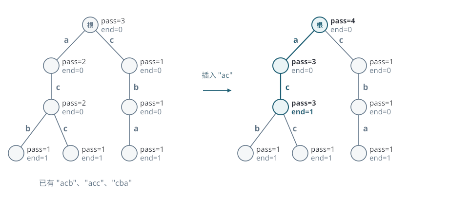

# Trie

> Author：玖沐 (Jura)  |  Last Updated：2026/10/26

- [左程云 - 算法044 前缀树原理](https://www.bilibili.com/video/BV1Yu4y1Q7vR)；

## Theory

- 前缀树 / 字典树 是一种按**字符逐层存储字符串**的树，适合快速判断某个单词是否存在，或查找具有相同前缀的单词；
  - 边存路径信息，节点存计数信息； 

 

## Practice

##### NC - 接头密钥

- [牛客 - 接头密匙](https://www.nowcoder.com/practice/c552d3b4dfda49ccb883a6371d9a6932)；

##### LC421

- [LeetCode - 421. 数组中两个数的最大异或值](https://leetcode.cn/problems/maximum-xor-of-two-numbers-in-an-array/)；

##### LC212

- [LeetCode - 212. 在二维字符数组中搜索可能的单词](https://leetcode.cn/problems/word-search-ii/)；
