# Database System

> Author: Jay Wei (GitHub: [JayWei-git](https://github.com/JayWei-git) | Email: jaywei0610@163.com) — Please let me know if you spot any errors.
>
> Based on "Database Systems: The Complete Book" (2nd Edition) by Hector Garcia-Molina, Jeffrey D. Ullman, and Jennifer Widom.
>
> (Last Updated: 2026-05-13) 

## Part One: Relational Database Model

### 1. The Worlds of Database Systems


### 2. The Relational Model of Data

#### 2.1. Basics of the Relational Model

- We use a $n\times n$ table called **relation** to represent data.

##### Basic Concepts

- **Attributes**: (属性) The name of columns of a relation.

- **Schemas**: (模式) The name of a relation and the set of attributes for the relation. 

- **Tuples**: (元组) The rows of a relation. 

  - a tuple has one *component (分量)* for each attribute of the relation.

- **Domains**: (域) The type of each attributes.

  > Example: Movies relation
  >
  > | title        | year | length | genre     |
  > | ------------ | ---- | ------ | --------- |
  > | Interstellar | 2014 | 169    | Drama     |
  > | Inception    | 2010 | 148    | Action    |
  > | Coco         | 2017 | 105    | Adventure |
  >
  > - attributes are *title*, *year*, *length* and *genre* of Movies relation.
  > - schema for Movies relation is $Movies(title, year, length, genre)$.
  > - the first tuple of the three  in Movies relation has four components: (Interstellar, 2014, 169, Drama).
  > - shcema including domains is $Movies(title:string, year:integer, length:integer, genre:string)$

  - Relational DataBase: Composed of $1^{+}$ relations.
    - Relation: Has a schema.
    - Relational DataBase Schema: Set of all relation schemas.
  - Tuples/Attributes are **unordered sets** $\to$ Change their order won't change this relation.

---

##### Relation Instances

- A set of tuples for a given relation is an instance (实例) of that relation.

- Relation is dynamic $\to$ Current Instance: Tuple set of the relation at present.

---

##### Keys of Relations

- Natural key: Subset of attributes $\to$ 唯一的元组标识符 (for any instance).
- Artificial key: 专用属性 (e.g., user_id) $\to$ Created when natural key becomes invalid (due to instance changes).

> Notation: Underline key attributes (e.g. Movies(<u>title</u>, <u>year</u>, length, genre)).
>
> Note: Some attributes (e.g., genre) may seem like keys but fail (duplicate values in updated instances).

---

**End of 2.1.**


#### 2.2. Basical SQL

见 6.0. 一节；

 

#### 2.3. An Algebraic Query Language

##### Set Operations on Relations

- Common operations: union($\cup$), intersection($\cap$), difference($-$). (并、交、差)
- Rule: Treat relation tuples as set elements for operations.
  - $R\cap S=R-(R-S)=S-(S-R)$.

---

##### Projection

- Operator: $\pi\:(projection)$ (投影) 

- Effect: Applies to $R\to$ New relation with **subset** of $R$ ’s **attributes**.

- Expression: $\pi_{A_1,A_2,...A_n}(R)\to$ Only columns for $A_1,A_2...A_n$ of $R$. 
  - NOTION: 投影后需要去掉重复的元组；

---

##### Selection

- Operator: $\sigma\:(selection)$ (选择)
- Effect: Applies to $R\to$ New relation with **subset** of $R$ 's **tuples**.
- Expression: $\sigma_C(R)\to$ 和 $R$ 的attributes一致，仅保留满足condition $C$ 的元组.

> $\pi$ 投影列 ; $\sigma$ 选择行；

---

##### Cartesian Product

- Operator: $\times\:(Cartesian\:Product/Product)$ (笛卡尔积)

- Effect: Pairs every tuple of $R$ with every tuple of $S$ $\to$ Longer  tuples  (all  attributes of $R$ and $S$).

  > 关系 $A$ 2元组2属性，关系 $B$ 3元组3属性，$R \times S$ 6元组5属性；

- Handle with same attributes: 作笛卡尔积后用 “relation.attribute” 区分两个关系的同名属性；

- Expression:  $R \times S$.

---

##### Natural Joins

- Operator: $\bowtie\:(Natural\:Joins)$ (自然连接)

- Effect: Pairs tuples of $R$ and $S$ that match on **common attributes** (shared  by $R/S$ schemas).

- Expression: $R\bowtie S$.

- 等价形式: $R\bowtie S=\pi_L(\sigma_C(R\times S))$.

  - $L$ : Union of $R$ and $S$ attributes.
  - $C$ :  $R.A_1=S.A_1\land R.A_2=S.A_2\land\dots\land R.A_n=S.A_n$ (all common attributes $A_1,A_2,...,A_n$).

  > 先作笛卡尔积，然后选择，保留“所有公共属性值都相等”的行(tuples)，最后投影，去掉重复的列(attributes)，就是自然连接；

---

##### Theta-Joins

- Operator: $\bowtie_C\:(Theta\:Join)$ ($\theta$ 连接)

- Expression: $R\bowtie_c S$.
  - Step 1: Compute product $R\times S$.
  - Step 2: Select tuples satisfying condition $C$.
- Equivalent form: $R\bowtie_c S=\sigma_C(R\times S)$. 先作笛卡尔积，不要被符号混淆！

---

##### Renaming

- Operator: $\rho\:(rename)$ (重命名)
- Basic form: $\rho_S(R)\to$ Rename relation $R$ to $S$.
- Extended form: $\rho_{S(A_1,A_2...A_n)}(R)\to$ Rename relation to $S$, and attributes (in order) to $A_1,A_2,...,A_n$

---

##### Combining Operations to Form Queries

- 查询示例: Find titles/years of Fox movies $\ge$ 100 mins long:
  - Form 1: $\pi_{title,year}(\sigma_{length\ge100}(Movies)\cap\sigma_{studioName='Fox'}(Movies))$
  - Equivalent Form 2: $\pi_{title,year}(\sigma_{length\ge100\text{ AND }studioName='FOX'}(Movies))$
- Stepwise Assignment:

$$
\begin{aligned}
R(t,y,l,i,s,p) &:= \sigma_{length \ge 100}(\text{Movies}) \\
S(t,y,l,i,s,p) &:= \sigma_{studioName='Fox'}(\text{Movies}) \\
\text{Answer}(\text{title}, \text{year}) &:= \pi_{t,y} (R \cap S)
\end{aligned}
$$

> $R\text{ \& }S$ are "temporary relations".

---

**End of 2.3.** 


#### 2.4. Constraints on Relations

- Two Expression Forms in Relational Algebra for Constraints:

  - $R=\varnothing$ :  Result of $R$ has no tuples.

  - $R\subseteq S$ : All tuples in $R's$ result are in $S's$ result.

    >  Equivalence: $R\subseteq S\Leftrightarrow R-S\subseteq \varnothing$.

##### Referential Integrity Constraints

- 引用完整性约束: If value $v$ is in attribute $A$ (tuple of $R$), $v$ must exist in attribute $B$ (some tuple of $B$).

- Expression: $\pi_A(R)\subseteq \pi_B(S)$, or equivalently, $\pi_A(R)-\pi_B(S)=\varnothing$.

---

##### Key Constraints

- Let $A$ be the key of $R$ ($B$ is any other attributes) $\to$ If two tuples share $A$ value,  they must share $B$ value.
- Expression: $\sigma_{R1.A=R2.A\land R1.B\neq R2.B}(R1\times R2)=\varnothing$.
  - $R1$ and $R2$ are renamings of $R$ :  $\rho_{R1}(R)$ , $\rho_{R2}(R)$.  

---

##### Other Constraints

- e.g. $\sigma_{length \le 100}(\text{Movies})=\varnothing$；$\sigma_{gender\ne'F'\text{ AND }gender\ne'M'}(\text{MovieStar})=\varnothing$ ......

---

**End of 2.4.**


### 3. Design Theory for Relational Database

#### 3.1. Functional Dependencies

##### Definition

- **functional dependency (FD)**: 

$$
A_1A_2\cdots A_n \to B_1B_2\cdots B_m
$$

>WARNING : 函数依赖 $A\to B$  means: “$if\:A1=A2, then\:B1=B2$” .
>
>- Inverse "$if\:A1\neq A2, then\:B1\neq B2$" : **NOT** always true.
>
>(A1, A2 are the values of attribute A in different tuples.)
>
>NOTION: 属性名直接写在一起不要打逗号；

---

##### Key Definition (via FD)

- $\{A_1,A_2,..,A_n\}$ is a key for $R$ if :

  - **key能函数决定所有属性** :  FD condition: $\{A_1,A_2,..,A_n\}$ functionally determines **all other** attributes of $R$.
  - **key 必须是最小的** : No proper subset of $\{A_1,A_2,..,A_n\}$ can functionally determine all other attributes of $R$.

  > When a key consists of a single attribute $A$, we call $A$ (rather than $\{A\}$) is a key.

- **Primary Key**: (主键) One designated key (when $R$ has multiple keys).

  > 键是不唯一的，一个关系可以有多个键(所以又叫候选键 candidate keys)；

- How to find candidate keys of $R$  (Given attributes & FD Set):

  1. Classify all attributes:

     - **L**: Only appear on the **left** of FDs.
     - **R**: Only appear on the **right** of FDs.
     - **LR**: Appear on **both sides** of FDs.
     - **N**: Do **not** appear in any FD.

     L and N **must be in every candidate key**. R **can never be in any key**.

  1. Compute the closure of **L ∪ N **:

     - If it includes **all attributes of R**, it is the candidate key.
     - If not, **add LR attributes one by one**, compute the closure each time, until it includes all attributes (preserve minimality of keys).

  Candidate keys are not unique. Check **all possible combinations** and compute their closures.

---

##### Superkeys

- 超键: Attribute set that **contains** a key (of relation $R$).

- All keys are superkeys $\to$ Not all superkeys are (minimal) keys.

  > 最小的超键 $\to$ 候选键；

---

**End of 3.1.**


#### 3.2. Rules About Functional Dependencies

- Derive other FDs from the given set of FDs.

##### The splitting/Combining Rule

- *splitting rule* : Replace an FD $A_1A_2...A_n\to B_1B_2...B_m$ with a set of FD’s $A_1A_2...A_m \to B_i(i=1,2,...,m)$ .

- *combining rule* : Replace  a set of FD’s $A_1A_2...A_m \to B_i(i=1,2,...,m)$ with a single FD $A_1A_2...A_n\to B_1B_2...B_m$ .

  > **WARNING**: Cannot replace  $A_1A_2...A_m \to B$ with $A_i \to B(i=1,2,...,m)$.

---

##### Equivalent & Follows

- Equivalent: (等价) Two sets of FDs $S$ and $T$ are **equivalent** if the set of relation instances satisfying $S$ is exactly the same as the set of relation instances satisfying $T$ .

- Follows: (推断) A set of FDs $S$ **follows** from a set of FDs $T$ if every relation instance that satisfies all the FDs in $T$ also satisfies all the FDs in $S$ .

  > Two sets of FDs $S$ and $T$ are equivalent if and only if $S$ follows from $T$ , and $T$ follows from $S$ .

---

##### Trivial Functional Dependencies

- 平凡的 FD: For a FD $A_1A_2...A_n\to B_1B_2...B_m$, if $\{B_1,B_2,...B_m\}\subseteq\{A_1,A_2,...A_n\}$ $\to$ Always holds (any relation instance).

- Simplification Rule:
  $$
  \begin{align*}
  A_1A_2\cdots A_n\to B_1B_2\cdots B_m &\iff A_1A_2\cdots A_n\to C_1C_2\cdots C_k \\
  (\{C_1,C_2,\dots,C_k\} = \{B_1,&B_2,\dots,B_m\} - \{A_1,A_2,\dots,A_n\})
  \end{align*}
  $$

> Example:  $AB \to AC \iff AB \to C$

---

#####  The Closure of Attributes

- Suppose $A=\{A_1,A_2,...,A_n\}$ is an attribute set and $S$ is a FD set.
- 计算属性集的闭包:
  - 对 $A$ 迭代应用 each FD: $X\to Y\in S$ , if $X\subseteq A^+$, add $Y$ to $A^+$.
  - Repeat this process，until 完成一轮完整迭代后，$A$ 中不再新增任何属性为止；
  - Resulting set $\to$ closure of $A$ (under the FD’s in $S$), 记作 $A^+$.

- Derive FDs via closure:
  - For any **subset** $C\subseteq A^+$ , FD: $A\to C$ must hold. 
  - Conversely, if FD $A\to C$ holds, then $C\subseteq A^+$ must be true.
  - If $B\notin A^+$, then $A\to B$ does not hold. 

---

##### The Transitive Rule

- if FD’s $A_1A_2\cdots A_n\to B_1B_2\cdots B_m$ and $B_1B_2\cdots B_m\to C_1C_2\cdots C_k$ hold in relation $R$, then FD $A_1A_2\cdots A_n\to C_1C_2\cdots C_k$ also holds in $R$.

> Obviously $\{C_1C_2\cdots C_k\}$ is in $\{A_1A_2\cdots A_n\}^+$.

---

##### Closure and Key/Superkey

- $X$ is key (of $R$) if :
  - $X^+$ (closure of $X$) contains all attributes of $R$.
  - Closure of any proper subset of $X$ does **not** contain all attributes.

- Superkey: Only $X^+$ contains all attributes (no minimality $\to$ not a key).

---

##### Minimal Basis

- For FD set $S$, any set of FDs equivalent to $S$ is called a **basic set** (基本集) of $S$.

  > Obviously many basic sets exist; 只考虑FD右边是单一attrubite的基本集 (右边非单一属性的FD可分解)；

- Minimal Basis (最小基本集) $S_m$ must satisfy three conditions:  

  1. All FDs: $X\to A$ (only one attribute in right).

  1. For every FD $X\to A$ in $S_m$: 

     removing any attribute from $X$ makes $S_m$ no longer equivalent.

  1. Removing any FD makes $S_m$ no longer equivalent.

  > There may be more than one minimal basis for $S$.

- Computation Step:

  1. 右拆分: Split each  FD $X\to Y_1Y_2...Y_k$ into $X\to Y_1,X\to Y_2,...,X\to Y_k$.

  1. 去冗余: For each FD $F$ in the set, check if $F$ can be derived from the rest. If yes, delete $F$.

     > 做法：设欲删FD $B\to D$ ，用<u>剩下所有FD</u>去求 $B^+$ ，看是否 $D\in B^+$，如果是则可删 $B\to D$；(注意不要应用已删除的FD) 

  1. 左化简: For each FD $X\to A$, and for each attribute $B\subseteq X$ , check if $(X-\{B\})\to A$ is derivable from current FD’s (求闭包). If yes, delete $B$ from $X$.

---

##### Projecting FD Set

- Problem: Given $R$ with FD set $S$. Project $R$ by $R_1=\pi_L(R)$. Which FD’s in $S$ still hold in $R_1$?

- Computation Steps:

  1. 枚举子集: List all subsets of $R_1$ (除了$R_1$ 本身和 包含 $S$ 中R类属性的子集).
  1. 计算闭包: Compute the closure of each subset based on $S$. 去掉闭包中$R_1$ 没有的属性；
  1. 选取FD: Collect all valid FDs that hold in $R_1$ (To form the projected FD set $T$).

  > Post-step: Minimize $T$ to minimal basis 最小集.

---

> **NOTE: Armstrong's Axioms**
>
> 1. 自反律 (Reflexivity)：如果 $Y \subseteq X \subseteq U$，则 $X \to Y$ 被 $F$ 逻辑蕴含；
> 2. 增广律 (Augmentation)：如果 $X \to Y$ 且 $Z \subseteq U$，则 $XZ \to YZ$；
> 3. 传递律 (Transitivity)：如果 $X \to Y$ 且 $Y \to Z$，则 $X \to Z$；
>
> 通常还会有以下三条引理：
>
> - 合并律 (Union)：如果 $X \to Y$ 且 $X \to Z$，则 $X \to YZ$；
> - 分解律 (Decomposition)：如果 $X \to YZ$，则 $X \to Y$ 且 $X \to Z$；
> - 伪传递律 (Pseudo-transitivity)：如果 $X \to Y$ 且 $WY \to Z$，则 $WX \to Z$；

---

**End of 3.2.**


#### 3.3. Design of Relational Database Schemas

##### Anomalies

- 异常：Adding too many attributes to the same relational schema causes anomalies；

- Three Types: 
  - Insertion Anomaly: (插入异常) Can’t insert new data without adding irrelevant data.
  - Deletion Anomaly: (删除异常) Deleting target data removes unrelated essential data.
  - Updata Anomaly: (更新异常) Redundant record updates required; omissions cause data inconsistency.

---

##### Decomposition

- Decompose (分解) to eliminate anomalies.

  - $R(A_1,A_2,...,A_n)$ $\to$ $S(B_1,B_2,...,B_m)$ and $T(C_1,C_2,...,C_k)$. 

    > $\{A_1,A_2,...,A_n\}=\{B_1,B_2,...,B_m\}\cup\{C_1,C_2,...,C_k\}$

- A decomposition shall have three properties:

  1. Elimination of Anomalies.
  1. Recoverability of Information. (无损连接 lossless join)
  1. 函数依赖FDs的保持；

> To achieve these, the decomposed sub-relations must satisfy a set of constraints, which we call **Normal Forms** (范式)

---

##### Lossless Decomposition

- 无损分解：将一个关系分解为若干子关系后，能通过自然连接精确还原出原关系，不丢失信息也不产生伪元组；
  - 原关系 $R$ 有 $n$ 个元组，分解出来每个子关系均 $n$ 个元组 (不考虑NULL)，连接后得到 $R'$ 也应为 $n$ 个元组；

1. 子关系有多个连通分量 $\to$ 一定不是无损分解 (连接时相当于作笛卡尔积，一定有伪元组)；

   - 比如将 $R(A,B,C,D,E)$ 分解为 $R_1(A,B),R_2(B,C),R_3(D,E)$；

2. 分解为两个子关系且有交集(无多个连通分量)时，但交集不能FD任一个子关系的剩余全部属性 $\to$ 不是无损分解；

   - 假设 $R$ 有两个元组 $(a,b_1,c_1,d_1,e_1),(a,b_2,c_2,d_2,e_2)$，现将 $R$ 分解为 $R_4(A,B,C),R_5(A,D,E)$;

   - 则 $R_4$ 元组为 $(a,b_1,c_1),(a,b_2,c_2)$，$R_5$ 元组为 $(a,d_1,e_1),(a,d_2,e_2)$；显然连接 $R_4$ 和 $R_5$ 会得到4个元组 $\to$ 两个伪元组；

3. 分解为两个子关系且有交集(无多个连通分量)时，且交集能FD任一个子关系的剩余全部属性 $\to$ 是无损分解；、

   - 即满足 $(R_1 \cap R_2) \to R_1-R_2$ 或 $(R_1 \cap R_2) \to R_2-R_1$；不再举例；

4. 分解成多个子关系时，两两连接即可；

   - 假设$R(ABCDE), F\{A \to C, C \to D, B \to C, DE \to C, CE \to A\}$ 将其分解为 $R1(AD), R2(AB), R3(BC), R4(CDE), R5(AE)$；

   - 显然 $R_1$ 和 $R_2$ 是 $R'(ABC)$ 的无损分解，$R'(ABC)$ 和 $R_3(BC)$ 是 $R''(ABCD)$ 的无损分解，然后就进行不下去了；

   - 所以这5个子关系不是原关系的无损分解；

- chase检验的原理其实就是上面所述；因为多个子关系的“两两连接”路径非常多，逐个排查相当麻烦，一般采用chase检验；

---

##### BCNF

- $R$ is in BCNF $\iff$ $\forall$ **nontrivial** FD $X\to A\in R$ , $X$ contains key (superkey). (注意key可能不止一个)

- Decomposition into BCNF: Suppose a FD $X\to Y$ 违反BCNF (即 $X$ 没有完全包含 key(所以需要先求候选键)). 

  1.   Compute $X^+$ .
  1.   Let $R_1=X^+$ .
  1.   Let $R_2=X\cup(R-X^+)$ .

  > Check $R_1$, $R_2$ for BCNF; if violated, repeat. 所以每次处理一个违例FD即可；

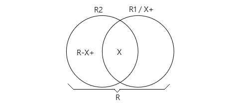

- Good/Bad of BCNF:

  1. Elimination of anomalies: **Yes**.
  2. Recoverability of information:
     - 连接 subrelations 能重新获得 original relation $\iff$ 该分解具有 lossless join (无损连接).
     - BCNF decomposition **always** satisfies lossless join.

  3. Preservation of FDs: **NOT** always satisfy.

---

##### 3NF

- $R$ is in 3NF $\iff$ $\forall$ **nontrivial** FD $X\to A$ in $R$ ,

  either:

  - $X$ is a superkey.
  - $A$ is part of a candidate key.

- Decomposition into 3NF: 

  1. Compute the minimal cover of $F$ , 记为 $G$.

  1. $\forall$ FD $X\to A\in G$ , 子关系 $R_i=X\cup A$ (each $R_i$ already in 3NF).

  1. 若没有任何子关系包含 $R$ 的键 (不是lossless join)，则再增加一个子关系，模式为 $R$ 的任何一个键 (此时为lossless join)；

     > Remove $R_i$ if it’s schema is a proper subset of the schema of some $R_j$ .

- 3NF works:

  1. Elimination of anomalies: **Yes**.
  1. Recoverability of information: **Yes**.
  1. All subrelations resulting from the decomposition are in **3NF**.

---

**End of 3.3.**


#### 3.4. Multivalued Dependencies

##### Definition

- Let $X$ ,  $Y$ , $Z$ be sets of attributes of $R$ , where $X$ and $Y$ are disjoint, and $Z=R-X-Y$ . If :

  - For any two tuples that agree on $X$ , there always exists a "patched" tuple $t_3$ such that $t_3[X]=t_1[X], t_3[Y]=t_1[Y], \text{and }t_3[Z]=t_2[Z]$ .

    > equivalently, after fixing the values of $X$ , $Y$ and $Z$ form a complete Cartesian product.

then we say: $X$ multivalued determines $Y$ , or $X\to\to Y$ . 

> “两个一对多，两个多独立”；

---

##### Reasoning About Multivalued Dependencies

- Trivial MVDs: The MVD $A_1A_2...A_n\to\to B_1B_2...B_m$ holds in any relation if $\{B_1B_2...B_m\}\subseteq\{A_1A_2...A_n\}$ .

  > **WARNING**: If $A_1A_2...A_n\cup B_1B_2...B_m=R$ ,  **it’s also trivial**.

- Every FD is a MVD. That is, if $A_1A_2...A_n\to B_1B_2...B_m$ , then $A_1A_2...A_n\to\to B_1B_2...B_m$.

  > MVD是两个一对多，两个多独立，然后FD把两个一对多变成了一个一对一和一个一对多；

- Complementation Rule: (互补规则) if $A_1A_2...A_n\to\to B_1B_2...B_m$ holds in $R$ , then $R$ also satisfies $A_1A_2...A_n\to C_1C_2...C_k$ . Where $\{C_k\}=R-\{A_i\}-\{B_j\}$ .

- Transitive Rule: (传递规则) if $A_1A_2...A_n\to\to B_1B_2...B_m$ and $B_1B_2...B_m\to\to C_1C_2...C_k$ , then $A_1A_2...A_n\to\to C_1C_2...C_k$ .

- Combination Rule: (结合规则) if $A_1A_2...A_n\to\to B_1B_2...B_m$ and $A_1A_2...A_n\to\to C_1C_2...C_k$ , then $A_1A_2...A_n\to\to B_1B_2...B_mC_1C_2...C_k$ .

- **WARNING** : **不存在分解规则**；与FD不同，$X\to\to YZ$ 不能推出 $X\to Y$ 或 $X\to Z$ ；因为 $YZ$ 整体独立于其它属性不意味着 $Y$ 与 $Z$ 互相独立

  > 比如属性Y与Z各有两个取值，但是关系中YZ只有3个组合，剩下属性4个组合，共12个元组，所以YZ整体独立于其它属性，但是Y 与Z内部并不互相独立；

---

##### 4NF

- $R$ is in 4NF $\iff$ $\forall$ **nontrivial** MVD $A_1A_2...A_n\to\to B_1B_2..B_m$ , {$A_1A_2...A_n$} is a superkey.

- Decomposition into 4NF: (Must satisfy **BCNF**)

  For a 4NF violation $A\to\to B$ , decompose $R$ into:

  1. $R_1=A\cup B$.
  2. $R_2=A\cup(R-A-B)$.

  Which also equivalents to "$X, Y, Z$ form a partition of $R$, if $X \twoheadrightarrow Y$ and $X \twoheadrightarrow Z$ hold, then decomposing $R$ into $R_1(X, Y)$ and $R_2(X, Z)$".

---

**End of 3.4.**


#### 3.5. An Algorithm for Discovering MVDs


### 4. High-Level Database Models

数据库设计的六个阶段：

1. 需求分析阶段：自顶向下地了解与分析用户的应用需求(结合数据字典等工具)；
2. 概念结构设计阶段：形成概念模型(如ER模型)；
3. 逻辑结构设计阶段：将概念结构转换为数据模型(如关系模式)；
4. 物理结构设计阶段：确定存储结构和存取方法(索引、聚簇)
5. 数据库实施阶段：数据载入，应用程序调试，试运行；
6. 数据库运行与维护阶段；

#### 4.1. The Entity/Relationship Model

##### Basic Concepts

- 在 E/R 模型中，数据的结构用图形化方式表示；
  1. Entity sets. 实体集
  1. Attributes. 模式
  1. Relationships. 联系

**Entity Sets**: For example, in the movie-database, each movie is an entity, and the set of all movies constitutes an entity set.

**Attributes**: 实体集有相关的属性，属性是这个实体集中实体所具有的性质；

> 实体集Movies可能会有属性length、name等；
>
> 实体集Movies的属性与关系Movies的属性可能相似；

**Relationships**: 两个或多个实体集的连接；

---

##### Entity-Relationship Diagrams and Instances

- 矩形 → 实体集；椭圆 → 属性；菱形 → 联系；

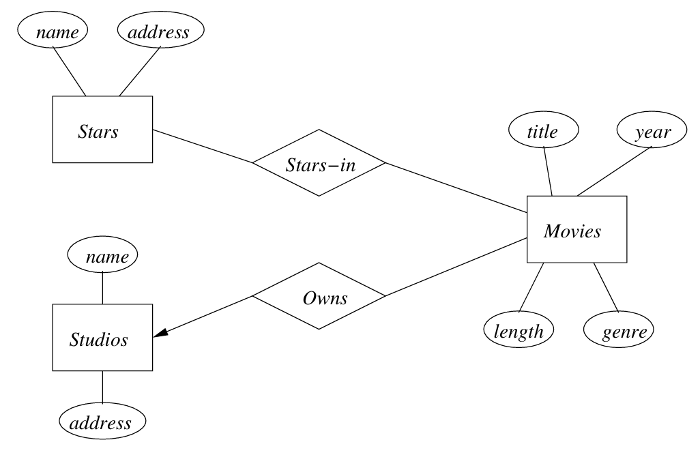

- 数据库实例：指 E/R 图对应数据库中实际存储的特定数据；

- 实体集与实例：

  每个实体集在数据库实例中对应一个有限实体集合，每个实体对自身所有属性都有具体取值；

  - 比如实体集`Movies`的一个实例包含`Basic Instinct《本能》`等电影实体，每个实体都有`title`, `year`等属性；

- 联系集与实例：

  连接n个实体集$E_1,E_2...E_n$的联系R的一个实例由元组($e_1,e_2,...e_n$)的有限集构成，每个$e_i$来自对应实体集$E_i$的实例；

  这个元组集称为R的**联系集**，可直观地表示为表格

  e.g. 联系`Stars-in`的一个实例为：

  | Movies       | Stars               |
  | ------------ | ------------------- |
  | 《流浪地球》 | 刘德华              |
  | 《星际穿越》 | Matthew McConaughey |
  | 《火星救援》 | Matt Damon          |

  (《流浪地球》，刘德华 )是联系Stars-in的当前实例的联系集中的一个元组；

---

##### Concepts of Relationship

1. 二元联系的多样性

   - R是E到F的多对一联系：E中任一实体最多联系F中一个实体(也可以不联系)，F中实体可联系多个E中实体；

   - 一对一联系：E到F和F到E都是一个实体最多联系一个实体；

   - 多对多联系：E到F和F到E都是一个实体可联系多个实体；

     如果R是E到F的多对一联系，则从R指出箭头指向F；若是一对一联系，则为：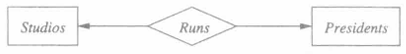

   ---

2. 多路联系

   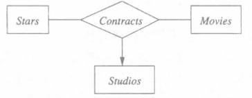

   - 从实体集Stars和Movies中各选择一个实体，它们最多与Studios中一个实体联系(也是多对一)；

   ---

3. 联系的角色

   - 当一个实体在同一个联系中出现多次时，每一条连向实体集的连线代表该实体在联系中扮演的不同`角色`；这些连线需要命名加以区分；

     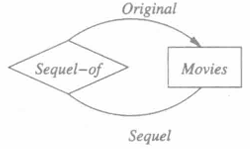

     > 显然一部电影可以有多部续集，但是一部续集只能有一部最初电影；所以Sequel电影与Original电影之间是多对一联系；

   ---

4. 联系的属性

   - 联系也可以有自己的属性；这些属性由联系集中的对应关系的整个元组函数决定；

   - 可以将联系的属性转换为一个单独的实体集，但是要放置一个箭头指向那个实体集；


---

##### Converting Multiway Relationships to Binary

- 连接实体集：其实体为多路联系的联系集的元组；

- 从连接实体集与原先的实体集之间引入多对一联系，注意若一个实体集扮演了多个角色，那么每个角色就是一个联系；


---

##### Subclasses in E/R Model

- 实体集中某些实体拥有特殊性质时，可定义为子类 subclass；

- isa 联系：

  isa 联系实体集和它的子类；用三角形表示，一条边与子类相连，相对的那个角与父类相连；每个isa联系都是一对一联系；

  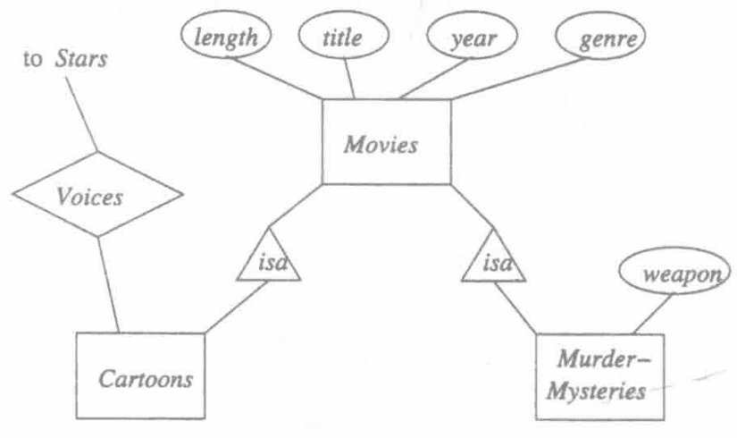

---

**End of 4.1.**


#### 4.2. Constraints in the E/R Model

##### Keys in E/R Model

- 实体集E的键key是一个或多个属性的集合；
  - 每个实体集必须有键；
  - 一个实体集可以有多个键，习惯上选择一个作为主键；
  - 当一个实体集处于isa层次中时，要求根实体集拥有键所需的所有属性；
- 在E/R图中，实体集键的属性用下划线标出；

---

##### Referential Integrity

- 尖箭头：最多；圆尖头：至少；

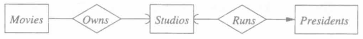

- 联系Owns：指向Studios的圆箭头：代表每部电影至少属于一家公司；
- 联系Runs：
  - 指向Presidents的尖箭头：代表多对一联系，每家公司最多属于一个总裁(每个总裁可拥有多家公司)；
  - 指向Studios的圆箭头：代表每个总裁至少拥有一家公司；

---

##### Degree Constraints

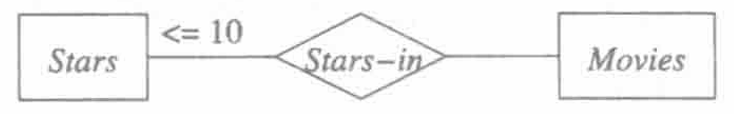

- 每部电影最多与10个影星实体相联系；

---

**End of 4.2.**


#### 4.3. Weak Entity Sets

- 弱实体集：自身属性无法唯一标识实体，必须依赖另一个强实体集(所有者实体)才能唯一确定的实体集；

  - 其主键 = 自身的部分键 + 所依赖额强实体集的主键；
  - E/R 图中用**双矩形**表示弱实体集，用**双菱形**表示它和强实体集的多对一联系 (标识性联系)；

  > 部分键：弱实体自身能区分同一属主下实体的属性，仅在所属强实体范围内唯一；

---

##### Causes of Weak Entity Sets

1. 层次依赖型

   当实体处于与泛化(isa)无关的层次体系中，自身属性无法保证全局唯一，必须结合所属父实体的标识才能唯一确定；

   e.g. 电影公司拍摄班子：若每家公司对拍摄班子都采用相同的编号，则实体集 `拍摄班子` 的自身属性 `编号` 仅在单个公司内唯一，是部分键，不能作为独立主键；还需要加上公司名称，即完整主键为：Crews.number + Studios.name；

   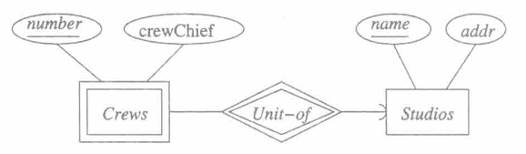

1. 连接实体型(多路联系的分解产物)

   前面说过连接实体集用于消除三元及以上多路联系，但这类实体通常无独立主键，键由所连接的多个强实体的主键共同构成；

   即：**连接实体集是弱实体集**；

   e.g. 用于连接的实体集Contracts替代了三重联系Contracts后；Contracts有一个属性salary，但它不是键；合同的键由公司名，演员名，电影名及出品日期共同组成；

   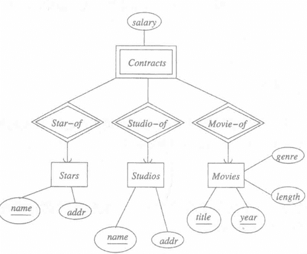

---

##### Requirements for Weak Entity Sets

1. 弱实体集的键构成规则

   若E是弱实体集 ，其完整主键由两部分组成：

   - 零个或多个E自身属性(即部分键)；

   - 从E到其他强实体集的多对一联系所关联的键属性；

     这类多对一联系称为**支持联系 (supporting relationships)**；

     被关联的实体集称为**支持实体集 (supporting entity set)**；

1. 支持联系的5项强制条件

   要让E到F的多对一联系成为E的支持联系，必须同时满足：

   a) 联系R必须是从E到F的二元多对一联系 (一对一联系是多对一的特例)，禁止多路联系作为支持联系；

   b) 引用完整性约束：R到F是圆箭头，不能存在无主的弱实体；

   c) F提供给E作键的属性，必须是F自身的主键属性，不能用非键属性作为弱实体的键来源；

   d) 若F本身也是弱实体集，则提供给E的键属性，必须来自F的支持联系所关联的实体集的键 (规则c的递归版本)

   e) 弱实体E同时依赖于多个强实体F1,F2,F3..，则E的主键 = 各个强实体的主键 + 自己的部分键 (比如上面那个合同的键由公司名，演员名，电影名及出品日期共同组成)

---

##### Weak Entity Set Notation

- 在E/R图中：

1. 弱实体集用**双边矩形**表示；
1. 弱实体集的支持多对一联系用**双边菱形**表示；
1. 弱实体集的部分键(如果有)，也需要加**下划线**；

---

**End of 4.3.**


#### 4.4. From E/R Diagrams to Relational Designs

- 非弱实体集转化为关系 $\to$ 直接创建同名且属性集相同的关系即可；

##### From E/R Relationships to Relations

- 给定联系R，转化后的关系含有下列属性：
  - 联系R涉及的每一个实体集的键属性；
  - 联系本身的属性(如果有)；

- 需要重命名的情况：
  - 实体集以不同角色在联系中多次出现，其键属性出现次数也一样多，需要重命名；
  - 联系R本身属性与涉及的实体集的键属性同名时；

---

##### Combining Relations

- 给定实体集E和一个E到F的多对一联系R，将它们转换为关系；

  - E的键可以确定E关系本身的元组，由于R是多对一联系，所以E的键也可以确定关系R的元组；

    > 多对一联系 $\implies$ 一个E中元组最多对应一个R中元组；

  - 所以最好将这两个关系模式进行连接，即将它们组合在一个关系中；

- 如果联系R不是多对一联系，仍然连接关系E和R，则同一个E中元组会复制多行，造成冗余；

---

##### Handling Weak Entity Sets

- 三条原则：

1. 弱实体集W转换得到的关系需包含：W本身所有属性 + 所有支持实体集的键属性+所有支持联系的属性；

   > 支持实体集就是那些用双边菱形与W连接的实体集；
   >
   > 为什么要包含支持联系的属性，看第3条的解释；

2. 与W相连的联系转化为关系时，需包含W的完整键(自身部分键+所有支持实体集的键)；

   > 联系R转化为关系需包含R涉及每一个实体集的键属性+R本身属性(同名就重命名)，这里并不冲突，因为弱实体集的完整主键就是自身部分键+支持联系集的键；

3. 支持联系R不必被转换为关系，如果R本身有属性，直接包含在W转化后的关系中即可；

   > 联系R转为关系需包含R涉及每个实体集键属性+R本身属性，
   >
   > 由于支持联系R联系的就是弱实体集W和支持实体集，
   >
   > 所以R转化为关系后包含的属性有：弱实体集W的键属性+支持实体集键属性+R本身属性(如果有)，
   >
   > 前两部分已经包含在弱实体集W转化后的关系中，
   >
   > 所以如果R有本身属性，添加到W转化后的关系中即可，无需单独建表；

- 警告：第3条规则中指出：由于支持联系R的属性集是弱实体集W转化关系属性集的子集，所以我们去掉了关系R以此避免不必要的建表，但是不是所有的属性集为其它关系子集的关系都可以被去除！

  >e.g. (1) 关系People(name, ss#)存储姓名和社保号，关系TaxPayer(name, ss#, amount)存储姓名，社保号和纳税金额，直观上可以去掉关系People，但是它可能包含没有纳税的人，而这是关系TaxPayer不记录的；
  >
  >e.g. (2) 关系Stars(name, addr)和Studios(name, addr)，属性集互为子集，但仅仅是名称罢了，记录的信息、语义完全不同，不可能去掉其中一张表；

---

**End of 4.4.**


#### 4.5. Converting Subclass Structures to Relations


##  Part Two: Relational Database Programming

### 5. Algebraic and Logical Query Language


### 6. The Database Language SQL

- SQL is short for "Structured Query Language (结构化查询语言)". 
  - There are two aspects in SQL: *Data Defination Language (DDL), Data Manipulation Language (DML)*. 

#### 6.0. Basical SQL

##### Table Declarations

- use keyword **CREATE TABLE** to  declare a relation schema (including domains).

  ~~~sql
  CREATE TABLE Movies (
  title	CHAR(100)	NOT NULL,
  year	INT			NOT NULL,
  length	INT			NOT NULL,
  genre	CHAR(10)
  ); 
  ~~~

  - **table**: (表) in SQL, a table is the structure used for storing relation.
  - **data type**: SQL supports CHAR(n), BIT(n), BOOLEN, INT, FLOAT, DOUBLE, DATE, TIME. 

- use keyword **INSERT INTO ... VALUES ...** to add tuples.

  ~~~sql
  INSERT INTO Movies VALUES ('流浪地球', 2019， 125， '灾难，科幻');
  ~~~

---

##### Modifying Relation Schemas

- use keyword **DROP TABLE** to delete a whole relation.

  ~~~sql
  DROP TABLE R; /* relation R is no longer part of the database schema */ 
  ~~~

- use keyword **ALTER TABLE** to add or delete attribute.

  ~~~sql
  ALTER TABLE Movies ADD studioName CHAR(30); /* add studioName attribute */
  ALTER TABLE Movies DROP title; /* delete the title attribute */
  ~~~

---

##### Default Values

- use the keyword **DEFAULT** to specify a default value for attributes. Thus, when we insert tuples and do not provide a value for an attribute, the default value will be automatically assigned to it.

  ~~~sql
  CREATE TABLE Movies (
      ...
      genre	CHAR(10) DEFAULT 'Unknown'
  ); 
  
  ALTER TABLE Movies ADD studioName CHAR(30) DEFAULT 'Unknown';
  ~~~

---

#####  Declaring Keys

- **UNIQUE**: multiple per table; supports single/composite keys; values can be NULL (non-NULL values must be unique); each UNIQUE constraint works independently.

- **PRIMARY KEY**: only one per table; supports single/composite keys; values **cannot** be NULL and must be unique.

  ~~~sql
  CREATE TABLE Movies (
  	title	CHAR(100) UNIQUE,
      year	INT UNIQUE,
      length	INT,
      genre	CHAR(10),
      UNIQUE(length, genre)
  ); 
  
  CREATE TABLE Movies (
  	title	CHAR(100) PRIMARY KEY,
      ...
  ); 
  
  CREATE TABLE Movies (
  	...
      PRIMARY KEY(length, genre)
  ); 
  ~~~

---

**End of 6.0.**


#### 6.1. Simple Queries in SQL

- Using three keywords: **SELECT**, **FROM** and **WHERE**.

##### Projection & Selection in SQL

- Use **SELECT** for projection. 

  e.g. $\pi_{title,length}(\sigma_{studioName = 'Disney'\text{ AND }year = 1990}(Movies))$ :

  ~~~sql
  SELECT title, length # SELET * 显示所有attributes, 相当于不投影
  FROM Movies
  WHERE studioName = 'Disney' AND year = 1990;
  ~~~

  - Keyword **AS** : rename attributes in query results.

  ~~~sql
  SELECT title AS name, length AS duration
  ...
  ~~~

  - 可对查询结果的属性值做算术操作；

  ~~~sql
  SELECT title AS name, length*0.016667 AS lengthInHours
  ...
  ~~~

  - Add a constant column to query results:

  ~~~sql
  SELECT title, length*0.016667 AS length, ’hrs.’ AS inHours
  ...
  ~~~

  - 关键字 **DISTINCT** $\to$ 去掉重复行；

  ~~~sql
  SELECT DISTINCT length FROM Movies;
  ~~~

- Use **WHERE** for selection.

  - Comparison Operators: = (等于), <> (不等于), <, >, <=, >=.

    a **BETWEEN** x **AND** y $\iff$ $a\ge x\text{ AND }a\le y$ .

    a **NOT BETWEEN** x **AND** y $\iff$ $a<x\text{ OR }a>y$ .

  - Logical Operators: **NOT, AND, OR** .(优先级NOT→AND→OR)；

---

##### String in SQL

- 单引号；

- Operator `||` :连接字符串；`‘Hello’ || ‘World’` has value `‘HelloWorld’`.

- Pattern Match: keyword **LIKE** / **NOT LIKE** :

  - 通配符：_ 匹配任意单个字符；% 匹配任意长度字符；

  ~~~sql
  SELECT title FROM Movies
  WHERE title LIKE 'Star ____'; # e.g. Star Wars;Star Dust...
  ~~~

  ~~~sql
  ...
  WHERE title LIKE '%''s%'; # 两个单引号转义为一个单引号
  						  # e.g. The King's Speech ...
  ~~~

  - Keyword **ESCAPE** : 声明转义字符 (任意声明) (let % and _ to be ordinary character)；

    > 默认 \ 为转义字符；

  ~~~sql
  ...
  WHERE title LIKE 'x%%x%' ESCAPE 'x'; # 匹配以%开头以%结尾的字符串
  ~~~

---

##### Dates  & Times in SQL

- Keyword **DATE** & **TIME** :

  ~~~sql
  DATE '2026-03-13' # 月份和日期不满两位要补0
  TIME '15:00:02.5' # 时:分:秒.分秒
  ~~~

- Keyword **TIMESTAMP** : combine dates and times.

  ~~~sql
  TIMESTAMP '2026-03-13 15:00:02.5'
  ~~~

- Compare dates and times using `<` .

---

##### NULL & UNKNOWN in SQL

1. **NULL** : special value for attributes. (value unknown/value inapplicable/value withheld).

   - Arithmetic: NULL `±/×/÷` any value (incl. NULL) $\to$ NULL.

     Comparison: NULL `=/>/<` any value (incl. NULL) $\to$ UNKNOWN.

   - NULL is **not** a constant. Cannot use NULL as an aperand.

     **IS NULL** / **IS NOT NULL** : if `x` has value NULL, then `x IS NULL` has value TRUE.

1. **UNKNOWN** : The third Boolean value in SQL. 

   - TRUE as 1, FALSE as 0, and UNKNOWN as $\frac{1}{2}$.

   - Rules: 

     **AND** : return the smaller value.

     **OR** : return the larger value.

     **NOT** : return `1-v`.

   ~~~sql
   SELECT * FROM Movies
   WHERE length <= 120 OR length > 120;
   # 直观上我们会认为WHERE条件永真
   # Actually, length值可能为NULL，而NULL参与比较结果为UNKNOWN，再者WHERE只筛选结果为TRUE的元组，所以实际上是: 查询所有length字段非NULL的Movies元组
   # 等价于
   SELECT * FROM Movies WHERE length IS NOT NULL;
   ~~~

---

##### Ordering the Output

- Keyword : **ORDER BUY** <list of attibutes\>.
  - The order is by default ascending.
  - The keyword **DESC** for descending,
  - The keyword **ASC** for ascending (unnecessary).

~~~sql
SELECT title, year, length FROM Movies ORDER BY year DESC, length ASC;
# 先按year降序，year一致时按length升序
~~~

> SQL 执行顺序：`FROM` → `WHERE` → `GROUP BY` → `HAVING` → `ORDER BY` → `SELECT`；
>
> 这意味着：排序是基于**筛选后的完整结果集**进行的，最后再投影出 `SELECT` 指定的列；
>
> 所以排序时关系的所有attributes都可用，没有被SELECT包含也没关系；

---

##### Products and Joins in SQL

1. 内连接

   use keyword **INNER JOIN** .

   (1) 等值连接：

   ~~~sql
   SELECT <属性>
   FROM <左表> INNER JOIN <右表> # 可以简写为 FROM <左表> JOIN <右表>
   	ON <左表><主键> = <右表><外键> # 连接谓词
   WHERE <其它条件...>
   
   # 等价于
   SELECT <属性>
   FROM <左表>, <右表>
   WHERE <左表><主键> = <右表><外键> AND <其他条件...>
   # 不推荐这种旧式写法
   ~~~

   - ON 子句后接**连接谓词**，连接谓词中出现的列称为连接字段；
   - 相当于先生成笛卡尔积，再根据连接字段作selection (注意与自然连接的区别)；

   (2) 交叉连接：

   ~~~sql
   SELECT <属性>
   FROM <左表> CROSS JOIN <右表>
   # 不能写 ON 子句！！
   ~~~

   - 可看作连接谓词永真的等值连接 (生成笛卡尔积)；

   (3) 自连接 (其实就是同一张表的等值连接) :

   ~~~sql
   # e.g. 查询姓名相同学生的学号
   SELECT s1.sno, s2.sno, s2.name
   FROM student s1 INNER JOIN student s2
   	ON s1.name = s2.name
   WHERE s1.sno < s2.sno # 去掉连接产生的冗余元组
   ORDER BY s1.sno
   ~~~

   > Use an example to explain how the above query statement works: 
   >
   > - Suppose the instance of R(A, B) has two tulpes: (a1, b), (a2, b).
   >
   > - then `FROM R R1 INNER JOIN R R2` generates the Cartesian product:
   >
   >   1. (R1.A=a1, R1.B=b, R2.A=a1, R2.B=b)
   >   1. (R1.A=a1, R1.B=b, R2.A=a2, R2.B=b)
   >   1. (R1.A=a2, R1.B=b, R2.A=a1, R2.B=b)
   >   1. (R1.A=a2, R1.B=b, R2.A=a2, R2.B=b)
   >
   > - then `ON R1.B = R2.B` and `WHERE R1.A < R2.A` filter tuples.
   >
   >   属性B值相等的两个元组作笛卡尔积后会变成4个，而 R1.A < R2.A就是用于排除3个(先排除自匹配的两个(序号1、4)再去重(序号2、3任意去一个)所以写成R1.A > R2.A也可以)
   >
   > - At last **SELECT** projects attributes.

1. 外连接

   可将左右表中不匹配的行也输出；

   左外连接 **LEFT OUTER JOIN**，右外连接 **RIGHT OUTER JOIN**，完全外连接 **FULL OUTER JOIN**；

   e.g. 

   ~~~sql
   SELECT * 
   FROM student LEFT OUTER JOIN sc 
   	ON student.sno = sc.sno; 
   ~~~

   | sno   | sname | sgender | sbirth              | sdept | sno   | cno  | score |
   | ----- | ----- | ------- | ------------------- | ----- | ----- | ---- | ----- |
   | 22002 | 李四  | 女      | 2002-01-09 00:00:00 | CS    | 22022 | 3    | 80    |
   | 22003 | 王五  | 女      | 2001-12-08 00:00:00 | CE    | NULL  | NULL | NULL  |
   | 22004 | 赵六  | 男      | 2001-08-30 00:00:00 | IS    | NULL  | NULL | NULL  |

   - 左外连接输出左表全部行；若左表某行在右边中无匹配行，则在结果表中，用NULL填充来自右表的列；

1. 自然连接：Use keyword **NATURAL JOIN**，效果不赘述；

- **WARNING** ：当**连接中含有空关系**时，生成的笛卡尔积为空，WHERE选择SELECT投影结果都是空；

---

##### Union, Intersection, and Difference of Queries

- We use keyword **UNION, INTERSECT, EXCEPT** , these three keywords treat the tables returned by the query as tuple sets.

e.g.

```sql
SELECT <attributes> FROM <relation_name> WHERE <filter_condition>
UNION
SELECT <attributes> FROM <relation_name> WHERE <filter_condition>;
```

- 该查询会返回两个子查询返回的元组的并集(会去重)；

---

**End of 6.1.**


#### 6.2. Subqueries

##### Scalar Value

- Scalar Value: (标量) the component of **one** attribute in **one** tuple.

- If a query returns a scalar value, it can be used as a scalar in clauses of other queries

~~~sql
SELECT name FROM MovieExec
WHERE cert# = (
    SELECT producerC#
    FROM Movies
    WHERE title = 'Star Wars' # 这个子查询只返回title='Star Wars'的元组的producer#值，假设为1234(标量)
);							  # 外部查询的WHERE子句等价于 WHERE cert# = 1234;
~~~

---

##### Conditions Involving Relations

- Suppose `R` is a single-column subquery and `s` is a scalar.

  | Operator      | Meaning(当R是单列子查询时)                               |
  | ------------- | -------------------------------------------------------- |
  | **EXISTS** R  | True if R is non-empty                                   |
  | s **IN** R    | True if scalar s equals any value in R                   |
  | s > **ALL** R | True if scalar s is greater than all values in R         |
  | s > **ANY** R | True if scalar s is greater than at least one value in R |
  | ...           |                                                          |

  s <> **ALL** R $\iff$ s **NOT IN** R；s = **ANY** R $\iff$ s **IN** R；

- Key Notes:

  - R must be subquery (SELECT col FROM Table), instead of a direct table name；
  - IN/ALL/ANY要求R必须是单列subquery，EXISTS不要求是单列；
  - 可以与其它布尔运算符结合，也可以加 **NOT** (NOT (s > ALL R), true if s不大于R中最大值)；

---

##### Conditions Involving Tuples

- Tuples in SQL are expressed by **parenthesized lists of scalar values**.

  - Examples: `(123, 'foo')` (constants as components), `(name, address, netWorth)` (attributes as components).
  - Mixed components (constants + attributes) are also allowed.

- A comparison between a tuple `t` and a relation `R` is meaningful **if and only if** they have the **same number of components**.

  | Operator       | Meaning                                                      |
  | -------------- | ------------------------------------------------------------ |
  | t **IN** R     | True if tuple `t` matches any tuple in `R`.                  |
  | t <> **ANY** R | True if there exists at least one tuple in `R` that is different from `t`. |
  | t <> **ALL** R | True if all tuples in `R` are different from `t`.            |
  | t > **ANY **R  | 注：元组的比较逻辑是按字段顺序逐列比较；                     |
  | $\text{...}$   |                                                              |

> ~~~sql
> SELECT name          -- 最终返回：制片人姓名
> FROM MovieExec       -- 主表：制片人信息表
> WHERE cert# IN (     -- 条件：证书号 在下面子查询的结果中
>  SELECT producerC#      -- 中间子查询：返回符合条件电影的制片人证书号
>  FROM Movies
>  WHERE (title, year) IN (  -- 条件：(电影名,年份) 元组 在最内层子查询结果中
>      SELECT movieTitle, movieYear  -- 最内层子查询：返回Harrison Ford出演的所有电影的(名,年)
>      FROM StarsIn
>      WHERE starName = 'Harrison Ford'
>  )
> );
> ~~~
>
> - 这里的WHERE (title, year) IN (...)的(title, year)指的是表Movies的属性名，也就说这个WHERE子句的作用是：选择表Movies中的元组，条件为其(title, year)出现在子查询返回的表中；

---

##### Correlated Subqueries

- 普通子查询只需执行一次，然后返回结果给外层用即可；

  但是关联子查询需要执行多次；因为子查询依赖于外层查询；

- 外层查询遍历一次，代入进子查询，再根据内层结果判断外层记录是否保留；

e.g. 查寻被两部及以上电影使用过的电影名：

~~~sql
SELECT title
FROM Movies Old
WHERE year < ANY
   (SELECT year
    FROM Movies
    WHERE title = Old.title
   );
~~~

- 解析：

  - 首先外层查询遍历一次，拿到 title 和 year；
  - 然后将Old.title代入子查询，执行一次，拿到 year属性列；
  - 如果Old.year < ANY 子查询返回的year属性列 为真，说明有同名电影，外层查询保留这条记录；

  > 如果外层查询遍历到的是同名电影中年份最大的，就不会保留，所以每个重名电影名会输出(出现次数-1)次；

---

##### Subqueries in FROM Clauses

- 子查询还可以在FROM子句中当关系使用；

~~~sql
SELECT name
FROM (SELECT * FROM student WHERE grades > 90) AS high_grades
	# 注意：FROM子句中使用子查询时，必须起一个别名，否则报错；
WHERE age < 20;
~~~

- 解析：子查询先筛选所有90分以上的学生，然后外查询进一步筛选20岁以下的；

---

**End of 6.2.**


#### 6.3. Full-Relation Operations

##### Duplicates

- SQL查询不会自动去除重复元组，需要使用 **DISTINCT** 去重；

  ```sql
  SELECT DISTINCT <attributes>
  ```

  > 去重有一定代价；

- UNION，INTERSECT，EXCEPT 等集合操作会自动去重，使用 **ALL** 防止去重操作；

  ~~~sql
  (SELECT FROM WHERE)
  UNION ALL
  (SELECT FROM WHERE);
  ~~~

---

##### Grouping and Aggregation in SQL

- 聚合函数：keyword: **SUM, AVG, MIN, MAX, COUNT** .

  | 聚合函数          | 作用                 | 适用数据类型                 |
  | ----------------- | -------------------- | ---------------------------- |
  | SUM(列名)         | 求该列总和           | 数值类型(整数 / 小数)        |
  | AVG(列名)         | 求该列平均值         | 数值类型(整数 / 小数)        |
  | MIN(列名)         | 求该列最小值         | 数值、日期、字符串(按字典序) |
  | MAX(列名)         | 求该列最大值         | 数值、日期、字符串(按字典序) |
  | COUNT(attributes) | 求元组个数(不会去重) |                              |

  > 单独使用时，作用于全表；加上GROUP BY分别作用于不同分组；
  >
  > 聚合函数的结果被视为元组中的component，所以常常给聚合函数取别名(有多少个分组结果就有多少个元组)；
  >
  > ```sql
  > SELECT COUNT(DISTINCT(*)) FROM name; # 统计name表中有几个不同的元组
  > SELECT MAX(price) AS max_price FROM PC;
  > ```
  >
  > 所有聚合函数都会自动忽略NULL (只对非空数据计算)；

- 分组：keyword: **GROUP  BY** .

  效果：按某属性对元组进行分组，聚合函数会分别作用于每个组上；

  ```sql
  -- 假设表 Product(maker, model, type) 和 PC(model, speed, ram, hd, price)
  -- 按厂商分组，统计每个厂商的PC最高价格
  SELECT p.maker, MAX(pc.price) AS max_price
  FROM Product p JOIN PC pc
  	ON p.model = pc.model
  WHERE p.type = 'PC'
  GROUP BY p.maker;
  ```

  **WARNING**: 分组后，**SELECT** 后面只能出现「分组列」和「聚合函数」，不能出现其他普通列；

  > `SELECT  <属性a> FROM <表名> GROUP BY <属性a>` 等价于 `SELECT DISTINCT <属性a>`

- 有NULL时聚合函数与分组效果举例：

  设表  R(A, B), 只有一个元组 (NULL, NULL);

  ```sql
  SELECT A, COUNT(B) FROM R GROUP BY A;
  -- 此查询结果只有一个元组 (NULL, 0)
  -- 解析：根据A分组，只有一个分组，且该分组只有一个元组(NULL, NULL)，聚合函数忽略NULL，COUNT(B)值为0
  SELECT  A，SUM(B) FROM R GROUP BY A;
  -- 结果只有(NULL, NULL)
  -- 解析：还是只有一个分组一个元组(NULL, NULL),忽略NULL后没有任何东西，SUM返回NULL
  ```

---

##### HAVING Clauses

- keyword: **HAVING**，用于分组后 过滤不符合条件的分组；

  | **Clauses** | **执行时机** | **作用对象**       | **作用**                                         |
  | ----------- | ------------ | ------------------ | ------------------------------------------------ |
  | **WHERE**   | **分组前**   | **原始表的每一行** | **选择符合条件的行，让不符合条件的行不参与分组** |
  | **HAVING**  | 分组后       | 每个分组           | 选择符合条件的分组                               |

e.g. 

```sql
SELECT class, AVG(score) AS avg_score
FROM score
WHERE subject = '语文' AND score >= 60 -- 分组前：过滤不及格的行
GROUP BY class
HAVING AVG(score) >= 90;               -- 分组后：过滤平均分不达标的班级
```

**WARNING**：前面说过，分组后 **SELECT** 后面只能出现「分组列」和「聚合函数」，不能出现其他普通列，HAVING也一样；

**WARNING**：**WHERE** 执行于分组前，所以WHERE中不能有任何聚合函数；

> 所有子句的执行顺序为：
>
> FROM + JOIN + ON：确定数据源
> WHERE：过滤行
> GROUP BY：分组
> HAVING：过滤分组
> SELECT：计算字段、别名
> DISTINCT：去重
> ORDER BY：排序

---

**End of 6.3.**


#### 6.4. Database Modifications

##### Insertion

- 标准插入格式

  ~~~sql
  INSERT INTO R(A1, A2, ..., An) VALUES (v1, v2, ..., vn);
  -- R：表名
  -- A1, A2, ..., An：要赋值的属性名
  -- v1, v2, ..., vn：要插入的具体值 
  ~~~

  - 省略的列名会自动填充默认值 (NULL 或 建表时指定的DEFAULT默认值)；
  - 插入的具体值必须和列名顺序及数据类型一一对应；

  如果插入全列数据，也可省略列名：

  ~~~sql
  INSERT INTO R VALUES (v1, v2, ..., vn);
  ~~~

  也可一次性插入多个元组：

  ~~~sql
  INSERT INTO StarsIn(movieTitle, movieYear, starName)
  VALUES('The Maltese Falcon', 1942, 'Sydney Greenstreet'),
        ('Casablanca', 1942, 'Humphrey Bogart'),
        ('Citizen Kane', 1941, 'Orson Welles');
  ~~~

- 子查询批量插入：

  **INSERT** 支持用 **SELECT** 子查询批量插入多条数据，替代 **VALUES**：

  ~~~sql
  INSERT INTO score_90plus (s_id, s_name, class)
  -- 用 SELECT 子查询替代 VALUES，一次性查出所有符合条件的数据
  SELECT s.s_id, s.s_name, s.class
  FROM student s
  JOIN score sc ON s.s_id = sc.s_id
  WHERE sc.subject = '数学' AND sc.score >= 90;
  ~~~

  注意：**先完成子查询的全部计算，再执行插入操作**，以避免插入的新数据影响子查询的筛选条件；

---

##### Deletion

- 标准删除格式

  ~~~sql
  DELETE FROM R WHERE <条件>;
  -- 满足WHERE子句条件的元组会被删除
  -- 若省略WHERE，会直接删除整张表
  ~~~

- 子查询作为条件的删除：

  ~~~sql
  -- 删除没有参演任何电影的演员
  DELETE FROM Actor
  WHERE actor_id NOT IN (SELECT actor_id FROM StarsIn);
  ~~~

---

##### Updates

- 标准更新格式

  ~~~sql
  UPDATE R 
  SET <赋值表达式> [, <赋值表达式>...] 
  WHERE <条件>;
  -- SET: 指定要更新的属性及新值
  -- WHERE: 筛选满足条件的行，仅更新满足条件的行(省略则更新全表所有行)
  ~~~

  e.g.

  ~~~sql
  UPDATE MovieExec
  SET name = 'Pres. ' || name,	-- name列追加前缀，||是字符串连接运算符
      netWorth = netWorth + 1000000 -- netWorth列值加一百万
  WHERE cert IN (SELECT cert FROM Studio);
  ~~~

- 子查询更新

  ~~~sql
  -- 根据Studio表的地址，更新MovieExec的地址(仅匹配证书号一致的记录)
  UPDATE MovieExec me
  SET address = (SELECT s.address FROM Studio s WHERE s.cert# = me.cert#)
  WHERE EXISTS (SELECT 1 FROM Studio s WHERE s.cert# = me.cert#);
  ~~~

  - 子查询必须返回 **一个单行单列** 的标量值(scalar value)；
  - **WHERE** 筛选出多行，每一行都会单独执行一次子查询，各自拿到自己对应的值，不会全部更新成同一个值；

---

**End of 6.4.**


#### 6.5. Transactions in SQL

##### Transactions

- 事务：一组对数据的操作被封装成一个不可拆分的独立执行单元；

  - 要么全部执行，要么全部不执行(回滚初始状态)；

- 两种执行模式：

  1. 自动提交模式(默认)：每条SQL语句本身就是一个事务，执行后自动提交；
  2. 显式事务模式：程序员用 **START TRANSACTION** 手动开启事务，将多条语句打包为一个事务，最后通过**COMMIT`/`ROLLBACK** 统一控制；

  | SQL命令               | 操作     | 作用                                   |
  | --------------------- | -------- | -------------------------------------- |
  | **START TRANSACTION** | 开启事务 | 标记事物的起点，后续操作都属于该事物   |
  | **COMMIT**            | 提交事务 | 事务成功结束，将所有修改永久写入数据库 |
  | **ROLLBACK**          | 回滚事务 | 事务失败，撤销所有修改                 |

- 事务的ACID特性：

  1. 原子性(Atomicity)：事务是不可分割的最小操作单元；
  2. 一致性(Consistency)：事务执行前后，数据库的完整性约束不被破坏；
  3. 隔离性(Isolation)：多个并发事务之间相互隔离，一个事务的执行不被被其他事务干扰；
  4. 持久性(Durability)：事务一旦提交，对数据的修改就是永久的；

  > 注：“原子性”仅仅保障：事务要么完整落地、要么完全消失；至于中间是否缓存、写回磁盘时机、能否并行、能否抢占，原子性一概不负责；
  >
  > - 原子性和持久性 由 恢复系统 保障；
  > - 隔离性 由 并发控制系统 保重；
  > - 一致性 依赖于编写者写出正确的事务逻辑；

---

##### Isolation

- ACID特性中的隔离性是为了解决三类并发问题：

  1. 脏读(Dirty Read)：一个事务读取了另一个事务未提交的修改数据 (如果该修改被回滚，则读取到了无效的"脏数据")；
  2. 不可重复读(Non-Repeatable Read)：同一事务内，对同一份数据的两次读取结果不一致 (因为两次读取之间，该数据被其他事务提交修改了)；
  3. 幻读(Phantom Read)：同一事物内，两次相同条件的范围查询，结果集行数不一致 (因为两次查询之间，其他事务插入/删除了符合条件的数据并提交)；

- 共4个隔离等级，从低到高，隔离性增强，并发性能减弱：

  | 隔离等级                  | 脏读     | 不可重复读 | 幻读     |
  | ------------------------- | -------- | ---------- | -------- |
  | 读未提交 READ UNCOMMITTED | $\surd$  | $\surd$    | $\surd$  |
  | 读已提交 READ COMMITTED   | $\times$ | $\surd$    | $\surd$  |
  | 可重复读 REPEATABLE READ  | $\times$ | $\times$   | $\surd$  |
  | 可串行化 SERIALIZABLE     | $\times$ | $\times$   | $\times$ |

- SQL语法：

  1. 读未提交：

  ~~~sql
  SET TRANSACTION READ WRITE
  ISOLATION LEVEL READ UNCOMMITTED;
  ~~~

  2. 读已提交

  ~~~sql
  SET TRANSACTION ISOLATION LEVEL READ COMMITTED;
  ~~~

  3. 可重复读：

  ~~~sql
  SET TRANSACTION ISOLATION LEVEL REPEATABLE READ;
  ~~~

  4. 可串行化：

  ~~~sql
  SET TRANSACTION ISOLATION LEVEL SERIALIZABLE;
  ~~~

---

**End of 6.5.**


### 7. Constraints and Triggers

#### 7.1. Keys and Foreign Keys

##### Declaring Foreign-Key Constraints

- 设两张表S与Q，现将S一属性(组)A声明为外键(foreign key)，其引用自Q的属性(组)B，则：

  - 属性(组)B 必须是表Q的候选键(Candidate Key)，通常选主键；

  - 外键属性(组)的数据类型(精度，字符串长度)必须与被引用属性(组)完全一致；

  - 属性(组)A出现的元组值，必定也在属性(组)B中出现，反之未必；

    > 外键可取NULL，且并不要求被引用的属性(组)也有NULL；

- 声明外键：

  ```sql
  -- 直接声明
  CREATE TABLE Studio (
  	name CHAR(30) PRIMARY KEY,
      address VARCHAR(255),
      presC INT REFERENCES MovieExec(cert)
  );
  
  -- 单独添加外键声明
  CREATE TABLE Studio (
  	name CHAR(30) PRIMARY KAY,
      address VARCHAR(255),
      presC INT 
      FOREIGN KEY (presC) REFERENCES MovieExec(cert)
  );
  ```

---

##### Maintaining Referential Integrity

- 四种非法update：

  1. 向表S中插入一元组，其A分量非空，且不是B的任何一个分量值；
  2. 修改A分量为某一非空值，也不是B的任何一个分量值；
  3. 删除Q的某个元组，其B的分量值是A的某一分量值；
  4. 修改Q某个元组的B分量值，且修改前的值是A的某一分量值；

  前两种update必须拒绝，而后两种是对于被引用关系的修改，可以接受，但是要进行处理；

- 修改被引用关系导致外键约束失效的处理选项：

  1. 缺省原则(The Default Rolicy)：直接拒接；
  2. 级联原则(The Cascade Policy)：被引用的属性(组)怎么修改，外键也采用同样的修改；
  3. 置空原则(The Set-NULL Policy)：将被影响的外键值改为NULL；

  上述原则需同外键一起声明，不可修改：

  ```sql
  CREATE TABLE Studio (
  	name CHAR(30) PRIMARY KAY,
      address VARCHAR(255),
      presC INT REFERENCES MovieExec(cert)
      	ON DELETE SET NULL
      	ON UPDATE CASCADE -- 注:这其实是同一行
  );
  ```

  > 外键值在被引用的关系中不出现的元组称为悬浮元组(dangling tuple)，就是那些对于外键约束违反引完整性的元组；

---

##### Deferred Checking of Constraints

> 有时我们希望DBMS只在整个事务完成执行、提交前才校验某个约束，而不是每条语句执行后都立即校验；

- 任何约束在声明时，后面可以有 **(NOT) DEFERRABLE** 选项 (如果省略则默认是 **NOT DEFERRABLE**)

  - **NOT DEFERRABLE**：语句执行后立即校验；后续不能更改校验时机；

  - **DEFERRABLE**：等价于 **DEFERRABLE INITIALLY IMMEDIATE** ，语句执行后立即校验；

  - **DEFERRABLE INITIALLY DEFERRED**：整个事务提交前校验；

    > 看似DEFERRABLE (INITIALLY IMMEDIATE)和NOT DEFERRABLE是一致的，但是DEFERRABLE后续是可以临时更改校验时机的；

- 任何约束都可以命名；如果约束被命名，且带有选项 **DEFERRABLE** ，则可使用 **SET** 语句修改：

  ```sql
  SET CONSTRAINT MyConstraint DEFERRED;
  SET CONSTRAINT MyConstraint IMMEDIATE;
  ```

  **WARNING**：该 **SET** 语句只修改约束**在当前事务内**的校验时机；事务结束后 (COMMIT / ROLLBACK)，约束自动恢复；

---

**End of 7.1.**


#### 7.2. Constraints on Attributes and Tuples

- SQL的 CREATE TABLE 语句中可以声明两种约束：
  1. 在单一属性上的约束：非空约束与CHECK条件约束；
  1. 在整个元组上的约束；

##### Not-Null Constraints

e.g.

```sql
presC INT REFERENCES MovieExec(cert) NOT NULL
```

- 注意，此时 “修改被引用关系导致外键约束失效的处理选项” 中的 “置空原则” 就不能使用了；

---

##### CHECK Constraints

1. Attribute-Based CHECK Constraints

   直接在对应属性后声明；

   e.g.

   ```sql
   presC INT REFERENCES MovieExec(cert) CHECK (presC >= 10000)
   gender CHAR(1) CHECK (gender IN ('F', 'M'))
   -- 不要忘了IN的用法，('F', 'M')是一个两个元组的单分量关系
   ```

   基于属性的CHECK约束的校验时机：该属性在某元组上的分量获得新值时校验；

   注意：如果没有修改与约束相关的属性，不做基于属性的CHECK检查；

   ```sql
   -- 尝试使用基于属性的CHECK约束模拟外键约束
   -- 将下面的外键约束声明
   presC INT REFERENCES MovieExec(cert)
   -- 改为
   presC INT CHECK (presC IN (SELECT cert FROM MovieExec)) -- 当然，CHECK可以复合子查询
   -- 对吗？
   ```

   显然错误，因为修改被引用表MovieExec，不会触发CHECK约束的校验；

   **WARNING**：所以，带有子查询(跨表属性)的CKECK约束，是可能不成立的(跨表属性被修改时)；

1. Tuple-Based CHECK Constraints

   在相关属性全部声明后声明；

   e.g. 

   ```sql
   CREATE TABLE MovieStar (
       name CHAR(30) PRIMARY KEY,
       gender CHAR(1),
       [CONSTRAINT NoAndro] CHECK (gender = 'F' OR name NOT LIKE 'Ms.%'),
       address CHAR(30)
   ); -- 注: 方框为可选项，为这个CHECK约束命名，具体见7.3.节
   ```

   注意校验时机发生了变化，只要修改了元组(无论涉不涉及被约束的属性)，都会重新校验；

   但是直接删除整个元组，不会触发基于元组的CHECK约束；

---

**End of 7.2.**


#### 7.3. Modification of Constraints

- 想要修改 / 删除一个约束，该约束必须有名字；

  **CONSTRAINT** <约束名> <具体的约束>

  ```sql
  name CHAR(30) CONSTRAINT NameIsKey PRIMARY KEY
  gender CHAR(1) CONSTRAINT NoAndro CHECK (gender IN ('F', 'M'))
  ```

---

##### Altering Constraints on Tables

- 之前提到过，**SET CONSTRAINT** 可以临时切换约束的校验时机，当前事务结束自动恢复；

  **ALTER TABLE** 可以永久增删、修改表上的约束，且对所有的未来事物生效；

1. 删除约束：

   **ALTER TABLE** <表名> **DROP CONSTRAINT** <约束名>；

   ```sql
   ALTER TABLE MovieStar DROP CONSTRAINT NameIsKey;
   ALTER TABLE MovieStar DROP CONSTRAINT NoAndro;
   ```

1. 添加约束：

   **ALTER TABLE** <表名> **ADD CONSTRAINT** <约束名> <约束的具体定义>；

   ```sql
   ALTER TABLE MovieStar ADD CONSTRAINT NameIsKey PRIMARY KEY (name);
   ALTER TABLE MovieStar ADD CONSTRAINT NoAndro CHECK (gender IN ('F', 'M'));
   ```

- 注意：
  1. 添加的约束必须是基于元组 / 表级约束，不能是基于属性约束；
  1. 添加约束时，表中所有现有数据必须满足约束条件，否则添加失败；

---

**End of 7.3.**


#### 7.4. Assertions and Triggers

##### Assertions

- 创建 / 删除一个断言：

  ```sql
  CREATE ASSERTION <断言名> CHECK (<条件>);
  DROP ASSERTION <断言名>
  ```

  建立断言时，条件必须为真，且此后也保持为真；任何导致断言失败的update都会被拒绝；

- 使用一个断言：

  注意断言的条件需返回逻辑值，有时需使用聚集操作符；

  ```sql
  CREATE ASSERTION RichPres CHECK
      (NOT EXISTS
          (SELECT Studio.name
           FROM Studio, MovieExec
           WHERE presC = cert AND netWorth < 10000000
          )
      );
  ```

  > 如果用元组级约束来约束整张表(比如要求某个属性所有值的和有下限)，而删除元组不会触发元组级约束，所以这个约束是不能保障的，此时应该使用断言；

---

##### Triggers

- 只有数据操纵语言 DML 的 **INSERT，UPDATE，DELETE** 会触发 trigger；

- 触发器的核心三要素：

  1. 事件(Event)： 激活触发器的特定操作；

     通常是：INSERT、DELETE、UPDATE；(在UPDATE中可以精确到某一列：UPDATE OF column_name)；

  1. 条件(Condition)：**WHEN** 定义的逻辑表达式；

  1. 动作(Action)：被 **BEGIN** 和 **END** 包裹，满足条件后执行，必须是完整的SQL语句(见2.4.一节)(要有分号 )；

- 触发器的行为取决去其作用范围(行 or 语句) 和 触发时机(之前 or 之后)：

  1. 行级 vs 语句级触发器

     |          | 行级触发器 (FOR EACH ROW) | 语句级触发器 (FOR EACH STATEMENT)  |
     | -------- | ------------------------- | ---------------------------------- |
     | 频率     | 影响一行就执行一次        | 整个语句只执行一次(无论影响多少行) |
     | 元组引用 | **NEW ROW / OLD ROW**     | **NEW TABLE / OLD TABLE**          |

  1. 触发时机(timing)：**BEFORE** or **AFTER** .

  - **NEW ROW /  OLD ROW** 是临时**只读**变量，可以当成"多出来的两行"；

- e.g.

  ```sql
  CREATE TRIGGER ProtectSalary          -- 1. 起名
  AFTER UPDATE OF salary ON Employees   -- 2. 触发时机(AFTER)与触发事件(UPDATE OF ...)
  REFERENCING 
      OLD ROW AS OldRow,                -- 3. 旧数据叫 OldRow
      NEW ROW AS NewRow                 --    新数据叫 NewRow
  FOR EACH ROW                          -- 4. 作用范围：行级
  WHEN (NewRow.salary < OldRow.salary)  -- 5. 条件
  BEGIN                                 -- 6. 开始动作
      UPDATE Employees
      SET salary = OldRow.salary        -- 用 SET 设置回旧值
      WHERE emp_id = NewRow.emp_id;     -- 用 WHERE 锁定是哪位员工被改低了
  END;
  ```

  ```sql
  CREATE TRIGGER StudioPresCheckInsert
  AFTER INSERT ON Studio				  -- 触发时机(AFTER)与触发事件(INSERT)
  REFERENCING NEW ROW AS NewRow
  FOR EACH ROW
  WHEN (NewRow.presC# NOT IN (SELECT cert# FROM MovieExec))
  BEGIN
      DELETE FROM Studio
      WHERE name = NewRow.name;
  END;
  ```

---

**End of 7.4.**


### 8. Views and Indexes

#### 8.1. Virtual Views

##### Defining Views

- (虚拟)视图 (Virtual Views) 本质是对SQL查询的封装，是“宏定义”；

  ```sql
  CREATE VIEW <视图名> AS <SQL查询>;
  -- rename attributes:
  CREATE VIEW <视图名>(newname1, newname2,...) AS <SQL查询>;
  ```

  对视图的查询 $\iff$ 替换视图名后的嵌套子查询；

  ```sql
  SELECT <attributes> FROM view_name WHERE <condition>
  -- 等价于
  SELECT <attributes>
  FROM (SELECT A, B
       FROM R
       WHERE <conditong>
       ) -- 这里可以给个别名，以便于在下面的WHERE子句中使用
  WHERE <condition>;
  ```

- 删除视图：

  ```sql
  DROP VIEW <视图名>;
  ```

  如果视图引用的表被DROP了，那么这个视图也就没有意义了；

- 视图的用处简述：

  1. 简化操作：可以将复杂SQL查询包装成一个视图名；
  2. 稳定接口：底层数据库重构后，只需修改视图定义保持输出列名不变，应用程序就不需要改动；
  3. 定制展示：同一个数据库可以为不同用户群体创建不同视图；

---

##### Modifying Views

- 视图一般是不可修改的(本质就是SQL查询语句)，但是满足特定条件的视图是 updatable 的：

  1. **FROM** 中只有一个关系(表或另一个可更新视图)；
  1. **WHERE** 中不能有涉及该表的子查询；
  1. **SELECT** 不能是 **DISTINCT**；
  1. 必须包含基表中所有声明为 **NOT NULL** 且没有默认值的属性；(向视图中插入时没有被包含的基表属性会被置NULL)

  包含GROUP BY分组和聚合函数一般来讲也不行；总之一句话：可更新视图的操作必须能够唯一、无歧义地映射回基础表；

- **INSERT** ：必须包含基表必填项 (NOT NULL 且无默认值)；

  **DELETE / UPDATE** ：仅能删除 / 修改视图范围内的数据 (会通过 **AND** 合并视图的 **WHERE** 条件)；

- e.g. 

  ```sql
  -- 定义一个视图
  CREATE VIEW ParamountMovies AS
  	SELECT studioName, title, year FROM Movies WHERE studioName = ’Paramount’;
  -- 则以下对视图的修改
  INSERT INTO ParamountMovies VALUES(’Paramount’, ’Star Trek’, 1979);
  DELETE FROM ParamountMovies WHERE title LIKE ’%Trek%’;
  -- 等价于
  INSERT INTO Movies(studioName, title, year) VALUES(’Paramount’, ’Star Trek’, 1979);
  DELETE FROM Movies WHERE title LIKE ’%Trek%’ AND studioName = ’Paramount’;
  ```

---

#####  Instead-Of Triggers on Views

- **INSTEAD OF** 替换触发器用于拦截对视图的修改，并执行预定义的SQL语句；

- e.g.

  ```sql
  -- 修改先前的视图定义为
  CREATE VIEW ParamountMovies AS
  	SELECT title, year FROM Movies WHERE studioName = ’Paramount’;
  -- 显然插入该视图会导致studioName为NULL，不合预期
  -- 定义一个trigger
  CREATE TRIGGER ParamountInsert
  INSTEAD OF INSERT ON ParamountMovies
  REFERENCING NEW ROW AS NewRow
  FOR EACH ROW
  INSERT INTO Movies(title, year, studioName)
  VALUES(NewRow.title, NewRow.year, ’Paramount’);
  -- 向视图的插入操作全部被替换为向基表的插入
  ```

---

##### Materialized Views

- 物化视图 (Materialized Views)：可理解为表的缓存；

  ```sql
  CREATE MATERIALIZED VIEW <视图名> AS <SQL查询>;
  ```

- 物化视图同步基表的方式：增量 / 实时维护；定期维护；

  - 增量维护：避免全量维护的巨额开销(基表修改一点点就重新计算)，只处理被修改的那部分数据；
  - 定期维护：避免实时维护的开销(尤其是数据库更新频繁时)；代价时与基表之间存在延迟；

- 物化视图作为缓存，核心功能自然是减少查询开销；能用视图简化的查询必须满足：

  1. 查询里必须用到视图涉及的表；
  1. 查询的WHERE过滤范围必须比视图窄(或者相等)；
  1. WHERE过滤所需的属性必须在视图里；
  1. SELECT的结果列，视图里得有：

---

**End of 8.1.**


#### 8.2. Indexes in SQL

##### Defining Indexes

- 索引是建立在关系 (表) 的属性 $A$ 上的数据结构，其目的是为了高效地找到属性 $A$ 为特定值的元组；

  > 实际中，实现索引最常用的核心数据结构是B树；
  >
  > 所以带索引的属性查询中，有两次磁盘IO，一次读索引一次读数据行；

- 声明与删除索引：

  ```sql
  CREATE INDEX <索引名> ON 表名(属性列); 
  ```

  将组成索引的属性称为索引键，可以是任意属性，与表的键属性无关；

  > 键作为索引当然不能为 NULL，普通属性作为索引键可以为 NULL；

  ```sql
  DROP INDEX <索引名>;
  ```

- 多列索引：以索引最左列开头、连续不跳过的查询条件才能命中索引；

  ```sql
  -- 假设索引为 (A, B)
  WHERE A = ?				-- 能命中索引
  WHERE A = ? AND B = ?	-- 能
  WHERE B = ? AND A = ?	-- 能，编译器会自动优化顺序
  WHERE B = ?				-- 不能
  WHERE A > ? AND B = ?	-- 仅A列命中索引，A用范围查询后，B 列无法走索引
  WHERE A LIKE '%xxx'		-- 不能，A列用了前缀模糊，无法定位
  ```

---

##### Selection of Indexes

- 数据库操作时间瓶颈：磁盘页的IO；(即使只读一行，也必须将整个页写入内存)；

  索引作用：最小化页面读取数量；

- 键索引：效率最高；键的唯一性 $\to$ 索引能精确指向唯一页面；

  非键索引：要么选择重复率低的(接近键)，要么选择聚簇的；

  > 聚簇：相同属性值的元组在连续或相同的磁盘页里；

- 自动选择与贪心策略：

  现代 DBMS 通常配备“调优顾问(Tuning Advisor)”，其核心逻辑是贪心算法：

  1. 单点评估：假设不建索引，逐个测试每个候选索引能带来的收益；
  1. 迭代增加：选出收益最大的那个，固定下来；
  1. 循环：在已选索引的基础上，再选下一个能带来最大额外收益的索引，直到增加新索引反而导致总代价上升为止；

---

##### Query/Insert Cost Analysis for Different Index Types

- 有如下假设：

  - 只考虑磁盘IO开销 (将页面拷贝进主存后进行的逐行比较可以忽略)；
  - 磁盘页面是最小IO单元；

  - 只考虑最坏情况：
    - 比如需要全盘扫描时必须扫描所有页面；
    - 无特殊说明默认数据随机均匀分布；
  - 索引全部在一个磁盘页中；
  - 空白磁盘页能被直接定位；

- e.g. 考虑关系：Ships(<u>name</u>, class, year)

  - 存储Ships的磁盘页有50个；
  - 关系按照class进行聚合，并且处于一个磁盘页中，一次磁盘IO就可以找到给定类别的ship
  - 每个class 5艘船，每个year 25艘船；
  
- 现执行：

  - ```sql
    SELECT * FROM Ships WHERE name = <...>
    ```

    ```sql
    SELECT * FROM Ships WHERE class = <...>
    ```

    ```sql
    SELECT * FROM Ships WHERE year = <...>
    ```

    概率分别为为 $p_1$、 $p_2$、 $p_3$；

  - 插入一个元组的概率为 $1-p_1-p_2-p_3$；

- 对于查询1：

  - 无索引：需要全盘扫描，50次IO；
  - name索引：1次索引页IO，因为是键索引，所以能精确定位，加1次数据页IO；
  - 其它索引：全盘扫描，50次IO；

- 查询2：

  - 无索引：根据假设，1次数据页IO；
  - class索引：1次索引页IO加一次数据页IO；
  - 其它索引：1次数据页IO；

- 查询3：

  - 无索引：全盘扫描，50次IO；
  - year索引：1次索引页IO，每个year 25艘船，默认均匀分布，所以还需要25次数据页IO；
  - 其它索引：全盘扫描50次IO；

- 插入：

  - 无索引：读空白页+写回，2次IO；(IO实际是I/O，我懒得打斜杠)
  - 每多一个索引，就要多2次索引页IO (索引也要更改)；

| 操作 / 索引  | None                      | Name                       | Class                      | Year                       | Name & Class              | Name & Year               | Class & Year               | Three Indexes             |
| ------------ | ------------------------- | -------------------------- | -------------------------- | -------------------------- | ------------------------- | ------------------------- | -------------------------- | ------------------------- |
| Q1 (name)    | 50                        | 2                          | 50                         | 50                         | 2                         | 2                         | 50                         | 2                         |
| Q2 (class)   | 1                         | 1                          | 2                          | 1                          | 2                         | 1                         | 2                          | 2                         |
| Q3 (year)    | 50                        | 50                         | 50                         | 26                         | 50                        | 26                        | 26                         | 26                        |
| I (Inserts)  | 2                         | 4                          | 4                          | 4                          | 6                         | 6                         | 6                          | 8                         |
| Average Cost | $2 + 48p_1 - p_2 + 48p_3$ | $4 + 46p_1 - 3p_2 - 46p_3$ | $4 + 46p_1 + 2p_2 + 46p_3$ | $4 + 46p_1 - 3p_2 + 22p_3$ | $6 - 4p_1 - 4p_2 + 44p_3$ | $6 - 4p_1 - 5p_2 + 20p_3$ | $6 + 44p_1 - 4p_2 + 20p_3$ | $8 - 6p_1 - 6p_2 + 18p_3$ |

---

**End of 8.2.**


### 9. SQL in a Server Environment

#### 9.1. Architecture and Environment

##### The Three-Tier Architecture

- 大型数据库的安装具有通用的体系结构，称为三层 (three-tier) 体系结构；

  1. Web服务器：连接客户端与数据库服务器；

  2. 应用服务器：处理业务逻辑、统一连接数据库、并为前端提供接口；

     每个Web服务器可以调用一个或多个应用层的进程来处理请求；

     被应用层执行的操作称为数据库运行结构的**交易逻辑**；

  3. 数据库服务器：存储数据，执行SQL，管理事务与安全，为应用服务器提供数据读写服务；

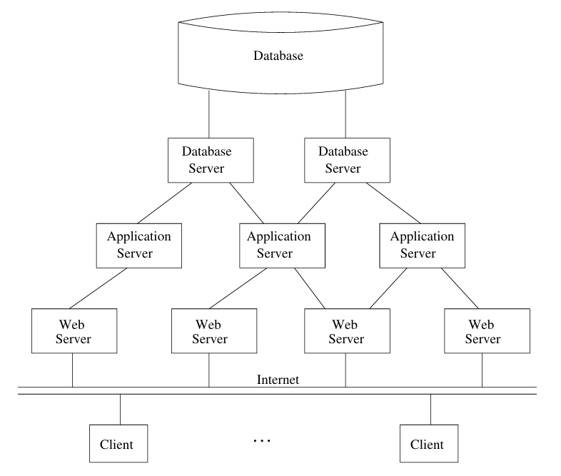

---

##### SQL Environments

- SQL环境是整个数据库系统运行的框架，本质就是安装并运行在服务器上的DBMS，是所有数据库对象的容器，所有表、视图、触发器等对象都必须在SQL环境下定义；

**Environment (环境)**：最高层级，指代在一个特定安装实例上运行的 DBMS (数据库管理系统)；

**Cluster (集群)**：环境内部的集合，由多个 Catalog 组成，是 SQL 查询能涉及的最大范围 (即跨 Catalog 查询的上限)；

**Catalog (目录)**：对应于平时所说的一个“数据库”实例，它包含了一系列 Schema；

**Schema (模式)**：Catalog 下的逻辑分组，包含了实际的数据库对象，如：

- 表 (Tables)、视图 (Views)、触发器 (Triggers)、断言 (Assertions) 等；
- 常用指令包括 **CREATE SCHEMA** 和 **SET SCHEMA**；


---

**End of 9.1.**


#### 9.2. Stored Procedures

- 用于在数据库内部编写复杂的逻辑，为SQL引入过程化编程的能力；

- Persistent Stored Modules, PSM 持久存储模块：

  1. Triggers，触发器：由数据库事件 (INSERT/UPDATE/DELETE) 自动触发；

  2. Stored Procedures，存储过程：

     可以接收参数并返回多个输出值；支持复杂的流程控制；用于封装完整的业务逻辑；使用 **CALL** 调用；

  3. Stored Functions，存储函数： 

     有且仅有一个返回值(需指明类型；用于扩展 SQL 表达式的功能)；直接嵌入 `SELECT` 或 `WHERE` 子句中；

#####   Create PSM Functions and Procedures

```sql
CREATE PROCEDURE <名称> (<参数列表>)
	<局部声明>
	<过程体>;
	
CREATE FUNCTION <名称> (<参数列表>) RETURNS <返回值类型>
	<局部声明>
	<函数体>;
```

- 声明PSM参数：

  $\to$ 形式为 "模式 - 名称 - 类型" ，三元组声明；e.g. `IN s CHAR`；(省略模式则默认为 **IN**)

  $\to$ 模式有三种：**IN** 仅输入，值不可修改，为default时可省略；**OUT** 仅输出；**INOUT** 输入输出均可；

- **FUNCTION** 的参数模式只能是 **IN** (所以可省略模式的声明)；

---

##### Kinds of PSM Statements

1. Variable & Assignment

   **`DECLARE`**：声明变量名及类型；

   - e.g. `DECLARE var_name INTEGER;`

   **`SET`**：赋值；

   - e.g. `SET var_name = 10;` 

2. Return value

   **`RETURN`**: 返回值；

   - **WARNING**: RETURN不会终止过程执行；

3. Conditional Control

   **`IF ... THEN ... ELSEIF ... ELSE ... END IF;`**：条件分支逻辑；

   **`CASE`**：类似 switch ，用于处理多个分支；

4. Loop Control

   **` <循环名> LOOP <循环体> END LOOP;`**：无条件循环，通常配合 `LEAVE <循环名>` 使用；

   **`WHILE`**：当满足特定条件时重复执行；

   **`REPEAT`**：直到满足特定条件才停止循环 (类似于do-while)；

   **`FOR`**：通常用于遍历查询结果集 (游标)；

5. Queries in PSM

   ```SQL
   DECLARE p INT;
   SET p = (SELECT...FROM... WHERE...) -- 返回单个变量的查询
   SELECT...INTO p FROM...WHERE...;    -- 返回单个变量的查询
   SELECT...INTO n, p FROM...WHERE...; -- 返回单行双列的查询
   ```

---

##### Invoking PSM

1. Use **CALL** to invoke stored procedures:

   ```sql
   CREATE PROCEDURE Move (IN oldAddr VARCHAR(255), IN newAddr VARCHAR(255))
   UPDATE MovieStar SET address = newAddr WHERE address = oldAddr;
   ```

   ```sql
   CALL Move('old', 'new');
   ```

2. Stored functions are generally embedded within SQL expressions:

   ```sql
   CREATE FUNCTION calculate_bonus(salary DECIMAL) RETURNS DECIMAL
   BEGIN
       RETURN salary * 0.15; -- 奖金是工资的 15%
   END;
   ```

   ```sql
   SELECT name, salary, calculate_bonus(salary) AS bonus  -- 函数嵌入在这里，像普通列一样
   FROM employees;
   ```

---

##### Cursors

- 常用于逐行处理复杂逻辑；

- e.g. 有表 employees(id, name,  debt, salary) 和 bonus_logs(emp_id, bonus_amount)；

  遍历表 employees，如果部门是 "Sales"，则发放工资的 20% 作为奖金；如果是 "Tech"，则发放 15%；其他部门发放 10%；需要将发放记录记入表 bonus_logs 中；

  ```sql
  CREATE PROCEDURE Distribute_Bonuses() -- 创建一个存储过程
  BEGIN
      DECLARE emp_id INT;            -- 一系列局部变量
      DECLARE emp_dept VARCHAR(20);
      DECLARE emp_salary DECIMAL(10,2);
      DECLARE bonus_amt DECIMAL(10,2);
  
      -- 声明游标
      DECLARE cur CURSOR FOR SELECT id, dept, salary FROM employees;
  
      -- 捕获SQL操作状态码
      DECLARE NotFound CONDITION FOR SQLSTATE '02000';
  
      OPEN cur; -- 打开游标
  
      -- 循环处理
      read_loop: LOOP
          -- 从游标中提取当前行的数据到变量中
          -- INTO后面的变量列表需与声明Cursor的查询语句结果对应
          FETCH cur INTO emp_id, emp_dept, emp_salary;
  
          -- 遍历结束则离开循环
          IF NotFound THEN LEAVE read_loop;
          END IF;
  
          -- 业务逻辑
          IF emp_dept = 'Sales' THEN
              SET bonus_amt = emp_salary * 0.20;
          ELSEIF emp_dept = 'Tech' THEN
              SET bonus_amt = emp_salary * 0.15;
          ELSE
              SET bonus_amt = emp_salary * 0.10;
          END IF;
  
          INSERT INTO bonus_logs VALUES (emp_id, bonus_amt);
  
      END LOOP;
  
      CLOSE cur; -- 关闭游标
  END;
  ```

- 注：每个SQL操作都会返回一个状态(5位字符串)，e.g. 00000: 正常，02000: 未找到元组；

---

##### Exception Handling

```sql
DECLARE <WhereToGo> HANDLER FOR <条件列表>
	<statement>
```

- <条件列表>就是 DECLARE <name\> FOR CONDITION SQLSTATE '02000'; 的那些布尔变量，可以多个，只要有一个为真，就要执行下面的<statement list\>；

- <WhereToGo\> 有三种

  **CONTINUE**：执行完处理程序后，回到触发异常的那条语句的**下一条语句**继续执行；

  **EXIT**：执行完处理程序后，直接**退出**声明该处理程序的整个 `BEGIN...END` 代码块；随后开始执行该代码块之后的语句；

  **UNDO**：与 `EXIT` 类似，但多了一个回滚操作：如果异常发生在一个事务块中，系统会撤销该事务内已执行的操作；

- e.g.

  ```sql
  CREATE FUNCTION GetYear(t VARCHAR(255)) RETURNS INTEGER
  DECLARE Not-Found CONDITION FOR SQLSTATE '02000';
  DECLARE Too-Many CONDITION FOR SQLSTATE '21000';
  BEGIN
      DECLARE EXIT HANDLER FOR Not-Found, Too-Many
          RETURN NULL; -- 如果没找到或找到多个返回NULL并直接EXIT，不执行下面的SELECT
      RETURN (SELECT year FROM Movie WHERE title = t);
  END;
  ```

---

**End of  9.2.**


### 10. Advanced Topics in Relational Databases

#### 10.1. Security and User Authorization in SQL

##### Kinds of Privileges

- 一共9中权限；

1. 基础数据操作权限 (DML 相关)

   可作用于整个表 (Relation)，也可限制在特定的列  (Attributes) 上；

   - **SELECT**: **查询权**；允许用户读取表中的数据；如果指定了属性列表，用户只能查询这些特定的列；(创建视图需要SELECT权)

   - **INSERT**: **插入权**；允许向表中添加新行；如果只给了某几列的 `INSERT` 权限，那么插入新行时其他列将自动填充为默认值或 `NULL`；

   - **UPDATE**: **更新权**；允许修改现有行的数据；同样可以限制用户只能修改特定的列；

   - **DELETE**: **删除权**；允许用户从表中删除行；注意，删除权限通常是针对整行的，不能针对特定列；


2. 结构与约束权限

   - **REFERENCE**: **引用权**；在设置外键约束时，必须拥有对被引用列的 `REFERENCE` 权限；

   - **USAGE**: **使用权**；主要用于关系和断言之外的架构元素(如域 Domain 或字符集)；允许用户在自己的定义中使用这些元素；

   - **TRIGGER**: **触发器权**；允许用户在特定的表上创建触发器；


3. 程序执行与类型权限

   - **EXECUTE**: **执行权**；允许用户运行存储过程或函数；

   - **UNDER**: **继承权**；在支持面向对象特性的 SQL 中使用；


---

##### Creating & Granting Privileges

1. 权限的产生：所有者 (Owner)

   在 SQL 中，权限的起点是“所有权”；

- 基本原则：谁创建了这个对象(如表、视图、索引)，谁就是该对象的所有者(Owner)；所有者自动拥有该对象上的所有权限(包括查询、修改、删除以及将权限分发给别人的权利)；
- 所有权确立的三个时刻：
  1. 创建 Schema(模式)时：整个模式内的对象默认归创建者所有；
  2. 通过 CONNECT 建立连接时：在连接语句中指定的 AUTHORIZATION userName 确定了当前会话的身份和所有权归属；
  3. 创建 Module(模块)时：在创建特定的代码模块时指定授权 ID；

2. 权限的授予机制 (Granting Privileges)

   所有者可以将手中的权限授予给别人；

   - 授予对象：权限可以授予给特定的用户 或 PUBLIC(系统中的所有用户)；

   - 转授权权：通常权限的被授予者不能授予权限，除非被授予权限时带有 **WITH GRANT OPTION** 选项；


3. GRANT 授权语法

   ```sql
   GRANT <权限列表> 
   ON <对象名(如表名)> 
   TO <用户 ID 列表>;
   -- 可选
   WITH GRANT OPTION;
   ```

   ```sql
   GRANT UPDATE ON Sells TO sally WITH GRANT OPTION; -- 用户sally拥有对表Sells的UPDATE权，还可转授该UPDATE权
   ```

---

##### Revoking Privileges

```sql
REVOKE <权限列表> 
ON <对象名(如表名)> 
FROM <用户 ID 列表>
[CASCADE | RESTRICT];
```

- 注意：如果用户从其他渠道也获得了同样的权限，只是你撤销的话，他们可能依然拥有该权限；

1. **CASCADE** 选项：撤销所有级联授予的权限；
2. **RESTRICT** 选项：如果有级联授权，该 REVOKE 操作会报错 (相当于一个安全提醒)；

---

##### Grant Diagrams

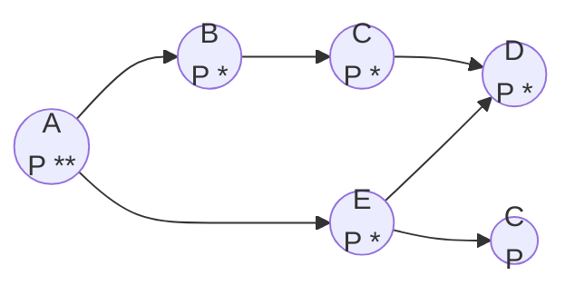

- P**：权限P的最初拥有者；

- P*：拥有P且可授权；

- P：仅拥有权限P；

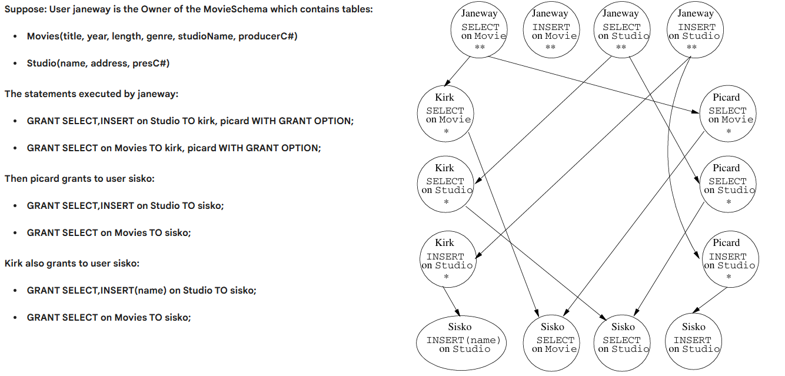

---

**End of 10.1.**


#### 10.2. Recursion in SQL

#### 10.3. The Object-Relational Model

#### 10.4. User-Defined Types in SQL

#### 10.5. Operations on Object-Relational Data

#### 10.6. On-Line Analytic Processing

#### 10.7. Data Cubes


## Part Three: Modeling and Programming for Semistructured Data

### 11. The Semistructured-Data Model

### 12. Programming Languages for XML


## Part Four: Database System Implementation

### 13. Secondary Storage Management

### 14. Index Structures

### 15. Query Execution

### 16. The Query Compiler


### 17. Coping With System Failures

- 事务读取数据库元素 (元组or磁盘块)：该元素首先被缓存到主存缓冲区，再复制到事务的局部缓冲区；事务写回过程与之相反；
- 系统故障：事务在主存中进行 $\to$ 掉电时事务状态丢失，无法确定事务哪些部分已经写回磁盘；对策为用日志记录所有database更新

- 几个原语：

  1. INPUT(X)：将包含数据库元素X的磁盘块写到内存缓冲区；
  2. READ(X, t)：将缓冲区中的X拷贝到事务的局部变量t (X不在缓冲区先INPUT(X))；
  3. WRITE(X, t)：与READ相反；
  4. OUTPUT(X)：与INPUT相反；
  5. FLUSH LOG：将缓冲区中的日志写回磁盘；

#### 17.1. Undo, Redo and Undo/Redo Logging

##### Log Records and Rules

```sql
<START T>	 -- 事务T开始
<COMMIT T>	 -- 事务T完成提交
<ABORT T> 	 -- 事务T没有成功完成
<T, X, v> 	 -- 三元组更新记录，undo与redo日志使用，表示事务T改变了元素X
<T, X, v, w> -- 四元组更新记录，undo/redo日志使用，X旧值为v，新值为w
```

- 三者的多元组记录都是响应动作 WRITE；
  - undo记录旧值；redo记录新值；undo/redo新旧值都记录；
- 三者的<START T\> 和多元组日志记录 都必须在事务OUTPUT前FLUSH到磁盘；

1. undo日志：OUTPUT之后才FLUSH <COMMIT T\>；
2. redo日志：FLUSH <COMMIT T\>后才OUTPUT；
3. undo/redo日志：FLUSH COMMIT和OUTPUT没有时序要求；但是COMMIT一旦被记录就必须立即FLUSH；

> 执行事务可并行交错 $\to$ 日志记录也会并行交错；

---

##### Examples

- e.g. 假设有一事务T：读取A、B将其翻倍再写回；

  1. undo日志

     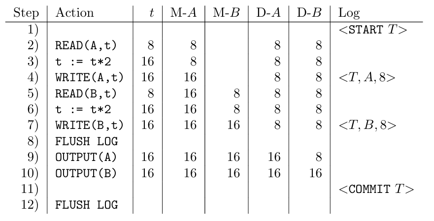

  2. redo日志

     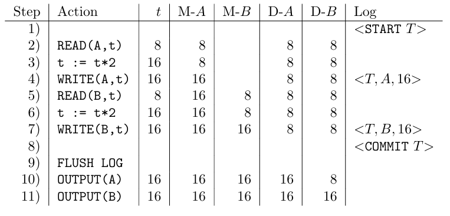

  3. undo/redo日志

     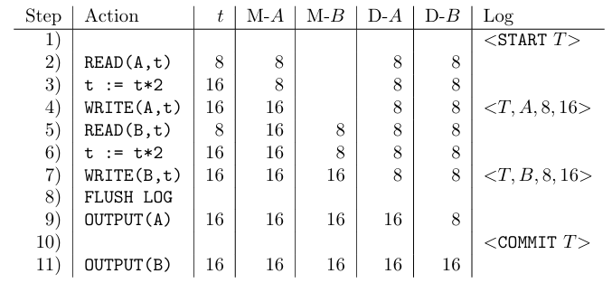

     11)应为FLUSH LOG，12)才是OUTPUT(B)；因为u/r日志中COMMIT必须立即FLUSH；

---

##### Recovery Using Logging

- 只有FLUSH到磁盘的日志记录，发生故障时不会丢失；

1. undo日志：

   已经COMMIT的事务一定OUTPUT，不用管；未COMMIT的事务不知是否OUTPUT，必撤销；

   - 由于OUTPUT之前所有三元组已被FLUSH，**从后向前**扫描日志并进行恢复即可；

     > 恢复过程中再次发生故障：重复恢复过程即可；

   - 撤销完失败事务T的所有修改，在日志末尾加上<ABORT T\>，即可正常进行新事务；

2. redo日志

   未COMMIT的事务一定未OUTPUT，不用管；已COMMIT的事务不确定是否OUTPUT，必重做；

   - **从前向后**扫描日志并重做即可；
   - 对于每个未COMMIT的事务T，在日志末尾加上<ABORT T\>，即可正常进行新事务；

3. undo/redo日志：

   - **从前向后**重做所有已提交事务；
   - **从后向前**撤销所有未提交事务；

---

##### Checkpointing

- 检查点：防止日志过长 / 降低故障恢复时扫描日志长度；

1. undo日志的checkpoint：

   - 当要插入检查点时：

     - 暂停新事务，等待当前所有事务提交或终止，并写了COMMIT / ABORT日志记录；
     - 将日志FLUSH到磁盘，写入<CKPT\>日志记录，再次FLUSH；

     此后在故障恢复中就不用再扫描CKPT之前的日志，删了也行；

   - 问题：要插入CKPT时，新事务必须被暂停 $\to$ 使用`非静止检查点`；

     - 写入日志记录<START CKPT(T~1~, T~2~, ... , T~k~)\> T~1~\~T~k~ 是正在进行的事务；
     - 照常接受新事务，当T~1~\~T~k~全部完成时，写入日志记录<END CKPT\> 并FLUSH到磁盘；

     故障恢复向上扫描日志时：

     1. 扫到<END CKPT\>，则配套<START CKPT(T~1~, ... , T~k~)\>前的所有日志记录可忽略；事实上二者之间的T~1~到T~k~相关事务也可忽略，但是扫到<START CKPT\>前不知道哪些可忽略...；
     2. 没扫到END就先遇见<START CKPT(T~1~, ... , T~k~)\>，则向上扫描完所有T~1~到T~k~的日志就不用扫描了，再往上的就可忽略了；

2. redo日志的checkpoint：

   静态检查点没用；

   动态检查点：<START CKPT(T~m~\~T~n~)\>，T~m~到T~n~是当前活跃事务，T~1~到T~m-1~是已提交但是不知OUTPUT的事务，等待T~1~到T~m-1~全部OUTPUT后，插入<END CKPT\>；

   - 扫到<END CKPT\>，找到配套的<START CKPT(T~m~\~T~n~)\>，再向上扫描完所有T~m~到T~n~的日志就不用继续扫描了；重做T~m~到T~n~中已提交的和<START CKPT(T~m~\~T~n~)\>后才开始但是成功提交的事务；
   - 先扫到<START CKPT(T~m~\~T~n~)\>，什么用也没有，只能继续向上扫描直到遇见前一个动态检查点的<END CKPT\>，然后就是上面的情况；

3. undo/redo日志的checkpoint：

   插入日志记录 <START CKPT(T~1~, T~2~, ... , T~k~)\> T~1~\~T~k~ 是正在进行的事务，并FLUSH LOG；

   等待当前所有对数据库元素的修改被写回磁盘(无论事务有没有被提交)，期间正常接受事务对主存缓冲区的修改，然后插入 <END CKPT\>；

   - 扫到<END CKPT\>，对应的START前的日志不用管(日志记录所对应的修改已经写到磁盘)；START后已提交的事务重做，未提交的事务撤销；
   - 先扫到<START CKTP\>，没用；

---

**End of 17.1. **


#### 17.2. Protecting Against Media Failures


### 18. Concurrency Control

- 操作记法：$r_i(X)\to$ 事务 $T_i$ 读元素 $X$；$w_i(X)\to$  $T_i$ 写 $X$；
- 并发控制核心目的：维护调度(操作序列)的可串行化，即其结果与事务串行执行一致 (参考6.5.一小节)；

#### 18.1. Enforcing Serializability by Locks

##### Conflict-Serializability

- 冲突可串行化是可串行化的“更严格版”，有的调度不是冲突可串行化的，但却是可串行化的；

1. 冲突 (Conflict)、

   两个操作是冲突的：

   - 来自不同的事务 ( $T_i$ 和 $T_j$ )；

   - 它们操作的是同一个数据元素 (如都是 $X$)；
   - 其中至少有一个是写操作 ($w$)；

   具体的冲突情况有三类：

   - 写-写冲突 (Write-Write)：$w_i(X)$ 与 $w_j(X)$；如果交换顺序，最终留在数据库里的值会不同；
   - 读-写冲突 (Read-Write)：$r_i(X)$ 与 $w_j(X)$；如果先写再读，读到的就是新值；如果先读再写，读到的就是旧值；
   - 写-读冲突 (Write-Read)：$w_i(X)$ 与 $r_j(X)$；原理同上；

   注： 如果两个事务都是读操作($r_i(X)$ 和 $r_j(X)$)，或者操作的是不同的数据($X$ 和 $Y$)，则不冲突，它们的顺序可以随意交换；

2. 冲突等价 (Conflict Equivalence)

   如果两个调度可以通过<u>交换非冲突动作的顺序</u>互相转变，称这两个调度是冲突等价的

3. 冲突可串行化 (Conflict Serializability)

   一个并行调度是 冲突可串行的 $\iff$ 它经过一系列非冲突交换后能变成串行调度；

- 优先图 (Precedence Graph) 判定冲突可串行化：

  - 事务(如 $T_1, T_2, ...$)是图中的结点；
  - 若 $T_1$ 的操作 $A_1$ 与 $T_2$ 的操作 $A_2$ 存在**冲突**，且 $A_1$ 在 $A_2$ 之前，则绘制一条从结点$1$指向结点$2$的弧 (记作 $T_1 <_S T_2$)；
  - 最终图中有环 $\to$ 非冲突可串行化；无环 $\to$ 冲突可串行化，且结点的任一拓扑顺序都是冲突等价的串行顺序；

  > 简要理解：冲突可串行化要求不能交换冲突操作，如果 $T_1$ 和 $T_2$ 的某个操作冲突，则在经过若干非冲突操作交换变成串行调度后，$T_1$ 和 $T_2$ 整体必存在先后顺序(有向图中有向弧含义)；如果图中存在环，说明既要 $T_1$ 在 $T_2$ 之前，又要 $T_2$ 在 $T_1$ 之前，矛盾；因此不能通过若干非冲突操作的交换变成串行调度，即不是冲突可串行化的；

  > 如何绘制优先图？先看所有写操作，然后找针对同一个元素但是下标不同的操作；

---

##### Enforcing Serializability by Locks

- 操作记法：$l_i(X)\to$ 事务 $T_i$ 对数据元素 $X$ 加锁；$u_i(X)\to$ 事务 $T_i$ 对 $X$ 解锁；

- 若规定事务只有对元素上锁后解锁前才能读写该元素，则可通过两阶段封锁 (Two-Phase Locking, 2PL)规则保证冲突可串行化：

  - 规定事务的锁操作分为两个阶段：增长阶段可以申请任何锁，但是一旦释放了一个锁，立即进入收缩阶段，不能再申请任何新锁；
  - 只要所有事务均遵循2PL规则，调度器产生的合法调度就一定是冲突可串行化的；

  > 因为这样就可以确保优先图无环；

问题：读操作也要获得锁，并发读会被阻塞，导致低效；

解决：**Using Shared and Exclusive Locks**

- $sl_i(X)$ (Shared Lock)： 事务 $T_i$ 申请共享锁；用于读操作；允许多个事务同时对同一元素持有共享锁；

  $xl_i(X)$ (Exclusive Lock)： 事务 $T_i$ 申请排他锁；用于写操作；一旦持有，其他事务既不能读也不能写；

  $u_i(X)$： 释放锁 (无论是什么种类)；

- 在执行 $r_i(X)$ 前，必须先持有 $sl_i(X)$ 或 $xl_i(X)$；

  在执行 $w_i(X)$ 前，必须持有更强的 $xl_i(X)$；

- 2PL规则没变：在一个事务中，所有加锁 ($sl$ 或 $xl$) 必须在任何解锁 ($u$) 之前；确保冲突可串行化；

> 注：相容性矩阵 (Compatibility Matrices)：当事务想要在某元素上申请锁时，必须根据相容性矩阵为该元素已有的每一把锁作结果查询，查询结果全为“是”则申请成功，出现“否”则锁申请被阻塞，进入队列；

锁的升级： $T$ 先申请 $X$ 上的共享锁 ($sl$)，在需要写入新值时再申请将该锁提升为排他锁 ($xl$)；这种做法可提高并发度：事务可能需先读取大量数据进行冗长计算后才写回结果，先拿共享锁可允许其他事务在此期间读取 $X$；

问题：多个事务同时尝试将共享锁升级为排他锁会导致的死锁；

解决：**Using Upgrading Locks**

- $ul_i(X)$：事务 $T_i$ 申请更新锁；

- 持有 $U$ 锁的事务只能读、不能写；

  $U$ 锁才能升级为排他锁 ($X$ 锁)；原共享锁 ($S$ 锁) 不再允许升级；

  一旦元素 $X$ 上被加了 $U$ 锁，调度器就会禁止在该元素上加任何其他锁 ( $S$ 锁、$U$ 锁或 $X$ 锁)；

- 由此导致的相容性矩阵为：

  | 持有 \ 申请 | S    | X    | U    |
  | ----------- | ---- | ---- | ---- |
  | $S$ (共享)  | 是   | 否   | 是   |
  | $X$ (排他)  | 否   | 否   | 否   |
  | $U$ (更新)  | 否   | 否   | 否   |

> 注：一般死锁问题的解决方法有等待图、超时机制等等；

---

**End of 18.1.**


#### 18.2. An Architecture for a Locking Scheduler

#### 18.3. Hierarchies of Database Elements

#### 18.4. The Tree Protocol

#### 18.5. Concurrency Control by Timestamps

#### 18.6. Concurrency Control by Validation


### 19. More About Transaction Management

### 20. Parallel and Distributed Databases


## Part Five: Other Issues in Management of Massive Data

### 21. Information Integration

### 22. Database Systems and the Internet

