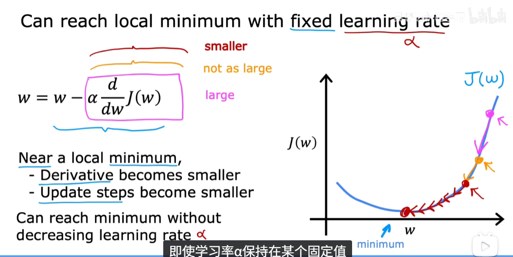

# Machine Learning

[吴恩达机器学习](https://www.bilibili.com/video/BV16jyuBBEom) $\to$ [吴恩达深度学习](https://www.bilibili.com/video/BV12urfB1E7s)

机器学习最常见的两种学习范式：监督学习、非监督学习；

### 1. Supervised Learning

**监督学习：训练数据包含 input 和对应的 label。**

给定训练集：$\mathcal{D}=\{(x^{(i)},y^{(i)})\}_{i=1}^{m}$

模型学习从输入 $x$ 到目标 $y$ 的映射： $f:x\rightarrow y$

根据 $y$ 的类型，监督学习主要分为：

- **Regression（回归）**

  - $y$ 为**连续数值**

  - 目标：预测一个数值

  - 例如：根据房屋面积、位置等特征预测房价

  - 输出可以是任意实数；

- **Classification（分类）**

  - $y$ 为**离散的类别标签**

  - 目标：判断样本属于哪个类别

  - 例如：判断邮件是否为垃圾邮件

  - 输出属于有限的类别集合：

    y∈{spam,not spam}y\in\{\text{spam},\text{not spam}\}

因此，更准确地说：

> **回归预测连续数值，分类预测离散类别。**

“分类”强调的是**类别标签**；回归则强调**连续数值**。

------

### 2. Unsupervised Learning

**非监督学习：训练数据只有 input，没有 label。**

即：$\mathcal{D}=\{x^{(i)}\}_{i=1}^{m}$

模型不需要预先知道每个样本的“正确答案”，而是从数据本身发现其中的**结构、规律或分布**。

典型任务：

- **Clustering（聚类）**
  - 将相似的数据自动划分到同一组
  - 例如：根据用户行为将用户自动分成若干群体
  - 不需要预先告诉模型“这个用户属于第几类”

**机器学习常见核心术语**

- **训练集（Training Set）**：用于拟合和训练模型的数据集合，常记作 $\mathcal{D}$。
- **样本（Example / Sample / Instance）**：数据集中的单个观测对象，记作 $(x, y)$。
- **输入变量 / 特征（Feature / Input Variable）**：描述样本属性的变量，记作 $x$。
- **输出变量 / 目标 / 标签（Target / Label / Ground Truth）**：模型试图预测的值，记作 $y$。
- **样本总量（Number of Training Examples）**：数据集中样本的数量，通常用 $m$ 或 $N$ 表示。
- **特征维度（Number of Features）**：每个样本包含的特征属性数量，通常用 $n$ 或 $d$ 表示。
- **回归（Regression）**：当目标变量 $y$ 为连续数值时（例如房价、温度）的监督学习任务。
- **分类（Classification）**：当目标变量 $y$ 为离散类别时（例如猫/狗、良性/恶性肿瘤）的监督学习任务。

**常用数学与下标符号规范**

- **带括号的上标 $(i)$**：表示**样本维度**的索引。
  - $x^{(i)}$：第 $i$ 个样本的特征向量（或标量）。
  - $y^{(i)}$：第 $i$ 个样本的真实标签。
- **无括号的下标 $j$**：表示**特征维度**的索引。
  - $x_j$：输入特征向量中的第 $j$ 个分量（特征）。
  - $x_j^{(i)}$：第 $i$ 个样本中的第 $j$ 个特征值。
- **无括号的上标 $[l]$（常用于深度学习）**：表示神经网络的**层级（Layer）**。
  - $W^{[l]}$、$b^{[l]}$：第 $l$ 层的权重矩阵和偏置项。
  - $a^{[l]}$：第 $l$ 层的激活输出向量。
- **带帽子符号 $\hat{y}$（y-hat）**：表示模型的**预测值**（$\hat{y} = f(x)$），用于区分真实标签 $y$。
- **矩阵与向量表示**：
  - 大写粗体或斜体（如 $X \in \mathbb{R}^{m \times n}$）通常表示特征设计矩阵（Design Matrix），每一行对应一个样本，每一列对应一个特征。
  - 小写粗体（如 $\mathbf{w}$ 或 $\mathbf{x}$）通常表示多维列向量。

### 一、板书内容提炼与技术笔记

#### 1. 监督学习核心工作流（Supervised Learning Pipeline）

- **训练集（Training Set）**：形式化定义为 $\mathcal{D} = \{(x^{(i)}, y^{(i)})\}_{i=1}^{m}$，其中每个样本包含输入特征向量（或标量）$x^{(i)}$ 与对应的真实标签 $y^{(i)}$。

- **学习算法（Learning Algorithm）**：在预设的函数族内进行参数搜索与优化。

- **模型 / 假设函数（Model / Hypothesis Function, $f$）**：学习算法的输出结果，表示从特征空间到目标空间的映射：

  $$f: \mathcal{X} \to \mathcal{Y}$$

- **预测值（Prediction, $\hat{y}$）**：

  $$\hat{y} = f(x)$$

  符号规范中使用“$\hat{y}$”（y-hat）表示估计值，用以严格区分观测到的真实目标值 $y$。

#### 2. 单变量线性回归（Univariate Linear Regression）

- **函数形式**：

  $$f_{w, b}(x) = wx + b$$

- **模型参数（Parameters）**：

  - **$w$（Weight / 权重）**：直线的斜率，控制特征 $x$ 对预测输出的影响尺度与方向。
  - **$b$（Bias / 偏置）**：截距项，提供输出基准偏移，使模型在特征为 $0$ 时不强制经过坐标原点。

- **几何解释**：在二维实数空间 $\mathbb{R}^2$ 中拟合一条直线，最小化所有样本点 $(x^{(i)}, y^{(i)})$ 到直线的垂直偏离程度。

- **术语命名**：

  - **Univariate（单变量）**：特征维度 $n = 1$（仅包含单一特征，如房屋面积）。
  - **Linear（线性）**：假设函数关于参数 $w, b$ 呈现一阶线性关系。

#### 3. 进阶拓展要点

- **假设空间（Hypothesis Space, $\mathcal{H}$）**：

  学习算法并不是在所有可能存在的数学函数中漫无目的地寻找，而是在特定的函数族 $\mathcal{H}$ 内部搜索。单变量线性回归的假设空间定义为：

  $$\mathcal{H} = \left\{ f_{w, b} \mid f_{w, b}(x) = wx + b,\; w \in \mathbb{R},\; b \in \mathbb{R} \right\}$$

- **多变量线性回归（Multivariate Linear Regression）拓展**：

  当特征从标量扩展为 $n$ 维向量 $\mathbf{x} = [x_1, x_2, \dots, x_n]^T \in \mathbb{R}^n$ 时，函数形式拓展为向量内积形式：

  $$f_{\mathbf{w}, b}(\mathbf{x}) = \mathbf{w}^T \mathbf{x} + b = \sum_{j=1}^{n} w_j x_j + b$$

  此时几何形态由二维平面上的“直线”扩展为高维空间中的“超平面”（Hyperplane）。

- **参数求解的优化准则**：

  确定 $w$ 和 $b$ 的标准通常采用普通最小二乘法（Ordinary Least Squares, OLS），即最小化均方误差代价函数（MSE Cost Function）：

  $$J(w, b) = \frac{1}{2m} \sum_{i=1}^{m} \left( f_{w, b}(x^{(i)}) - y^{(i)} \right)^2$$

  通过梯度下降法（Gradient Descent）或解析解（Normal Equation）求取极小值点 $(w^*, b^*) = \arg\min_{w, b} J(w, b)$。

### 二、关于“$f$ 的选择是否任意，包括神经网络”的解答

**结论：在形式化定义上，函数 $f$ 的结构形式确实由算法设计者预先指定，神经网络在数学本质上就是一种高度参数化、分层嵌套的复杂复合函数 $f$。但工程与理论实践中，$f$ 的选取受制于归纳偏置（Inductive Bias）、计算可优化性以及泛化误差的严格约束，并非无条件的随意选取。**

#### 1. 神经网络与线性模型的统一函数本质

从数学映射的角度，线性回归、支持向量机、决策树或深度神经网络，本质上都是在构建映射函数 $f(x)$：

- **线性模型**：

  $$f(x) = \mathbf{w}^T \mathbf{x} + b$$

- **前馈神经网络（Multilayer Perceptron, MLP）**：

  多层前馈网络是线性变换与逐元素非线性激活函数（如 ReLU、GELU）的交替复合：

  $$f(x) = \mathbf{W}^{[L]} \cdot \sigma \Big( \mathbf{W}^{[L-1]} \dots \sigma \big( \mathbf{W}^{[1]} \mathbf{x} + \mathbf{b}^{[1]} \big) \dots + \mathbf{b}^{[L-1]} \Big) + \mathbf{b}^{[L]}$$

  根据**通用近似定理（Universal Approximation Theorem）**：一个包含至少一个隐藏层、足够数量神经元以及非线性激活函数的前馈网络，能够在紧致集上以任意指定的精度逼近任意连续函数。因此，神经网络就是通过矩阵运算和激活函数构造出来的通用非线性函数逼近器 $f$。

#### 2. 为什么 $f$ 的选择不是无约束的“任意”？

预先选定 $f$ 的结构即引入了**归纳偏置（Inductive Bias）**。选择哪一种 $f$ 受到以下理论边界的约束：

- **偏差-方差权衡（Bias-Variance Tradeoff）**：

  - 若底层数据分布本质上是非线性的，若强制选取线性形式 $f(x) = wx + b$，会导致假设空间过小，产生严重的欠拟合（High Bias）。
  - 若无节制地选取表达能力极强的 $f$（如参数量巨大的深层神经网络或高阶多项式），在训练数据量不足时，函数会在训练点之间产生剧烈震荡，丧失对未见测试数据的预测能力，产生严重的过拟合（High Variance）。

- **目标函数的凸性与优化收敛性（Optimization Tractability）**：

  - 线性回归搭配均方误差代价函数具有**全局凸性（Convexity）**，其驻点即为全局最优解，不存在局部极小值（Local Minima）。
  - 深度神经网络构成的非线性复合函数 $f$ 导致其损失平面高度非凸，伴随大量局部驻点、鞍点以及梯度消失/爆炸问题，优化难度显著提高。

- **没有免费午餐定理（No Free Lunch Theorem）**：

  在所有可能的数据生成分布的平均意义下，没有任何一种函数形式 $f$ 在所有问题上优于其他形式。选择特定的函数结构（例如图像使用卷积结构的 $f$、序列使用自注意力结构的 $f$）依赖于输入特征在实际物理问题中的先验结构。

$\frac{1}{2m}\sum^m_{i=1}((wx^{(i)}+b)-y^{(i)})^2$ 

线性回归模型

x y 不一定是一维的；

如何确定最好的w和b？下一节：梯度下降https://www.bilibili.com/video/BV16jyuBBEom?t=0.0&p=15

