# Computer Network

> Author：玖沐 (JayWei)  |  Last Updated：2026/06/29
>
> Reference: *"Computer Networking: A Top-Down Approach"* (8th Edition, by James F. Kurose and Keith W. Ross)
>

### 0. Computer Network Overview

##### Network Architecture

- 网络体系结构描述了：网络的层次，每一层使用的协议及必须实现的功能；而**不关心具体的实现细节**；
- 教材采用的五层模型：
  1. 物理层：实现在各种传输媒体上传输比特0和1,进而给其上面的数据链路层提供透明的传输比特流的服务；
  2. 数据链路层：实现在相邻节点 (主机与路由器、或路由器之间) 的链路上以“帧”为单位传输数据，提供封装成帧、差错检测与介质访问控制等功能，进而给其上面的网络层提供相邻节点间的链路传输服务；
  3. 网络层：实现将分组 (IP数据报) 从源主机跨越多个网络和路由器路由并转发到目的主机，提供逻辑寻址、路由选择以及异构网络互联等功能，进而给其上面的传输层提供主机到主机的逻辑通信服务；
  4. 传输层：实现不同主机中运行的应用进程之间的端到端逻辑通信，提供端口寻址 (复用与分用) 、差错检测，以及可靠传输控制 (连接管理、流量控制与拥塞控制) 或不可靠传输服务，进而给其上面的应用层提供进程间的通信服务；
  5. 应用层：直接面向用户的应用进程，定义进程间通信与数据交互的规则、协议规范及报文格式 (如 HTTP、DNS、SMTP、FTP 等) ，进而直接满足用户的各类具体网络应用需求；

- 其它网络体系结构：

  - OSI模型 (Open Systems Interconnection，七层)：在五层模型的应用层的传输层之间添加了**表示层和会话层**；表示层：管数据格式 (翻译、加密、压缩)；会话层：管对话连接 (建连、维持、断开)；
  - TCP/IP模型 (四层)：将五层模型的数据链路层和物理层统一为**网络接口层**；

---

##### Circuit, Packet, and Message Switching

1. 电路交换：
   - 三个阶段：建立连接 $\to$ 数据传输 $\to$ 释放连接；
   - 连接建立后独占所有物理资源；
   - 只有连接建立时延，无排队 / 存储转发时延；
   - 局限：不适合突发的计算机通信 (信道利用率低)；中继节点故障直接中断整个连接；
   
2. 报文交换 (Message)：
   - 无连接：通信前无需预先建立专用物理路径；
   - 整报文存储转发 $\to$ 对中继节点的缓冲能力要求高；
   - 局限：差错重传开销大 (需重传整个报文)；无流水线效应，时延累积严重；
   
3. 分组交换 (Packet)：
   - 报文被拆分并被添加首部，信道按需分配，流水线式传输大幅减少端到端时延；
   - 设链路最多支持 $m$ 个用户同时传输，此刻有 $N$ 个独立用户且各自活跃概率为 $p$，则 $P(X > m) = \sum_{k=m+1}^{N} \binom{N}{k} p^k (1-p)^{N-k}$；
   - 优点：排队重传与重传粒度小；对节点缓冲区要求低；
   - 局限：引入首部开销；存在失序、拥塞等问题；

- 传输时延量化对比：设总数据量为 $M$，经过 $h$ 段相同速率为 $R$ 的链路 (忽略传播时延与节点处理时延)
  - 电路交换：$T_{\text{circuit}} = t_{\text{setup}} + \frac{M}{R}$；
  - 报文交换：$T_{\text{message}} = h \times \frac{M}{R}$；
  - 分组交换：下面的多跳流水线耗时去掉传播时延即可；
- Internet 选用分组交换原因：
  - 适配网络通信的突发性；
  - 免去握手时延 (就算是TCP中间节点也不维护两端的连接状态)；
  - 鲁棒性：分组独立寻址，路由算法实时更新转发表，绕开故障节点 / 链路；
  - 易拓展；

---

##### Performance Metrics

- 传输时延：$d_{\text{trans}} = \frac{L}{R} \quad (L\text{ 为分组数据长度 (bit)},\, R\text{ 为链路传输速率/带宽 (bps)})$；

- 传播时延：$d_{\text{prop}} = \frac{D}{s} \quad (D\text{ 为链路物理距离 (m)},\, s\text{ 为电磁波传播速率 (m/s)})$；

- 带宽-延迟积：$\text{BDP} = R \times d_{\text{prop}}$ (管道能容纳的最大bit数)；

- 比特宽度：$L_{\text{bit}} = \frac{s}{R}$；

- 多跳分组流水线总耗时：发送端连续发送 $n$ 个分组，经 $m$ 个路由器 ($m+1$ 段链路)：

  $t_{\text{total}} = (n + m) \cdot d_{\text{trans}} + \sum_{i=1}^{m+1} d_{\text{prop}\{i\}} = (n + m) \cdot d_{\text{trans}} + d_{\text{prop(总)}}$；

  (忽略排队与处理时延，链路带宽均为 $R$，各段链路传播时延为 $d_{\text{prop}\{i\}}$)

---

**End of 0.**

## Part One: Application & Transport Layers

### 1. Application Layer

#### 1.1. Principles of Network Applications

##### Network Application Architectures

1. 客户 - 服务器体系结构：服务器总是打开的，并且具有固定的、周知的IP地址；客户相互之间不直接通信；数据中心：托管大量主机，用于创建强大的虚拟服务器；
1. P2P 体系结构：应用程序在间断连接的主机对之间直接通信(称为`对等方`)，不依赖专门的服务器；具有自扩展性；高度非集中式结构的问题：安全性、性能、可靠性；

- 注：CS与P2P文件分发时间的计算见[Appendix A](#Appendix A)；

---

##### Transport Services Available to Applications

- 传输层向应用层提供的服务：进程到进程的通信；
  - TCP：可靠的，字节流服务 (不维护报文边界)；
  - UDP：不可靠、无连接的消息边界明确的数据报服务；

---

**End of 1.1.**

#### 1.2. Application-Layer Protocols

##### The Web and HTTP

- Web：

  - 全称 World Wide Web，即万维网；

  - Web三大支柱：HTML(超文本标记语言)，HTTP(超文本传输协议)，URL(统一资源定位符)；
    - Web页面(也叫文档)由对象组成；
    - 对象是一个文件(比如HTML文件，JEPG图像，CSS样式表文件等)，可通过一个URL寻址；
    - 一般来讲一个Web页面包括一个HTML基本文件和若干个引用对象；

  - URL由两部分组成：存放对象的服务器主机名 和 对象的路径名;

- HTTP：

  - HyperText Tranfer Protocol，HTTP，即超文本传输协议；

  - HTTP由两个程序实现，客户程序与服务器程序，运行在不同端系统中，通过交换HTTP报文进行会话；

    Web浏览器实现了HTTP客户端，所以术语`浏览器`和`客户`基本等价；

    Web服务器实现了HTTP服务端，存储Web对象，每个对象由URL寻址；

  - HTTP协议采用的传输层协议：TCP；

  - HTPP是无状态协议，不存储关于客户的任何信息；
  
- HTTP类型：

  - 非持续 HTTP：客户端获取每个对象都需经历完整的 "TCP三次握手 + 资源请求"；
  - 不带流水线的持续 HTTP：所有的请求/响应复用同一个持久 TCP 连接；但是客户端必须在收到前一个响应后才能发送下一个请求；
  - 带流水线的持续 HTTP：不仅复用单条 TCP 连接，客户端还可以一次性发送多个对象的请求，服务器则按顺序连续响应；

---

##### Electronic Mail in the Internet

- 电子邮件系统三大组件：
  - 用户代理 (User Agent) ：就是客户端 (如 Outlook、Foxmail 或网页端) ；允许用户阅读、回复、转发和撰写邮件；
  - 邮件服务器 (Mail Server) ：核心基础设施；每个用户在服务器上都有一个邮箱；
  - SMTP 协议：负责在服务器之间、或用户代理到服务器之间传输邮件；
- 邮件发送协议 SMTP：
  - 基于TCP，默认 port 25；发送方主动建立 TCP 连接，把文件推给接收方；
  - 三个阶段：握手 (HELO) 、对象传输 (MAIL FROM / RCPT TO / DATA) 、关闭 (QUIT) ；
- 邮件访问协议：
  1. POP3：用于用户代理从邮件服务器读取邮件；支持一条TCP连接收取多封邮件；
  2. IMAP：有状态；服务器会同步本地对邮件的修改(标记为已读、移入回收站...)，而POP3不会同步；

---

##### DNS

- 主机的两种标识方式：主机名标识 与 IP地址标识；

- DNS (Domain Name System 域名系统) 提供的服务：主机名到IP地址转换的目录服务；

  - DNS的两个部分：一个分层的DNS服务器实现的分布式数据库；一个使得主机能够查询分布式数据库的应用层协议；

- 域名命名逻辑： 子域名 . 二级域名 . 顶级域名

  - 顶级域TLD可分为通用顶级域gTLD(.com .net .org) 、国别域ccTLD(.cn .us) 和行业/品牌顶级域(.edu .gov)；

  - 二级域：自定义的真正注册部分；

  - 子域名：www官网、text测试、blog博客...；

- DNS域名解析流程：

  1. 本机查询：浏览器查缓存 $\to$ 查操作系统DNS缓存 $\to$ 查本地Hosts文件；都没有 $\to$ 下一步；

  2. 本地DNS服务器查询：自己机器随机端口 $\to$ DNS服务器53端口；然后本地DNS查自己缓存，若没有 $\to$ 下一步；

  3. 本地DNS服务器发起递归查询

     根域名服务器 $\to$ 返回顶级域(如.com)服务器地址；

     顶级域服务器 $\to$ 返回example.com的权威DNS服务器地址；

     权威DNS服务器存有域名到IP地址的映射，把最终结果返回给本地DNS服务器；

  > 客户端只问一次本地 DNS 服务器，所有查询由本地 DNS 服务器完成，最后直接把 IP 交给客户端；

- DNS采用的传输层协议是UDP；

---

**End of 1.2. **

### 2. Transport Layer

- 传输层：提供运行在不同主机上的进程间(逻辑)通信；

- 传输层协议工作在端系统上；
  - 发送端：传输层接收来自应用层的报文，并封装为传输层的**报文段**(可能会分块)，然后交给网络层；
  - 接收端：网络层提取出报文段并向上交付给传输层，传输层处理报文段再交付给目的进程 (Through socket)；

#### 2.1. Multiplexing and Demultiplexing

- 传输层的多路复用与多路分解：将网络层提供的主机到主机的交付服务延伸到为运行在主机上的应用程序提供进程到进程的交付服务；
- 传输层实际上不是直接将数据交付给进程，而是交给中间的套接字socket；

---

##### socket

- 一个 socket 实际上就是内核里的一个数据结构 + 一组API接口；

  > 一块内核内存区域：记录了IP、端口、状态、缓冲区(发送队列与接收队列)，记录的进程PID等；

- 两种socket：

  - UDP套接字仅通过 (目的IP，目的端口号) 标识，内核不区分发送者；

    > 但应用进程通过 recvfrom() 系统调用，可以获取报文的源 IP 和源端口，从而区分来自不同发送者的报文；
    >
    > 但是如果UDP socket也可通过调用connect()变成一个已连接UDP socket；

  - TCP已连接socket用四元组：(目的IP，目的端口号， 源IP，源端口号) 标识；一个TCP socket 只能一对一通信；
  
    > 但是通过listen()创建的监听socket只由二元组标识；
  
  > 注：TCP和UDP报文段都只有源端口号和目的端口号字段，因为源IP和目的IP在IP数据报中；

---

- 所以多路分解 (将运输层报文段中的数据交付到正确的套接字) 的原理就是：报文段带有协议、源端口号，目的端口号等字段，提取该字段并交付给对应socket即可(一般通过Hash)；
- 多路复用：在源主机从不同套接字中收集数据块，并为每个数据块封装上首部信息 (以后用于分解) 从而生成报文段，然后将报文段传递到网络层；这个过程倒是不怎么关心端口号，因为已经封装好了；

---

**End of 2.1.**

#### 2.2. Connectionless Transport: UDP

- 仅在IP协议的基础上增加了运输层最基础的 多路分解 / 复用 和 少量差错检测；
- 无连接：没有三次握手，发送方直接交付数据，尽力而为传输，不保证交付、不排序、无重传机制；
- 应用场景：适合对实时性要求高、能容忍少量丢包、不希望传输延迟的场景；

---

##### UDP Segment Format

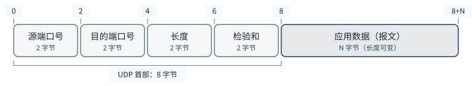

- 首部：固定长度，8 字节(4 个字段，每个字段 2 字节 / 16 比特)；
- 数据字段：承载应用层数据，长度可变；

---

##### UDP Checksum

- 发送方计算：将 UDP 报文段(首部 + 数据)按 16 比特分组；对所有 16 比特字做二进制加法，溢出位回卷(即加到结果的最低位)；对和做反码运算，结果填入检验和字段；
- 接收方校验：将收到的完整报文(含检验和)按 16 比特分组求和；结果全1 $\to$ 无差错，校验通过、含0 $\to$ 有差错，校验失败；
  - 发现差错后直接丢弃报文，或交付应用层告警，不重传；

---

**End of 2.2.**

#### 2.3. Connection-Oriented Transport: TCP

- TCP基本特性：
  1. 点对点连接，一次发送操作中不能从一个发送端将数据传送给多个接收端；
  2. 可靠的，按顺序的**字节流**：数据交付给应用层(写进内核缓冲区时)不保留报文界限 (黏包 / 短读 $\to$ 应用层协议需自己维护报文界限)；
  3. 管道化 (流水线)：TCP流量控制和拥塞控制设置窗口大小；
  4. 发送和接收缓存 (为协议设计而存在，并非仅仅平衡速率)；
  5. 全双工通信：同一连接中，数据可以双向流动，MSS：最大报文段大小；
  6. 面向连接：数据交换前，通过握手(交换控制报文)初始化发送方接收方的控制变量；但连接是逻辑的，仅两端维护连接状态，中间网络设备并不感知连接的存在；
  7. 流量控制：发送方不会淹没接收方；
  8. 拥塞控制：TCP协议会根据网络拥塞程度动态调整发送速率；

---

##### TCP Segment Format

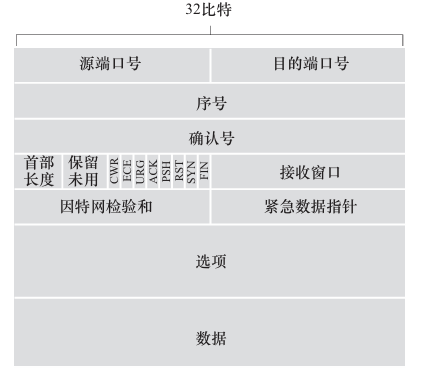

- TCP报文段由首部和数据组成；

1. 首部：

   - 各16bit的源端口号和目的端口号字段 $\to$ 实现多路复用与分解(见上)；

   - 各32bit的序号和确认号字段 $\to$ 实现可靠数据传输；

   - 4bit的首部长度字段：单位为32bit(4byte) $\to$ 首部最长 $4\times1111_{(2)}=60$ 字节；

     > 选项字段为空时 $\to$ 首部长为**典型的20字节**；

   - 12bit的各种标志字段(有4bit保留未用)：

     - ACK：指示确认字段有效；
     - RST、SYN、FIN $\to$ 连接管理 (连接的建立和拆除)；
     - CWR、ECE：拥塞通告；

   - 16bit的接受窗口字段 $\to$ 实现流量控制；

   - 16bit的因特网校验和字段 $\to$ 检查bit级的差错；

2. 数据：

   - 来自应用层的报文，可能被拆分，导致接收方短读；
   - 说明TCP是面向字节流的协议，不维护报文界限 (需要应用自己维护)；

---

##### Maximum Segment Size

- 根据 RFC 879 的定义：

  - **最大报文段长度** (Maximum Segment Size, MSS) 只计算 TCP报文段中的**数据部分** (Payload)；

  $$
  MSS=MTU-sizeof(IP\_header)-sizeof(TCP\_header)
  $$

  > MTU $\to$ 链路层最大传输单元，以太网MTU一般是1500字节，如果IP首部和TCP都是最小的20字节，那么MSS就是1460字节；
  >
  > 注意以太网MTU不包括帧头和帧尾，专指上层载荷最大长度；

- MSS初始值来源于三次握手期间：

  - 连接双方在SYN报文(的选项字段)中互相通告期望的MSS值；
  - 每一方发送数据时，会选择对端通告的MSS值与自身路径限制两者中的较小值；

- TCP连接过程中MSS一般不变，但是：

  - 路径MTU发现：某路由器发现需要分片但是IP头部设置了DF标志，则丢弃该分组并向源主机发送ICMP报文并通告其MSS；发送端接收到后会动态调整MSS；

  > 所以MSS反映的是链路承载能力，不会因为两端(比如接收窗口满了)而变化；

---

##### TCP Flow Control

- 三个窗口：

  1. 接受窗口 $rwnd$：表示接收方当前剩余空闲缓冲区大小；
  2. 拥塞窗口 $cwnd$：表示链路当前能承载的吞吐量上限 (具体计算方式见2.6.一节)；
  3. 发送窗口 $swnd\le\min\{rwnd,cwnd\}$；

- 发送窗口更新逻辑：

  -  接收方会在回传的ACK报文的TCP 首部的 window 字段中，向发送方通告自己当前的接收窗口大小；

  - 发送方收到ACK，一方面根据累积确认减少在途数据量，另一方面根据最新的 $rwnd$ 和自身的 $cwnd$ 重新计算发送窗口总额度；

    如果有剩余额度，则继续发送数据；

- issue：当接收方 $rwnd=0$ 并已通知发送方，若此后接收方没有数据要发给发送方，那么发送方将一直认为接收方缓冲区满；
  - RFC 1122 要求：当接收方接收窗口为0时，发送方继续发送只有一个字节数据的报文段，接收方对这些报文段进行确认；这些确认报文段可以通告发送方后续 $rwnd$ 的变化；

---

**End of 2.3.**

#### 2.4. TCP Connection Management

##### Establishing a Connection: The Three-Way Handshake

1. 客户端 $\to$ 服务端

   - 发送第一次握手包，无应用层数据，SYN比特被置1 (称为 **SYN报文段**)；
   - 客户随机选择自己的初始序号 (记为client_isn)，置于SYN报文段的序号字段中；
   - 选项字段中带有MSS；

   作用：客户端探测服务端是否可以进行通信，端口是否打开；

2. 服务端 $\to$ 客户端

   - 服务器收到SYN报文段，分配TCP缓存与变量；
   - 发送第二次握手包，无应用层数据，SYN比特被置1 (称为 **SYNACK报文段**)
   - 确认号字段值为client_isn+1；
   - 服务器随机选择自己的初始序号 (记为server_isn)，置于第二次握手包的序号字段中；

   作用：告知客户端可以发，并且服务端可以收；

3. 客户端 $\to$ 服务端

   - 客户端收到SYNACK报文段，分配TCP缓存和变量；
   - 发送第三次握手包，可以包含应用层数据，SYN比特被置0；
   - 确认号字段值为server_isn+1；

   作用：客户端收到第二次握手包，得知客户端可以发，并且服务端可以收；于是发送第三个握手包，告知服务端可以发，客户端可以收；

$\to$ 自此建立了全双工的四个操作通道，分别为 客户端收发、服务端收发；

- 注1：SYN握手过程中除了确定双方初始序号，还会通告MSS，是否开启时间戳等；
- 注2：分析HTTP首次连接延迟时，TCP握手开销只计算 $1 RTT$ (因为第3次握手包已经开始携带应用层数据)；

---

##### Terminating a Connection: The Four-Way Wave

- 由于 TCP 是全双工的 (即双方都可以同时收发数据)，关闭连接时需要双向确认；假设 Client 发起关闭请求：

1. 第一次挥手：**Client $\rightarrow$ Server (FIN)**

   客户端发送一个 **FIN (Finish)** 报文段，进入 **FIN_WAIT_1** 状态；Client不再发送数据，但仍可接受数据；

2. 第二次挥手：**Server $\rightarrow$ Client (ACK)**

   服务器收到 FIN 后，回传一个 ACK并进入 **CLOSE_WAIT** 状态，客户端收到ACK后进入 **FIN_WAIT_2** 状态；

   - 此时处于“半关闭”，客户端不再发服务器也不再收，但服务器如果还有没发完的数据，仍可以继续发送；

3. 第三次挥手：**Server $\rightarrow$ Client (FIN)**

   服务器发送完所有数据后(如果有)，也会向客户端发送一个 **FIN** 报文；Server也不再发数据，并进入 **LAST_ACK** 状态；

4. 第四次挥手：**Client $\rightarrow$ Server (ACK)**

   客户端收到服务器的 FIN 后，发送最后一个 **ACK** ，进入 **TIME_WAIT** 状态；服务器收到该 ACK 后立即进入 **CLOSED** 状态；客户端在等待 **2MSL **(最大报文生存时间) 后，也进入 **CLOSED** 状态；

   > 如果第四次挥手的 ACK 丢失，服务器会超时重传第三次的 FIN；如果客户端立即关闭，就无法处理这个重传的 FIN，导致服务器无法正常进入 CLOSED 状态；

> 为什么是4次？
>
> - **关闭是单向的：** 收到 FIN 只意味着对方不再发数据，不代表自己也没数据要发了；
> - **中间的等待：** 第二次和第三次挥手之间，服务器可能还有缓冲区数据需要处理；

---

**End of 2.4.**

#### 2.5. Sliding Window Protocols

##### Protocol Types

- 滑动窗口 (Sliding Window) 协议用于在不可靠信道 (bit错误or分组丢失) 上实现可靠数据传输 (RDT) 与流量控制；
  - 发送窗口 ($W_T$)：发送方未收到接收方ACK时，允许连续发送的最大分组数量；
  - 接收窗口 ($W_R$)：接收方允许接收并处理 (向上交付或暂存) 的分组数量；

- 根据 $W_T$ 与 $W_R$ 大小关系，协议可分为三类：
  - 停等协议 (SW)：$W_T = 1, W_R = 1$；   
  - 回退 N 步协议 (GBN)：$W_T > 1, W_R = 1$；   
  - 选择重传协议 (SR)：$W_T > 1, W_R > 1$；

---

##### GBN v.s. SR

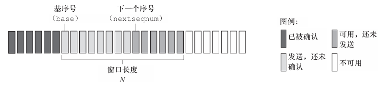

|  **机制维度**  | **回退 N 步**                                                | **选择重传**                                                 |
| :------------: | ------------------------------------------------------------ | ------------------------------------------------------------ |
|  **确认机制**  | **累计确认**：确认号表示该序号及之前的所有分组均已正确接收； | **逐个独立确认**：每个 ACK 仅确认对应序号的单个分组；        |
| **定时器管理** | 发送方仅维护**单一全局定时器**（针对窗口中最早未确认分组 `base`）； | 发送方为窗口中的**每个分组维护独立的私有定时器**；           |
|  **重传行为**  | 超时则重传当前发送窗口内的**所有已发送未确认分组**（$[base, nextseqnum - 1]$）； | 仅选择性重传超时的**特定单个分组**；                         |
| **接收端行为** | 仅按序接收分组；**失序分组直接丢弃**，并重发上一有效分组的冗余 ACK； | **缓存失序分组**，仅将连续有序部分交付上层；接收窗口前移至首个未收到的空洞处； |
|  **窗口滑动**  | 收到有效 ACK 即前移 `base`；若窗口内仍有分组，则**刷新**定时器； | 发送窗口仅在 `base` 对应的分组被确认时向前滑动；中间分组被确认则先标记； |

- 注：由于SR不具备累计确认，所以ACK丢失时，发送窗口将卡死在`base`直至超时重传，此时接收方不可忽略此已经接受了的分组，必须再次返回ACK避免发送窗口卡死；

---

##### Computing Window Size

- 设序号编码位数为 $n$，则序号空间为模 $2^n$ 的循环空间，序号取值范围为 $[0, 2^n - 1]$；

  核心矛盾：防止序号回绕导致旧分组被认为是新分组；

1. Stop-and-Wait：$W_T = W_R = 1$，仅需 $1$ bit 序号；

2. Go-Back-N：

   - 接收方只按序接收，因此 $W_R=1$；
   - 对于发送方，$W_T=2^n-1$；

   - 假设发送方一次发送 $2^n$ 个分组并被接收，但是ACK丢失；发送方重传，接收方恰好期待从序号 $0$ 开始的新分组，引发协灾难 $\to$ 少一个就行 $W_T=2^n-1$；

3. Selective Repeat：

   - 接收方允许乱序接收，因此 $W_R>1$；

   - 假设发送方发一次发送 $W_T$ 个分组并被接收，此时接收窗口为 $[W_T,W_T+W_R-1]$；

     ACK丢失，发送方超时重传 $[0,W_T-1]$ 的分组；

     为了防止接收方将重传的分组 $0$ 当成新分组，接收窗口右边界不能回绕，即 $W_T+W_R-1<2^n$；

     即 $W_T+W_R\le2^n$；

   - 一般取对称 $W_T=W_R=2^{n-1}$ (最大化信道利用率与吞吐量)；

- 注：虽然TCP序号空间很大，但是在高速网络中还是会迅速耗尽，办法：引入时间戳 (位于选项字段中)；

---

##### Computing Channel Utilization Size

- 信道利用率 $U$ = 发送端实际发射数据信号的时间占整个通信交互周期时间的百分比；

- 发送方连续发送 $W$ 个分组 (信道未满载)，且接收方每个分组都立即回传ACK (忽略ACK传输与主机处理时延)：

  - 交互周期 $T_{\text{cycle}} = d_{\text{trans}} + \text{RTT} = d_{\text{trans}} + 2d_{\text{prop}}$；
  - 信道利用率 $U = \min\left(1,\, \frac{W \times d_{\text{trans}}}{d_{\text{trans}} + \text{RTT}}\right)$；(SW协议 $W$ 就取 $1$)

  满载条件：$U\ge1$，即 $W \ge \frac{d_{\text{trans}} + \text{RTT}}{d_{\text{trans}}}$；

- 结论：最大窗口大小关系为 $W_{\text{Stop-and-Wait}} < W_{\text{SR}} < W_{\text{GBN}}$，因此最大信道利用率满足：$U_{\text{Stop-and-Wait}} \le U_{\text{SR}} \le U_{\text{GBN}}$；

- 提醒：

  - $T_{\text{cycle}}$ 是 $d_{\text{trans}} + \text{RTT}$ 而不是 $W\times d_{\text{trans}} + \text{RTT}$：

    一般为了简化起见，对于诸如信道利用率、拥塞控制等计算，都会假设接收方每收到一个分组都会立即回传ACK，接收方收到ACK后窗口就立即滑动；

    信道满载也就是发送方一次发完 $W$ 个分组之前就能收到第一个分组的ACK，窗口继续滑继续发 ($W \ge \frac{d_{\text{trans}} + \text{RTT}}{d_{\text{trans}}}$)；

    但在实际工程中并非如此，比如TCP就有延迟确认或捎带确认机制；

  - $T_{\text{cycle}} = d_{\text{trans}} + \text{RTT}$ 是忽略了ACK长度和主机的处理时延，需要情形设定是否可以忽略；
  - 得出让信道满载需要一次发送的分组数量 $W$ 后，一般还要根据具体的协议 (GBN / SR) 来进一步确定序号字段的比特长度；
  - TCP的窗口大小、分组序号与ACK均以字节为单位，且受接收端通告窗口 ($rwnd$) 与发送端拥塞窗口 ($cwnd$) 共同约束，另外ACK序号表示期望的下一个字节序号；

---

**End of 2.5.**

#### 2.6. TCP Reliable Data Transfer

##### Basic Settings

- 序号以字节为单位，发送序号代表该分组首字节序号；
- ACK为累计确认 + 期望，例如ACK555代表正确接收554及之前的所有字节，希望发送方从555开始发送；
- **单一的**重传定时器：紧盯窗口中最早发出的在途未确认分组；

---

##### Sender-Driven Event

- 假定忽略拥塞/流量控制，单方向数据流，应用层数据分块 $\le \text{MSS}$；

1. **应用层数据到达** (Data Received)：

   - TCP将其封装为报文段再交给IP (即进入发送窗口)；

   - 定时器处理：

     $\to$ 若当前定时器处于停止状态 (先前无在途未确认数据)，以当前的 $\text{TimeoutInterval}$ 启动定时器；

     $\to$ 若定时器已在运行 (已有在途数据正在倒计时)，保持原计时状态，不重置定时器；

2. **定时器超时** (Timeout Event)：

   - 动作：仅重传窗口后沿对应的最早在途未确认报文段；
   - 退避：超时重传时间加倍（$\text{RTO}_{\text{new}} = 2 \cdot \text{RTO}_{\text{old}}$）；
   - 重启：以翻倍后的时延重新启动定时器，继续监测该报文段；

3. **接收到ACK报文** (ACK Received)：

   - 比较 ACK 确认号与发送窗口基序号 $base$：

     $\to$ 若 $\text{ACK} \le base$：属于冗余/历史 ACK，窗口不滑动，用于快速重传计数；

     $\to$ 若 $\text{ACK} > base$：属于有效新 ACK，发送窗口前沿滑动至该 ACK 处（$base = \text{ACK}$）；

   - 定时器处理：窗口滑动后仍有在途未确认分组，定时器退出指数加倍，以正常 $\text{TimeoutInterval}$ 启动；没有在途分组就停止定时器；

---

##### Computing Retransmission Timeout

采用指数加权移动平均 (EWMA) 跟踪信道往返时延的平滑均值与偏差抖动：

- 平滑均值：

  $\text{EstimatedRTT} = (1 - \alpha) \cdot \text{EstimatedRTT} + \alpha \cdot \text{SampleRTT} \quad (\alpha = 0.125)$

  - 历史采样的权重以 $(1 - \alpha)^k$ 指数递减，平滑偶发波动，反映网络时延中心趋势；

- 离散偏差：

  $\text{DevRTT} = (1 - \beta) \cdot \text{DevRTT} + \beta \cdot \vert{}\text{SampleRTT} - \text{EstimatedRTT}_{\text{old}}\vert{} \quad (\beta = 0.25)$

  - 反映信道时延抖动程度；计算当前偏差时，采用更新前的旧平滑均值；

- 超时判定界限：

  $\text{TimeoutInterval} = \text{EstimatedRTT} + 4 \cdot \text{DevRTT}$

  - 增加 4 倍偏差裕量，覆盖绝大多数由于链路排队带来的波动，避免伪重传；

- 首个采样点初始化 (RFC 6298)：

  $\text{EstimatedRTT} = \text{SampleRTT}_1, \quad \text{DevRTT} = \frac{1}{2} \cdot \text{SampleRTT}_1$

  $\implies \text{TimeoutInterval} = 3 \cdot \text{SampleRTT}_1$

- Karn 算法与指数退避：

  - 重传不采样：发生过超时重传的报文段，不论后续收到何种 ACK，严禁用于计算 $\text{SampleRTT}$；

  - 指数退避：发生超时，定时器翻倍（$2\times, 4\times, \dots$），旧报文段不确认则窗口阻塞且持续翻倍；

  - 恢复机制：一旦收到确认了新数据的 ACK，累计确认直接覆盖旧报文段，定时器立即退出加倍状态，重置为正常 $\text{TimeoutInterval}$；

---

##### Fast Retransmit

用于在超时定时器溢出前快速识别丢包并执行局部重传，消除超时等待带来的信道空闲；

- 接收端 ACK 生成规则 (RFC 5681)：
  1. 按序到达且无未确认数据：延迟发送确认（通常等待 $\le 500\,\text{ms}$），期待与下一个报文段合并或捎带确认；
  2. 按序到达且前一报文段正处于延迟等待中：立刻发送单个累计 ACK，一次性确认两个报文段；
  3. 失序到达产生序号空洞 (Gap)：立刻回传冗余 ACK (Duplicate ACK)，**确认号指定当前缺失的字节序号**；
  4. 到达的报文段填补了空洞：接收窗口前移，立刻发送累积 ACK 表明下一个期待的起始字节；
- 快速重传判定：
  - 发送方连续收到 3 个针对同一序号的冗余 ACK（即总共收到 4 个相同确认号的 ACK）时；
  - 发送方断定该确认号所指向的报文段已在网络中丢失，不等定时器超时，立即重传该报文段；

---

**End of 2.6.**

#### 2.7. TCP Congestion Control

- 网络拥塞的代价：

  1. 巨大时延：根据 Little 定律 (队列平均长度=到达速率×平均排队时延)，到达速率增大会导致排队时延飙升；
  2. 无效重传：缓存溢出导致丢包，或高时延触发超时重传，都会导致重传，致使网络中充满垃圾“副本”流量；
  3. 容量浪费：当一个分组沿一条路径被丢弃时，每个上游路由器用于转发该分组到丢弃该分组而使用的传输容量都被浪费掉了；

- 核心指标与稳定条件：

  - $\lambda_{in}$ ：应用层向传输层套接字提交数据的速率；

    $\lambda'_{in}$ ：供给载荷 (offered load)，运输层实际注入网络层的报文段总速率；$\lambda'_{in}=\lambda_{in}+\lambda_{重传}$；

    $\lambda_{out}$ 表示网络链路瓶颈 / 接收方成功向上交付的有效吞吐量；

  - 系统稳定时，$\lambda'_{in}=\lambda_{out}$，否则队列持续增长，导致时延上升和丢包；

- 两大拥塞控制方法：(划分依据：网络层是否为传输层提供显式拥塞反馈)

  1. 端到端拥塞控制 (TCP默认)：网络层 (IP) 不提供任何拥塞提示；发送端通过观察网络行为 (超时/冗余ACK/RTT增大) 自行推断拥塞；
  2. 网络辅助拥塞控制：路由器显式反馈拥塞；要么直接给发送方发阻塞分组，要么在分组头部打上拥塞标记 (经接收方绕回，至少多花一个 RTT 延迟)；

- TCP拥塞控制需解决的三个问题：

  1. 发送方如何调整发送流量的速率；
  1. 发送方如何感知网络的拥塞程度；
  1. 发送方感到拥塞时，什么算法能改变发送速率；

---

##### Adjust the Sending Rate

- 设置拥塞窗口 $cwnd$；则 $swnd\le\min\{rwnd,cwnd\}$；

  若忽略接受窗口的限制，则发送方最多能一次发送 $cwnd$ 个字节的数据，并在一个 $RTT$ 后收到确认报文；

  - 则发送速率为 $cwnd/RTT$ 字节每秒；由此，调节 $cwnd$ 的值就能调整发送速率；

---

##### Congestion Awareness

1. 丢包(超时 or 3个冗余ACK) $\to$ 网络拥塞 $\to$ 发送方减少拥塞窗口长度；

2. 发送方收到ACK $\to$ 网络正常 $\to$ 发送方增加拥塞窗口长度；
   - 所以拥塞窗口增加速率取决于ACK到达速率 $\to$ TCP被称为是**自计时**的；

---

##### TCP Congestion Control Algorithm

> 设发送方每次发送 $cwnd$ 个字节的数据，并在一个 $RTT$ 后收到确认报文；

- 三个状态：慢启动，拥塞避免，快速恢复；

1. 慢启动：

   - TCP连接开始时，cwnd被设定为一个MSS；慢启动阈值ssthresh被设定为一个很大的值；

   - ACK确认了几个报文段(累计确认)，cwnd就增加几个MSS；**所以慢启动阶段每过一个RTT，速率就翻倍**；

     > 开始cwnd长为一个MSS，只能发送一个报文段并在一个RTT后被确认，然后cwnd变成两个MSS；然后就可以发两个报文段ACK一次性确认两个，然后cwnd变成4个MSS；....；所以慢启动并不慢，反而是指数级增加；

   但是这个指数增长不是无限制的：

     A. 发生超时导致丢包：将ssthresh设为当前cwnd的一半，cwnd重置为1个MSS并重启慢启动；

     B. 收到3个冗余ACK，TCP执行快速重传，并进入快速恢复；ssthred设置为cwnd的一半，cwnd减半；

     C. cwnd增加到ssthresh，那么结束慢启动，并进入拥塞避免；

2. 拥塞避免：

   - 没出现超时或者丢包，cwnd顺利增加到ssthresh，结束慢启动并进入拥塞避免；
   - 此时每个ACK仅让cwnd增加1个MSS(无论确认了多少个报文段)；

   当然这样的线性增加也不是无限制的：

     A. 发生超时导致丢包：ssthresh = cwnd/2，cwnd = 1个MSS，重启慢启动，重传；

     B. 收到3个冗余ACK，TCP执行快速重传，并进入快速恢复；ssthred设置为cwnd的一半，cwnd减半；

3. 快速恢复：

   - 收到3个冗余ACK执行快速重传并进入快速恢复，ssthresh = cwnd/2，cwnd也减半；
   - cwnd先加上3个MSS，用于补偿刚才的3个冗余ACK；之后每收到一个冗余ACK，cwnd就+1个MSS；
   
   A. 如果收到新的ACK，退出快速恢复；降低cwnd至ssthred，进入拥塞避免，开始每个RTT增加一个MSS的线性增长；
   
   B. 发生超时：ssthresh = cwnd/2，cwnd = 1个MSS，进入慢启动，重传；

注：旧版TCP Tahoe **不区分**超时丢包和冗余ACK指示，都是直接ssthresh减半、cwnd置1、慢启动；新版TCP Reno才综合了快速恢复；

---

**End of 2.7.**

## Part Two: Network Layer

- 网络层：提供主机到主机通信 (best effort, 尽力而为的服务)；

  为实现该服务，网络层具备的两个核心功能：转发(单台路由器) & 路由(整个网络)；

- 网络层因此被分成两个互相作用的平面：数据平面与控制平面；

### Overview: Data Plane vs. Control Plane

- 网络层所有工作都可以浓缩为两个核心动作(转发 & 路由)，分别属于两个不同平面：

  | Data Plane (数据平面)                    | Control Plane (控制平面)                           |
  | ---------------------------------------- | -------------------------------------------------- |
  | 本地：仅限单台路由器；                   | 全局：整个网络范围内；                             |
  | **转发**：将分组从输入链路移到输出链路； | **路由**：计算并维护分组从源主机到目的主机的路径； |
  | 数据报；                                 | 路由协议报文；                                     |

  > 术语**转发**与**交换**是等价的，都指“把分组从输入端口送到输出端口”；
  >
  > 分组交换机：通用术语，指按首部字段转发分组的设备，分两类：
  >
  > - 链路层交换机(2 层设备)：看链路层帧的字段转发；
  > - 路由器(3 层设备)：看网络层IP数据报的字段转发；
  >
  > 本章的“端口”一词不同于传输层协议中的“端口”；

  > - 路由表，存在于控制平面，全局网络范围；
  > - 转发表：存在于数据平面，是路由表的部分镜像，本地范围；

---

##### Implementation Paradigm: Coupling vs. Decoupling

1. 传统方式：Per-router Control 每路由器控制

   数据平面与控制平面耦合在同一台路由器中，垂直集成；

   - 路由器既执行本地转发，也通过本地的控制平面组件根据全局网络拓扑计算生成与分享路由表；
   - 数据平面和控制平面的组件是相同的，都是路由器，每台路由器都具备转发和路由的功能；

   弊端：难以更新与升级，也不灵活(无法实现不同类别流量的分流)；

2. SDN 软件定义网络

   解耦数据平面与控制平面；

   - (逻辑上)集中的SDN控制器统一执行路由功能：计算和下发路由表；
   - 路由器仅保留简单代理，负责接收控制器指令；

---

##### Evolution of Forwarding Mechanisms

1. 传统转发
   - 仅依据目的 IPv4 / IPv6 地址；
   - 采用最长前缀匹配；
   - 核心表项：转发表；
   - 核心动作：转发；
2. 泛化转发
   - 多维字段匹配：如MAC、IP、Port、VLAN ID等；
   - 采用完全匹配或通配符匹配；
   - 核心表项：流表；
   - 动作：转发、block、泛洪等等；
   - 可自定义链路负载，实现流量工程；

> 注：流表通过定义不同的 匹配-动作，实现了设备身份的统一：
>
> - 如果流表只匹配“目的 IP”并执行“转发”，它就等同于路由器的转发表；
> - 如果流表只匹配“目的 MAC”并执行“转发”，它就等同于交换机的 MAC 地址表；
> - 如果流表匹配“五元组”并执行“丢弃”，它就等同于防火墙的 ACL (访问控制列表)；
> - 如果流表匹配“VLAN 标签”并执行“修改”，它就实现了 VLAN 转换或 NAT；

---

**End of Overview**

### 3. The Network Layer — Data Plane

#### 3.1. Architecture of a Router

- 四大核心组件与两个平面：

  - 控制平面：路由选择处理器 (运行 RIP/OSPF 等路由协议，软件级处理，计算路由表)；
  - 数据平面：输入端口、交换结构、输出端口 (本地硬件级快速转发)；

  > 注：输入/输出端口是按照功能的逻辑划分，实际上路由器端口既是输入端口又是输出端口；

#####  Input Port

- 三层动作：物理层 (光 / 电信号转换为比特流) $\to$ 链路层 (解帧提取 IP 数据报) $\to$ 网络层 (查表转发)；
- 查找规则：最长前缀匹配 $\to$ 既能聚合路由，又能保障转发的精确；
- 分布式转发：每个输入端口的线路卡都拥有转发表的影子副本 $\to$ 无需每次请求 CPU，提升转发速度；

---

##### Switching

- 将分组从输入端口转发到输出端口；(术语“转发”等价于“交换”)；

  | **交换方式**              | **核心特征与瓶颈**                                           |
  | ------------------------- | ------------------------------------------------------------ |
  | **经内存交换**            | 早期经总线读写，操作**串行化**；现代采用分区共享内存，支持并行； |
  | **经总线交换**            | 总线访问**互斥**，同一时刻只能通过一个分组 (串行)，受限于总线带宽； |
  | **经互联网络 (Crossbar)** | 纵横式开关，**并行、非阻塞**；只要目的端口不冲突，多个分组可同时转发； |

---

##### Queuing & Scheduling

1. 排队与丢包

   - 输入排队 $\to$ 队首阻塞 (HOL Blocking)：采用 FIFO 时，队头分组因目标输出端口忙被阻塞，导致队列后方去往空闲端口的分组也一同被卡死；
   - 输出排队 $\to$ 主动队列管理 (AQM)：在缓存溢出前主动随机丢包 (如 RED 算法)，目的是让 TCP 降速以缓解拥塞；
   - 缓存大小经验公式：少数流时 $B = RTT \times C$；大量流时 $B=RTT\times C/\sqrt N$，由于平滑效应，所需缓存会变小；

2. 输出端口调度

   - FIFO / FCFS：先进先出，最基础；

   - 优先权排队：高优先级队列不空，永远先传高优先级 (通常为非抢占式)；

   - 加权公平排队 (WFQ)：最常用，按队列的权重比例分配链路带宽；

     > 每个类得到权重 $w_i$；类 $i$ 至少能得到 ${w_i}/{\sum w_j}$ 的带宽；

---

**End of 3.1.**

#### 3.2. IPv4: The Internet Protocol

##### IPv4 Datagram Format

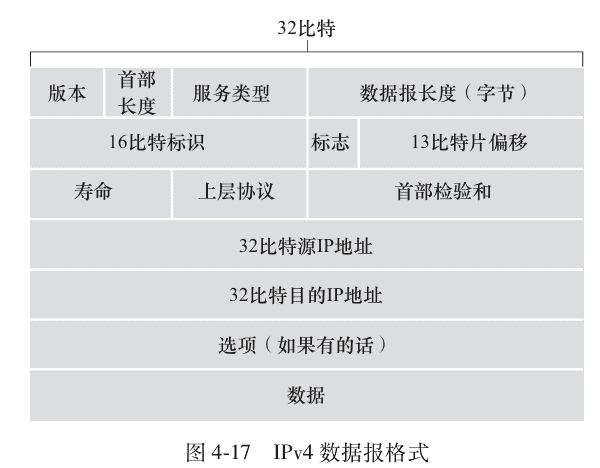

- 版本：4bit，用于确定IP协议的版本 (IPv4/IPv6)；

- 首部长度：由于IP首部的“选项”字段是可选的，所以需要首部长度字段；

- 服务类型 (TOS)：区分不同类型的IP数据报 (实时 vs 非实时等)；

- 数据报长度：用于确定整个IP数据报的长度；

  > 注意TCP头部仅有首部长度字段 (RFC 793)；

- 标识，标志与偏移 $\to$ 分片机制有关 (IPv6不允许分片)；

  > 标识：是否属于同一个分组；标志：是否允许分片，后面是否还有分片；

- 寿命：数据报每经过一跳，寿命TTL--，TTL为0时该数据报被抛弃(并向源主机回传ICMP控制报文)；

- 上层协议：指明数据部分按哪个传输层协议解析，值6为TCP，值17为UDP，值1为ICMP，值89为OSPF等等；

- 首部检验和：用于检验IP首部是否出现bit差错，注意仅针对IP首部，而传输层协议的检验和是针对于整个传输层报文段；

- 后面两个就是源与目的的IP地址；

- (IPv6没有选项字段)；

如果没有选项字段，则IP首部为20字节，如果携带TCP报文段(也没有选项)，则报文段首部也为20字节，共40字节；

---

##### IPv4 Fragmentation

- IPv4头部中有一个Flags(标志) 字段；共 3 个bit：
  1. Bit 0： 保留位(Reserved)，为 0；
  2. Bit 1：DF (Don't Fragment) 位；
  3. Bit 2：MF (More Fragments) 位(表示后面还有分片)；

- 当一个 IP 数据包到达某台路由器时，路由器需要将该包转发到下一跳链路；

  - 此时，路由器会对比数据包的总长度与输出接口的 MTU；

  - 如果 数据包长度 $>$ 接口MTU，路由器会读取该包报头中的 DF 位：

1. DF = 0 (允许分片)

- 路由器将该大包切割成多个满足 MTU 限制的小分片，并为每个分片复制报头、修改 Fragment Offset(片偏移)和 MF 位，然后转发出去；

2. DF = 1 (禁止分片)

- 路由器执行：
  1. 丢弃该包；
  2. 向该包的源 IP 地址发送一个 ICMP 差错报文(Type 3, Code 4 需要分片但设置了DF位)；
  3. 在该 ICMP 报文中，路由器会附带当前输出接口的 MTU 值；

> 但是现代网络抛弃了路由器分片机制(IPv4的DF位默认为1)； IPv6 中直接禁止路由器分片，只允许端到端分片；
>
> 现代网络依赖一种机制：**路径 MTU 发现**(PMTUD, Path MTU Discovery)；
>
> - 如果路由器发现数据包长度 $>$ 接口MTU，就丢包(因为DF=1)并返回上述的 ICMP Type 3, Code 4 报文；
> - 源收到该ICMP报文，悉知其附带的Next-Hop MTU，其网络栈会修改该连接的 MSS；
> - 此后 TCP 就会将按照该MSS切割上层报文；

---

##### IPv4 Addressing

- IPv4地址： 4 字节点分十进制 (`X.X.X.X`) ，每段范围 $[0, 255]$，无前导零，仅含数字；

  - IPv4地址标识的是物理接口而不是设备；

- IPv4地址分配：无类别域间路由选择 CIDR
  - 用物理链路相连 / 无线接入点互联 的接口构成一个子网；
  - 子网地址a.b.c.d/x 的前 x bit称为该地址的网络部分或前缀，/x 称为子网掩码；
  
  > 子网掩码从最左边向右延伸，越大地址数越少，不要搞反了；
  
- IPv4寻址：
  - 路由聚合：例如子网 $192.168.2.0/24$ 与 $192.168.3.0/24$ 可聚合为 $192.168.0.0/22$；减少转发表的长度；
  - 最长前缀匹配：有子网越过聚合网关直接与上层网关相连时，或是子网同时接入多个网关时；
  
- 路由器转发动作：将目的地址与掩码按位与，结果与子网地址相同则转发；
  - 0.0.0.0/0 表示默认路由，因为任何地址与0按位与结果都是0，必然与默认路由匹配；
  
- 特殊IPv4地址：见 [Appendix B](#Appendix B)；

---

##### Dynamic Host Configuration Protocol (DHCP)

1. DHCP Discover:

   客户端产生**DHCP发现报文**，然后封装上UDP首部 (源端口68、目的端口67)，再封装IP首部 (广播目的地址255.255.255.255、源地址0.0.0.0)，再交给链路层，链路层将该帧广播到所有相连节点；

2. DHCP Offer：

   DHCP服务器收到DHCP发现报文时，用**DHCP提供报文**进行响应；

   将事务ID，分配的IP地址，地址租用期等等广播到地址255.255.255.255；

3. DHCP Request：

   客户可能收到多个DHCP Offer，选择第一个，发送**DHCP请求报文**进行响应(带有事务ID，MAC地址等以区分)，注意此时仍是广播目的地址255.255.255.255、源地址0.0.0.0；

   服务器发现不是响应自己就回收分配的IP地址；

4. DHCP ACK：

   服务器用**DHCP ACK**确认DHCP请求报文；客户端收到ACK，就可以正式开始使用得到的IP地址了；

> - 4次交互过程可简记为：发现 $\to$ 提供 $\to$ 请求 $\to$ 确定；
> - 采用4次交互的原因：避免多DHCP服务器冲突 与 IP地址分配冲突；

---

##### Network Address Translation (NAT)

- 出站 (Outbound):
  
  - 网络层：替换源IP为唯一公网IP $\to$ 重新计算IP校验和；
  - 传输层：替换源端口号 $\to$ 重新计算传输层校验和；
  
  > 回顾：传输层校验和针对整个报文段；IP校验和只针对IP首部；

- 入站 (Inbound): 根据记录好的映射表，将公网发来的回包转发回对应的私有 IP；

  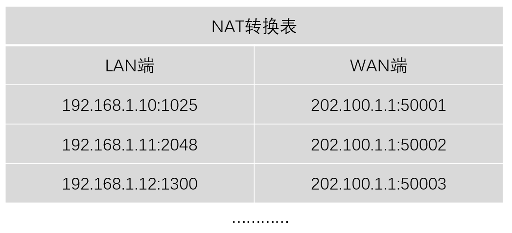

- 中间盒设备：工作在网络层，但是不同于路由器执行传统的数据报转发，而是执行NAT、流量流的负载均衡、防火墙等等功能；

---

**End of 3.2.**

#### 3.3. IPv6

##### IPv6 Datagram Format

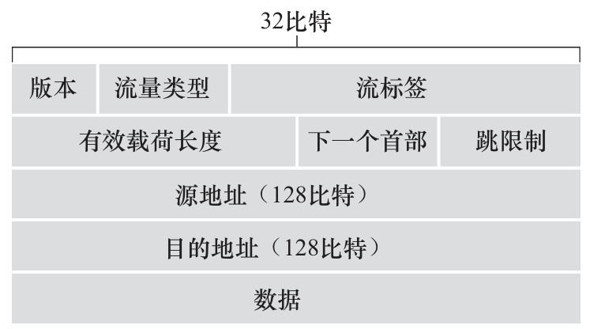

- 首部为定长的40字节；
- 流量类型：对应IPv4头部中的服务类型字段；
- 流标签：发送方随机生成的20位数值，用于标识一个特定的“流” (Flow)；
  - 流通常指从特定源地址到特定目的地址、具有相同传输层端口号的一串连续报文 (即五元组：源 IP、目的 IP、源端口、目的端口、传输层协议)；
- 有效载荷长度：标识了数据字段的大小；
- 下一个首部：指明数据部分按哪个传输层协议解析，与IPv4的上层协议字段值相同；
- 跳限制；
- IPv6的地址长度拓展为128bit；且除了单播与多播地址，还引入了任播地址(任意交付给一个)；

> IPv6禁止路由器的分片行为，只允许端到端分片；

---

##### From IPv4 to IPv6

- 采用隧道技术 (Tunneling Technology)；

- 隧道技术中，原始数据包(包括原始协议头)会被视为**净荷(Payload)**，再次包裹上一个新的隧道网络报头；

  - IPv6-in-IPv4 隧道中，外层IPv4头部的上层协议字段值为41；隧道出口处路由器可根据该值获悉这是一个隧道包 (中间路由器不感知)；

- 运载协议头会带来开销 $\to$ 隧道设备会拦截SYN报文段，缩小其中的MSS (见2.4.)；

---

**End of 3.3.**

### 4. The Network Layer — Control Plane

#### 4.1. Routing Algorithms

- 要求正确性、简单性、健壮性(鲁棒性 / Robustness)；
- 最终得到每个节点的汇集树 (Sink Tree)：以该节点为根，其它所有节点到该目的节点的最短路径的集合；

---

##### Classification Method

- 分类方式1：集中式 or 分布式；

  1. 集中式路由选择算法：算法拥有全局状态信息，因此也称作 **Link-State 算法**；

  2. 分散式路由选择算法：每个节点只维护与其直接相连链路的开销，通过迭代、分布式的计算方式得到最短路径；

     典型的分散式路由选择算法：**Distance-Vector 算法**；

- 分类方式2：静态 or 动态；

  1. 静态路由选择算法：路由随时间变化非常缓慢；
  2. 动态路由选择算法：随着网络流量负载或拓扑发生变化而改变路由选择路径；

- 分类方式3：负载敏感 or 负载迟钝；

  1. 负载敏感算法：链路开销会动态地变化以反映出底层链路的当前拥塞水平；早期算法采用，问题也较多；
  2. 负载迟钝算法：某条链路的开销不明确地反映其当前的拥塞水平；当今路由算法(OSPF / BGP)采用；

> 注：路由表三个表项：目的节点、总开销、下一跳；

----

##### The Link-State (LS) Routing Algorithm

1. 节点获取全局网络拓扑

   - 采用链路状态广播 (link state broadcast) 算法，每个节点都洪泛(flooding)其链路状态分组 (link-state packets)；

     > 而DV算法中节点仅向物理邻居发送路由表；

2. 所有节点得到一致的全局拓扑后 $\to$ 两种LS算法：Dijkstra算法 or Prim算法；

- 当边代价代表该链路拥塞程度时，可能出现的问题：路由震荡；
  1. 链路 A 拥塞 $\rightarrow$ 代价变高；
  2. 路由算法将所有流量切换到链路 B；
  3. 链路 A 变空闲(代价变低)，链路 B 变拥塞(代价变高)；
  4. 路由算法又把流量切回 A；
  5. .... 循环；

---

##### The Distance-Vector (DV) Routing Algorithm

- 特点：迭代、异步、分布式、自我终止；

- 节点向所有物理邻居发送本地路由表 (不包含路径信息)，同时根据邻居路由表更新本地路由表；

- 核心更新逻辑：Bellman-Ford 方程
  $$
  d_x(y) = \min_{v} \{ c(x,v) + d_v(y) \}
  $$
  $x$ 是源节点，$y$ 是目的节点， $v$ 是 $x$ 的任一邻居节点，$c(x,v)$ 为链路代价；

- 无穷大问题：邻居短路径可能包含节点本身，由此引发路由选择环路，缓解方法为 毒性逆转 等；

- 此后 本地路由表变化时 / 周期性地 向邻居发送路由表，最终网络中无路由表交换 (网络拓扑不变的话)，所有表稳定，算法自我终止；

---

**End of 4.1.**

#### 4.2. Intra-AS Routing in the Internet: OSPF

- 自治系统 (Autonomous System, AS)：指拥有统一路由策略的、由巨大网络和路由器组成的集合；
  - 唯一的 ASN (自治系统编号)；
  - CIDR化的 IP 路由前缀；
- OSPF (Open Shortest Path First，开放式最短路径优先) 是最主流的内部网关协议 (IGP) 之一；

---

##### OSPF

- 链路状态路由协议；

  - 还解决了传统距离矢量协议 (如RIP) 收敛慢、易环路、无法适应大规模网络等问题；

- 工作原理：三大核心组件

  1. 邻居表：记录已建立邻居关系的路由器；定期发送Hello报文来维系；
  2. 链路状态数据库 (LSDB)：所有路由器会生成链路状态宣告 (LSA，描述自己的接口状态和开销)，并泛洪到整个区域；最终同一区域内的所有路由器会拥有相同的 LSDB (完整的网络拓扑图)；
  3. 路由表：路由器以自己为根运行最短路径优先算法 (SPF，基于Dijkstra)，计算到达每个网段的最短路径，并交给本地的全局路由表；

  > 为什么需要全局路由表？因为路由信息不止OSPF产生，可能还会来自于网络管理员静态配置等等；

- **OSPF 封装在 IP 协议之上**，协议号为89 (所以有LSAck报文确保OSPF传输的可靠性，因为不基于TCP)；

- 区域 (Area)：用于减少SPF计算开销和LSDB数据量；

  - 骨干区域 (Area 0)：必须存在且唯一；与所有非骨干区域相连；
  - 1类和2类LSA只在区域内泛洪；跨区域时，区域边界路由器会将其转化为3类LSA；

- 特点：

  - 每台 Router 的ID唯一；
  - 所有OSPF报文必须认证 (安全性)；

---

**End of 4.2.**

#### 4.3. Routing Among the ISPs: BGP

- 边界网关协议 (BGP)
  - 路径矢量协议 (非距离矢量)：将整个AS视作黑盒，路由信息为该路由穿过的AS路径序列 (解决环路问题)；

- BGP实际是将分组路由到CIDR化的前缀(子网)；

- BGP的两个功能：
  1. 确保每个AS都知道所有子网；
  2. 能得到达到每个子网的最佳路由选择；

------

##### BGP Route Advertisement Mechanism

- 路由器角色：

  - 网关路由器 (Gateway Router)： 位于 AS 边缘，与相邻 AS 的路由器物理相连；
  - 内部路由器 (Internal Router)： 仅在本 AS 内部进行交换；

  > [!WARNING]
  >
  > - 应试理想模型：默认AS内所有路由器都是BGP路由器，都缓存公网路由表副本；
  >
  >   所以内部路由器向外网发包时，会先查BGP表，拿到出口网关IP，再查IGP表 (RIP/OSPF)，拿到去往网关的下一跳；
  >
  > - 实际工程架构：现代网络中，内部路由器一般不需要运行BGP，而是通过 MPLS (多协议标签交换) 来承载BGP流量，或者通过0.0.0.0/0来指向默认网关；

- BGP 会话：

  - BGP路由器通过 TCP port 179 交换BGP报文(包括路由信息)，TCP 保证了路由通告的可靠性：

  - eBGP (External BGP)： 跨越 AS 边界的会话；

  - iBGP (Internal BGP)： 同一 AS 内部的会话；(同AS内的不同网关之间也是iBGP)

- 路由信息通告逻辑：

  1. 当AS获知一个新子网时，其网关会通过eBGP向相邻AS发送通告；

  2. 网关收到 eBGP 报文后，会将该路径信息通过 iBGP 告知 AS 内部所有BGP路由器；

     *补充*：iBGP 并非简单的泛洪，通常要求 AS 内所有 BGP 路由器建立逻辑上的全连接 (Full-mesh)，以确保路由信息的一致性；

  3. 其他BGP路由器得知路径后，会继续向其相连的其他 AS 网关通过 eBGP 扩散该路由；

     *补充*：这种扩散受到策略 (Policy) 的控制 (e.g. AS 可能不想为某个邻居充当流量中转站)；

- 路径矢量 (Path Vector) 协议特性：

  1. 路径属性 (Path Attributes)：

     BGP 通告的不仅是目的地，还附带了属性：

     - AS-PATH： 路由经过的所有 AS 编号列表；

     - NEXT-HOP： 到达目的地应发往的下一个特定网关的 IP；

  2. 与 DV 算法的区别：

     - 防环路 (Loop Prevention)： BGP 路由器如果发现 AS-PATH 中包含自己的 AS 号，会直接丢弃该路由；

     - 策略选路： BGP 选路除了代价考量，更多是基于商业协议或管理策略 (e.g. 优先走免费的路径而非付费的路径)；

---

##### Determine the best route 

- 前面说过，BGP通告包括目的地前缀，AS-PATH，NEXT-HOP；

1. 路由器还会被指派一个本地偏好，最高本地偏好的路由将被筛选；
2. 筛选出的路由中，最短AS-PATH的路由将被进一步筛选；
3. 余下的路由中，采用热土豆路由进行选择 (让分组尽量快得离开本AS，而不关心AS间路由代价)；
4. 如果还有多条路由，则使用BGP标识符进行选择；

> “选择”具体是指每接收到一个路由选择就与原有路由选择进行比对，更优则更新，否则丢弃；

---

**End of 4.3.**

#### 4.4. The SDN Control Plane

##### SDN Controller

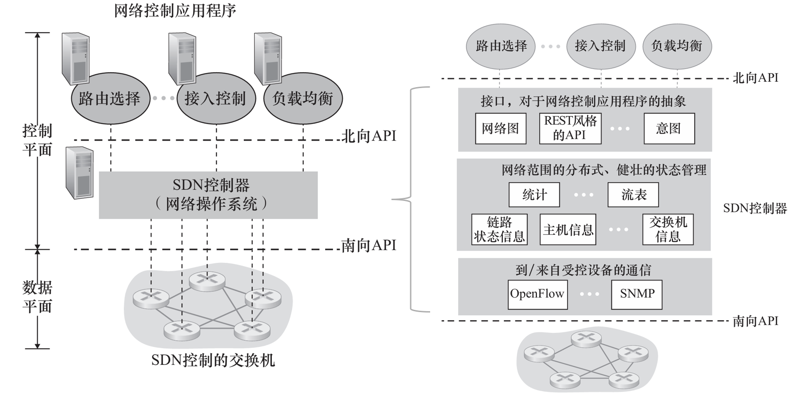

- SDN控制平面分为 SDN控制器(网络操作系统) 和 SDN网络控制应用程序；

  - 控制器通过北向API为控制应用提供网络视图，通过南向API来操纵交换机流表；

- SDN控制器又分为：

  - 上层接口：采用北向API沟通网络控制应用和网络范围状态管理器；

  - 中间为网络范围状态管理层：维护网络拓扑，为网络控制应用提供必要信息，并接受控制应用的策略转为具体流表(通过北向API)；

  - 下层为通信层：下发流表给网络交换机，回传网络交换机产生的网络状态信息(通过南向API)；

---

##### OpenFlow

- 运行在TCP之上，默认port 6653；
- 实现了网络设备控制平面与数据平面的分离：
  - SDN 控制器利用 OpenFlow 协议，向底层的南向网络设备直接下发、修改或删除流表；
  - 传统的分布式路由协议 (如 OSPF、BGP) 在单个设备上被停用；网络设备成为纯白盒的转发实体，完全听从 OpenFlow 传达的控制器最高指令；
  - 允许控制器实时收集底层硬件的流量统计数据和拓扑状态变化，从而让控制平面能够基于全网全局视角计算出最优的数据路由与控制策略；

---

**End of 4.4.**

#### 4.5. The Internet Control Message Protocol (ICMP)

- IP 协议缺乏差错报告和控制机制；当网络出现故障或需要诊断时，使用 ICMP 来进行通信；

- ICMP 报文主要用于以下两类任务：

  - **差错报告**：当路由器或主机在处理 IP 数据报发现错误时 (如TTL耗尽)，会向源主机发送 ICMP 报文；

  - **网络探测**：探测网络状态，如测试目标是否在线或测量往返时间；

---

#####  ICMP Message Format

- ICMP 是网络层协议，其报文封装在 IP 数据报 的数据部分中(上层协议字段为1)；包含以下字段：

  - 类型 (Type)：报文的大类；

  - 编码 (Code)：在类型基础上进一步细化原因；

  - 校验和 (Checksum)：用于检测报文在传输过程中是否损坏；
  - 引起该ICMP报文首次生成 的 IP数据报的首部 和 前8个字节 (以便发送方能确定引发该差错的数据报)；
- 常见的 ICMP Type & Code：

  - Type 0 Code 0：Ping的回送应答；

  - Type 3 Code 4：需要分片但设置了 DF 标志；
  - Type 11 Code 0：TTL耗尽；

---

**End of 4.5.**

## Part Three: Data Link Layer & Wireless Networks

### 5. Data Link Layer and LANs

- 链路层：在相同链路或局域网之间更局域化地移动分组；

#### 5.1. Error-Detection and -Correction Techniques

- 情形设定：
  - 发送方欲发送数据 $D$，包括网络层数据报及链路层帧首部；
  - 发送方使用差错检测和纠正比特 (Error-Detection and-Correction, EDC)来保护 $D$；

---

##### Parity Checks

- 单奇偶校验：为 $d$ 位数据添加一个额外bit位(称为奇偶校验位 parity bit)，使得这 $d+1$ 中比特1个数为偶数；接收方发现1个数是奇数说明出错了(也可以反着来)；
  - 多bit翻转时检测效果不佳；
- 二维奇偶校验：将数据分成多行多列，每一行每一列都予以一个奇偶校验比特；
  - 单bit翻转时不仅能检测到，还能定位到具体的行和列 (可纠错)；
  - 同行或者同列多bit翻转，虽能检测出差错，却不能纠正；
  - 比特翻转不在同行同列且恰好对偶，就检测不出来了；

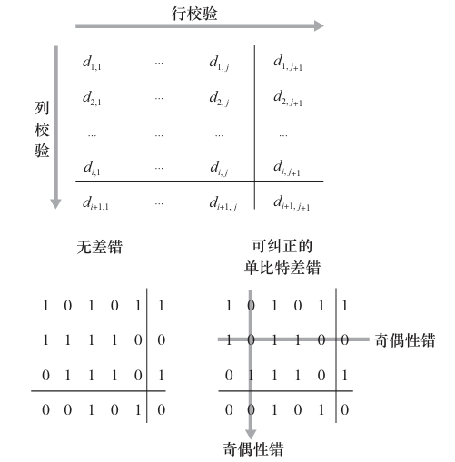

---

##### Checksum

> 传输层协议常用 (TCP / UDP)；

- 将数据 $D$ (共 $d$ 位bit) 视为一系列 $k$ 比特的整数序列，并将这些整数相加；

- 检测逻辑：(以因特网检验和为例) 

  将数据的字节作为16比特的整数进行求和，取其反码作为检验和存放在报文首部；

  接收方对包括检验和在内的所有接收数据求和并取反，如果结果全是 1，则认为没有差错；若出现 0，则说明存在错误；

- 易通过软件高效实现，但是保护效果较弱；

---

##### Cyclic Redundancy Check (CRC)

> 循环冗余校验，原理暂未搞懂....

Example: 设待保护数据为 00101001，约定的生成多项式 $X^3+X^2+1$；

1. 展开多项式得到二进制CRC除数：多项式为 $R=3$ 阶，展开得到除数为 1101；

2. 补零：在数据后补 $R$ 个零：00101001000；

3. 模2除法计算余数：

   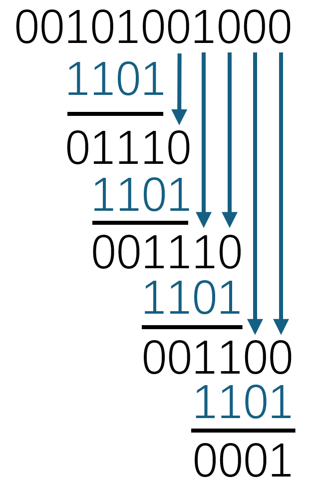.

   - 待保护数据的前导零不用管；
   - 下放几位数是看结果前面有几个零；
   - 计算终点：结果有效位数少于除数时；

4. 得到 $R$ 位结果：001 (补零或减零)；

5. 将结果拼接到待保护数据后，就是最终发送的数据：00101001001；

> 关于第3步中计算终点的提醒：
>
> 假设CRC除数有4位，某次结果为0001，应下放被除数后续的3个数字；
>
> 若此时被除数仅有两个数字可被下放，比如10，那么结果直接就是110；
>
> 被除数末尾的那两个数字不用异或处理，因为结果有效位少于CRC除数，计算终止；

---

**End of 5.1.**

#### 5.2. Multiple Access Links and Protocols

- 广播链路由多个发送方和接受方共享：任何节点传输一个帧，信道将广播该帧，使得所有其它节点收到一个副本；
- 多个节点同时传输帧时将发生**碰撞**，导致碰撞帧全部丢失，碰撞时间内广播信道被浪费；
- 因此需要多路访问协议 (Multiple Access Protocol)；

---

##### Channel Partitioning Protocol 

- 信道划分协议

1. 时分多路复用 TDM

   将时间划分为时间帧，并进一步将每个时间帧划分为 $N$ 个时隙 ($N$ 为节点数)；

   通常要求每个时隙能完整传输一个链路层帧；

   每个节点只在属于自己的时隙传输数据；

2. 频分多路复用 FDM

   将信道划分为 $N$ 个不同的频段；

   注意每个频段带宽仍然只有 $R/N$ bps (涉及通信知识)；

3. 码分多址 CDMA

   主要用于无线信道；特点为即使多个节点同时发送数据也不会发生碰撞；

---

##### Random Access Protocol 

- 随机接入协议

1. 时隙 ALOHA 协议

   时间直接被划分为时隙 (每个时隙能完整传输一个链路层帧)，节点只在时隙开始时传输帧；

   发生碰撞时，节点将以概率 $p$ 在后续每个时隙尝试重传，直到成功；

2. ALOHA 协议

   不再划分时间，节点想传就传；

   发生碰撞后，节点将以概率 $p$ 在传输完当前帧后尝试重传，直到成功；

3. 载波侦听多路访问 (Carrier Sense Multiple Access, CSMA)

   节点只有在侦听到信道一段时间没有传输时，才传输自己的数据；

   仍可能发生碰撞 $\to$ 取决于端到端信道传播时延；

4. 具有碰撞检测的载波侦听多路访问 CSMA/CD (Collision Detection)

   基于CSMA；

   当节点侦听到信道空闲时便开始传输，如果传输时检测到了碰撞则立即停止传输 (与ALOHA的区别)；

   中止传输后，节点等待一个随机时间量，然后继续侦听信道；

   $\to$ 如何选择这个随机时间量？以太网使用二进制指数后退算法；

> 注：二进制指数后退算法
>
> - 当一个帧经历 $n$ 次碰撞后，节点会从集合 $\{0, 1, 2, \dots, 2^n - 1\}$ 中随机选一个整数 $K$；
>
>   当 $n\ge10$ 时，$K$ 上限只能到 $2^{10}-1$ 即 $1023$； 而当 $n=16$ 时，此次传输会被放弃；
>
> - 等待时间 = $K \times 512$ 比特时间
>
>   512比特时间是以太网的一个基本单位 (Slot Time)；例如在标准以太网(10Base-T)中是 $51.2\mu s$；
>
> - 每次准备传输新帧时，都要重新运行 CSMA/CD；这意味着算法不考虑过去发生的碰撞；

---

##### Taking-Turns Protocol 

- 轮流协议

1. 轮询协议 polling protocol

   主节点轮流通知节点可以发数据了，最多发几帧；

   主节点检测到信道空闲后 (上个节点发完了或者没发)，就通知下一个；

   - 优点：无碰撞，效率高；

   - 缺点：中心化 (主节点瘫痪 $\to$ 整个网络瘫痪)，有轮询时延 (节点想要发数据得等待主节点的通知)；

   蓝牙 (Bluetooth) 协议就是轮询协议，如手机作为主节点轮训蓝牙耳机，手表等；

2. 令牌传递协议 token-passing protocol

   简单来讲，节点将轮流持有一个被称为令牌 (token) 的特殊帧；

   节点只有在持有token的时候才能使用信道，使用完毕后传递token；

---

**End of 5.2.**

#### 5.3. Switched Local Area Networks

##### Link-Layer Addressing and ARP

1. MAC地址

   也称为 LAN 地址或物理地址，6字节；

   - 适配器 (网络接口) 具有MAC地址，所以同一个主机 / 路由器可以带有多个MAC地址；

   - 链路层交换机并不具备MAC地址；
   - 协议设计中，MAC地址是全局唯一的、扁平的 (不具备层级结构)、固定的；
   - 特殊MAC地址：全1广播地址：FF-FF-FF-FF-FF-FF；

2. 地址解析协议 (Address Resolution Protocol, ARP)

   每台主机或者路由器都维护一张ARP表，记录IP地址与MAC地址的映射对，并带有TTL (一般为20min)；

   - 如果ARP缓存命中，则直接封装成帧发送；
   - 若未命中，则构造**ARP请求报文** (不要与应用层报文混淆)，带有信息源IP、目的IP和源MAC，然后被封装到链路层帧中，目标MAC地址为全1广播地址；匹配的目的主机回发**ARP响应报文**；

> 所以在跨子网传输时，MAC地址将被不断重写；

---

##### Ethernet

- 以太网：主流的有线局域网；

  - 无连接，发送方网络适配器封装成帧后直接发送，没有预先握手；

  - 不可靠，CRC校验不通过直接丢弃，重传是TCP的事；
- 早期以太网：同轴电缆 + 转发器 (类似红石中继器) + CSMA/CD协议 $\to$ 所有节点共享信道；

- 基于交换机的现代以太网：MAC地址表定向转发 + 交换机输出缓存 + 全双工通信 $\to$ 星形拓扑，碰撞几乎消失 $\to$ CSMA/CD协议几乎不用；

1. 以太网帧结构

   ；

   - 数据：承载上层协议分组 (如IP数据报)；
     - 以太网MTU为1500字节 $\to$ IP数据报超过1500字节就要分片；
     - 最小为46字节 $\to$ IP数据报小于46字节就要填充 (使用IP首部中的长度字段标识)；

   - 目的地址：即目的MAC地址 (包括全1广播MAC地址)；

   - 源地址：源MAC地址；

   - 类型：指示上层协议 (比如数据字段为ARP报文时，类型字段为0806)；

   - CRC纠错码；

   - 前同步码 (8字节)：前7字节都是10101010，最后一个字节是10101011；

2. 链路层交换机 (不具备MAC地址)

- 过滤和转发

  依托于交换机表 (表项为 [MAC地址 - 接口 - 已放置时间] )，但是与路由器转发行为不完全一致：

  - 如果帧的目的MAC地址对应的接口和帧到达的接口一致，交换机丢弃丢弃该帧 (过滤)；

  - 交换机表没有与帧目的MAC地址匹配的表项，则广播该帧；

  - 有对应表项且到达接口和输出接口不一致，将帧放入对应接口的输出缓存 (正常转发)；

- 自学习

  - 交换机表初始为空；
  - 核心原理：交换机会记录每个入帧的 [源MAC，它的到达接口]；
  - 两个保障：1. 老化机制：寿命耗尽的表项会被删除；2. 覆盖机制：源MAC相同但达到端口不同的新表项会覆盖旧表项；

- 全双工：交换机的接口能同时接受和发送；

---

**End of 5.3.**

#### 5.4. Virtual Local Area Networks (VLANs)

- 经交换机组织的交换局域网具有3个缺点：
  1. 缺乏流量隔离；
  2. 硬件资源的浪费；
  3. 用户管理困难；

- 故一般采用支持虚拟局域网 (VLAN) 的交换机；

---

##### Port Based VLAN

- VLAN允许网络管理员在单一的物理交换机上定义多个逻辑上的虚拟局域网；交换机内部维护一张“端口到VLAN”的映射表；

  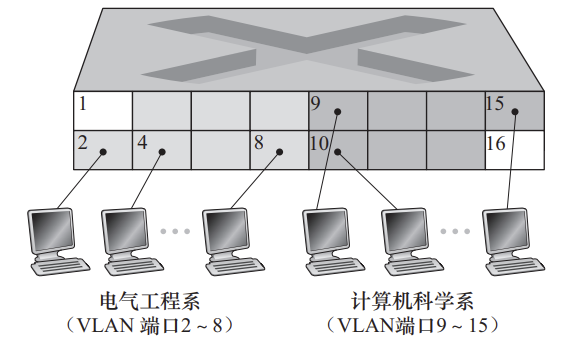

  - 端口 2~8 划分给电气工程系；端口 9~15 划分给计算机科学系；端口 1 和 16 暂未分配；
  - 在同一个 VLAN 内的主机可以正常通信，而不同 VLAN 之间在二层 (数据链路层) 是完全隔离的，仿佛连接在不同的独立交换机上一样；
  - 每个 VLAN 形成一个独立的广播域；即一个端口产生的广播流量，只能到达同一个 VLAN 内的其他端口；

- 不同VLAN如何通信 $\to$ 路由器转发；不过现代做法是将 VLAN 交换机和路由器功能集成在单一设备中；

---

##### VLAN Trunking

- 使用多台支持VLAN的交换机定义多个虚拟局域网；(原因：物理距离限制等等)

> 多交换机互联瓶颈：
>
> - 假设两台交换机，都有EE VLAN和CS VLAN，只能在每台交换机上为每个 VLAN 单独拿出一个端口，用一根网线一一对应地连接起来；
>
> 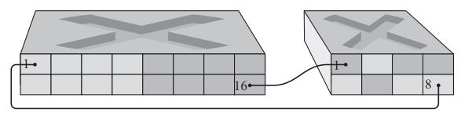
>
> - 但是这种做法不具备好的可拓展性，试想交换机和VLAN数量都很多，每台交换机上的VLAN数量各不相同，最终布线将极其繁琐；

- 干线连接：

  - 每台交换机都配置一个特殊的Trunk端口，这个端口属于这个交换机上的所有VLAN；

  - 新问题：交换机如何得知来自Trunk端口的分组属于哪个VLAN？

    $\to$ 使用VLAN tag

    出Trunk口时，交换机插入4 字节的 VLAN 标签 (VID 占 12 bit，最多支持 4096 个 VLAN)；

    交换机接受到来自Trunk端口的帧后，解析并剥离tag，再发往对应的VLAN；

  > 比如广播帧只在对应VLAN中广播，不区分VLAN的话，也就没法做到定向广播；

---

##### MAC Based VLAN

- 在上述基于端口的VLAN中，交换机只看流量来自于哪个端口和该端口所在的VLAN；
- 但在基于MAC的VLAN中，设备网卡MAC地址和对应的VLAN绑定，交换机维护了MAC和VLAN的映射表；
  - 好处是设备怎么更换物理位置都不会改变其所在的VLAN；
  - 坏处是需要人工配置新设备的MAC，移动设备的随机MAC技术也有悖于该设计；

---

**End  of 5.4.**

### 6. Wireless and Mobile Networks

#### 6.1. WiFi: IEEE 802.11 Wireless LANs

##### The 802.11 Wireless LAN Architecture

- 基本构件：

  - BSS (Basic Service Set)：无线局域网的最小构建模块，包含若干无线站点(主机) 与 一个中央基站 (接入点，AP，Access Point)；
  - 基础设施无线局域网：指带有 AP、并且 AP 连接到有线主干网络 (通过交换机 / 路由器) 的常规 WiFi 组网模式；
  - 自组织网络：没有AP，无线站点之间直接发现并动态组网，直接通信；无法连接外部因特网；
  - MAC地址：无线站点和AP的无线接口也拥有全球唯一的MAC地址；

-  信道分配与 WiFi 丛林：

  - 802.11 运行在 $2.4\text{GHz} \sim 2.485\text{GHz}$ 频段，共划分出 11 个部分重叠的信道；
  - WiFi 丛林：指某个物理位置能同时接收到多个 AP 强信号的现象；

- 发现与关联机制：主机在发送网络层数据前，必须先与某个特定的 AP 建立关联；AP 会周期性广播包含其 SSID (WiFi名)和 MAC地址 的信标帧 (Beacon Frame)；

  1. 被动扫描：AP 周期性广播信标帧 $\to$ 主机扫描 11 个信道，被动监听这些信标，并选择一个 AP 发送**关联请求帧** $\to$ AP 回应**关联响应帧**；
  2. 主动扫描：主机主动广播**探测请求帧** $\to$ 所有收到请求的 AP 回应**探测响应帧** $\to$ 主机选择一个 AP 发送**关联请求帧** $\to$ AP 回应**关联响应帧**；

  关联成功后就是正常的DHCP流程；

---

##### The 802.11 MAC Protocol

- 无线共享信道相较于有线共享信道：

  - 硬件难以全双工检测：无线适配器发送信号的强度远大于其接收信号的强度；网卡难以在强功率发射的同时检测微弱的碰撞信号；
  - 隐蔽终端问题：多个无线站点可能访问同一个AP，但是彼此却不感知 $\to$ 在该AP处发生碰撞；
  - 发生比特级差错的概率高；

  $\to$ 所以 WiFi 采用 CSMA/CA(碰撞避免) +  RTS / CTS (预约信道) + ACK (链路层确认)；

- CSMA/CA +  RTS / CTS + ACK：

  - 节点在发送数据前会侦听信道：

    $\to$ 信道空闲且持续 DIFS (分布式帧间间隔) $\to$ 直接发送数据；

    $\to$ 信道忙，节点选取一个随机回退值 (倒计时器)；

    该计数器仅在信道空闲 / NAV为0时才递减；信道忙或者正值NAV倒计时，计时器会冻结；

    计数器递减到 0 时，节点发送数据并等待 ACK；若没收到 ACK，则扩大随机范围，重新退避；

  - 节点准备发送数据：

    先向 AP 发送 RTS 帧，告知将占用的时间；

    AP 收到 RTS 后，等待 SIFS (短帧间间隔) 后广播一个 CTS 帧进行回应；节点收到该CTS，同样等待 SIFS 后才开始传输；

    同时隐蔽节点也会收到该广播 CTS，读取其中的持续时间，设置一个网络分配向量 NAV，并在这段时间中抑制自身发送；

    > 值得注意的是：通常只在传输体积较大的数据帧时才启动 RTS/CTS 序列，短数据帧会直接跳过预约，使用基础的 CSMA/CA；

  - AP接受完整数据，若CRC校验通过，则同样在等待一个SIFS后回复ACK；

- 完整时间线：节点侦听到信道DIFS内均空闲 / 计数器递减到0，发送RTS $\to$ AP收到RTS，等待SIFS，广播CTS $\to$ 节点收到CTS，等待SIFS，开始发送数据 $\to$ AP完整接受数据，等待SIFS，回复ACK；

  - 所以收到CTS的隐蔽节点的NAV $=SIFS+T_{DATA}+SIFS+T_{ACK}$；
  - 而收到RTS的节点的NAV = $SIFS+T_{CTS}+SIFS+T_{DATA}+SIFS+T_{ACK}$；

---

##### Other Notes

1. IEEE 802.11帧中的4个地址：

   - 地址1、2分别为下一跳MAC，本跳MAC；

   - 未开启AP无线中继时 (AP转发的帧的从AP和到AP字段不全为1)，地址3用于保存最终目的 / 源MAC；

   - 开启AP无线中继 / Mesh组网时 (AP转发的帧从AP和到AP全为1)，地址3、4分别为最终目的MAC和最终源MAC；

2. 如果交换机连接两个AP，那么就是相同子网；设备从一个BSS移动到另一个BSS时，新的被接入AP需要向交换机通告，交换机会重新学习目的MAC与端口的映射；

3. 蓝牙：需要一个主设备，采用轮询协议；蓝牙网络的建立分为查询和寻呼两个独立阶段；

---

**End of 6.1.**

#### 6.2. Cellular Networks: 4G and 5G

## Part Four: Physical Layer & Network Security

### 7. Physical Layer

- 物理层屏蔽掉了各种传输媒体和通信手段的差异，为其上面的数据链路层提供透明的传输比特流的服务；
- 物理层接口规程定义的四种特性：
  1. 机械特性：接线器的几何规格、引脚数目、排列形状、尺寸 (如 RJ-45 水晶头)；
  2. 电气特性：线路上信号电平范围、输入输出阻抗匹配、传输速率极限；
  3. 功能特性：某根引线上出现某一电平的物理意义(如哪根线是数据线、控制线、地线)；
  4. 规程特性 (过程特性)：不同功能引线进行信号交互的时序、工作状态转换逻辑与操作顺序；

#### 7.1. Transmission Media

- 传输媒体在物理层之下，**不属于**计算机网络体系结构；物理层规定了电气、机械等接口特性，传输媒体只是具体的物理载体；
- 传输媒体 $\neq$ 信道，传输媒体可能包含多条信道，比如光纤 + 波分复用可分出多条信道；

##### Guided Media

- 电磁波被导引在固体媒体中传播；

1. 双绞线：

   - 两根绝缘铜导线绞合 (减少电磁干扰)；
   - 分为无屏蔽双绞线 (UTP) 和 屏蔽双绞线 (STP)；
   - 常用于以太网；
   - 既可传输模拟信号，也可传输数字信号；

2. 同轴电缆：

   - 具有比双绞线更好的屏蔽特性，抗干扰能力强，传输距离更远，支持更高带宽；

   - 50Ω同轴电缆：用于基带传输 (数字传输)，曾广泛用于传统局域网；

   - 75Ω同轴电缆：用于宽带传输 (模拟传输)，常用于有线电视网；

3. 光纤

   - 利用光的全反射特性传输光脉冲；

   - 多模光纤：光源为发光二极管 (LED)；纤芯较粗；光在其中不断反射传播；存在色散，信号衰减较大；适用于近距离传输；
   - 单模光纤：光源为定向激光器 (Laser)；纤芯极细(直径只有一个光波长)；光沿直线传播无反射；衰耗极小；适用于远距离、大容量传输；

---

##### Unguided Media

- 即无线传输媒体，自由空间；

1. 无线电波：信号向所有方向传播 (全向性)，穿透能力强，常用于无线局域网 (WLAN) 和蜂窝移动通信；
2. 微波：信号沿直线传播 (定向性)，穿透能力差；分为：
   - 地面微波接力通信：需要在视线范围内有中继站；
   - 卫星通信：传播时延较大；
3. 红外线与激光：极强的定向性，需视线视距传播，不能穿透坚实的物体；

---

**End of 7.1.**

#### 7.2. Transmission Mode

##### Interaction between Two Communicating Sides

- 单工通信：
  - 只能单向传输，发送方只能发，接收方只能收；
  - 仅需 $1$ 条物理/逻辑信道；
- 半双工通信 (双向交替通信)：
  - 通信双方不能同时发送或接收；
  - 需 $2$ 条信道，同一时间仅激活一个；
  - **典型实例**：使用同轴电缆或集线器 (Hub) 连接的**CSMA/CD以太网**；
- 全双工通信 (双向同时通信)：
  - 通信双方可以同时发送和接收；
  - 需 $2$ 条独立的信道；
  - **典型实例**：**全双工以太网交换机**连接的网络；

---

##### Transmission Timing & Synchronization Mode

- 同步传输：
  - 以**数据块 / 帧**为单位连续传输；
  - 发送端和接收端必须保持时钟同步 (通过统一的时钟线或在数据流中嵌入自同步编码，如曼彻斯特编码)；
  - 每个数据块通常有特定的帧头 (同步序列) 和帧尾，但数据位之间没有间隔，传输效率高，适合远距离高速传输；
- 异步传输：
  - 以**字符**为单位独立传输，字符之间的间隔时间是任意的；
  - 每个字符独立加设 1 位起始位 (低电平)**、**数据位 (5~8位)**、**校验位 (可选)**、**停止位 (1/1.5/2位高电平)；
  - 对时钟精度要求低，但字符间附加的控制位比例较高 (开销大)，传输效率较低，适合低速通信；

---

##### Data Transfer Width

- 串行传输：
  - 数据在信道上按 bit 一位一位顺序传输；
  - 成本低，抗干扰能力强，适合远距离传输，常备网络通信采用；
- 并行传输：
  - 多条物理导线同一时刻传输多个比特；
  - 计算机内部总线 (PCI总线、早期的IDE硬盘接口)；
  - 短距离内速度快；但长距离各线路间的时延偏差和串扰严重，不适合远距离网络传输；
- 网卡 = MAC控制器 + PHY芯片；其中PHY芯片负责物理层数据的并 / 串转换；

---

##### Signal Bandwidth Occupancy Mode

- 基带传输：
  - 直接在信道上传输未经调制的数字基带信号(数字方波)；
  - 几乎所有局域网采用 (如以太网双绞线)；
  - 传输距离较短 (高频分量衰减快)；
- 频带传输 / 宽带传输：
  - 将数字基带信号进行**调制**，搬移到高频载波频段上传输 (模拟信号形式)；
  - 广域网传输、电话拨号调制解调器 (Modem)、无线通信 (Wi-Fi、蜂窝网络)；
  - 适合远距离传输，且支持频分复用 (FDM)；

---

**End of 7.2.**

#### 7.3. Encoding & Modulation

##### Basic Concepts

- 消息、数据与信号：

  - 消息 (Message)：需要传输和处理的内容 (图片、音视频...)；   

  - 数据 (Data)：运送消息的实体；   

  - 信号 (Signal)：数据的电磁表现形式 (网卡：数据 $\to$ 信号)； 

-  基带信号：

  - 信源发出的原始电信号，分为 模拟基带信号 和 数字基带信号；

  - 计网主要关注将计算机发出的数字基带信号通过编码和调制后在信道中进行传输；

- 码元：

  - 代表不同离散数值的基本波形；
  
  - 离散状态数为 $N$，则单个码元携带的信息量为 $\log_2 N$ bit (至少需要 $\log_2{N}$ 个 bit 来表示 $N$ 个离散状态)；
  
    $\implies$ $$\text{数据传输速率 (b/s)} = \text{码元传输速率 (Baud)} \times \log_2 N$$

---

##### Encoding Methods

- 数字基带信号 $\to$ 另一种数字基带信号 (用于数字信道)；

1. 不归零编码：
   - 正电平 bit $1$，负电平 bit $0$；
   - "不归零" $\to$ 整个码元时间内不出现零电平；
   - **不具备自同步能力**，需要额外时钟线，但是编码效率最高；
2. 归零编码：
   - 码元中间时刻必定回归到零电平 (正电平归零为 $1$，负电平归零为 $0$)；
   - 具备自同步能力 (归零时刻采样)；
   - 编码效率低，大多数带宽在传输零；
3. Manchester 编码：
   - 码元中间时刻发生电平跳变：跳变方向既表示时钟信号，又表示数据；
   - 传统以太网 ($10$ Mb/s) 采用；
4. 差分 Manchester 编码：
   - 码元中间电平必然跳变，但仅作为时钟信号，不代表数据；
   - 数据由码元起始边界是否有跳变决定：无跳变表示 $1$，有跳变表示 $0$；
   - 遇到大量连续 $1$ 或 $0$ 时，信号变化幅度少于曼彻斯特编码；
   - 抗干扰能力强，且具有极性无关性；

---

##### Modulation Methods

1. 基本带通调制方法：
   - 调幅 (AM / ASK)：载波振幅随基带数据变化 (如有载波为 1，无载波为 0)；   
   - 调频 (FM / FSK)：载波频率随基带数据变化 (如频率 $f_1$ 为 1，频率 $f_2$ 为 0)；   
   - 调相 (PM / PSK)：载波初相位随基带数据变化 (如 $0^\circ$ 相位为 0，$180^\circ$ 相位为 1)； 
2. 正交振幅调制 (QAM) 与星座图分析：
   - 由于频率和相位无法混合调制，常将相位与振幅结合调制 (如 QAM)；   
   - QAM-16 共 $12$ 个相位，每个相位有 $1$ 种或 $2$ 种振幅可选  $\implies$  共 $16$ 种码元 (波形)；
   - 因此单码元可携带 $4$ bit的信息 $\to$ 为了降低误码率，星座图采用格雷码映射

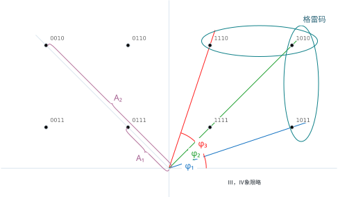

---

**End of 7.3.**

  

#### 7.4. Channel Capacity Limit

##### Nyquist Criterion

奈氏准则；

- 无噪声的理想低通信道中，最高码元传输速率 $= 2W \text{ (Baud)}$；

  - $W$：信道的频率带宽 $(Hz)$；
  - $Baud$：波特，码元传输速率 $(码元/秒)$，又称为波特率、调制速率、波形速率或符号速率；

- 若一个码元对应 $V$ 个离散状态 (每个码元携带 $n = \log_2 V$ 位比特)：
  $$
  C = 2W \log_2 V \text{ (b/s)}
  $$

  - $C$：信道的极限信息传输速率 $(bit/s)$；

---

##### Shannon Formula

香农公式；

- 带宽受限且存在高斯白噪声干扰的信道；
  $$
  C = W \log_2\left(1 + \frac{S}{N}\right) \text{ (b/s)}
  $$

  - $C$：信道的极限信息传输速率 $(bit/s)$；
  - $W$：信道的频率带宽 $(Hz)$；
  - $S/N$：无量纲信噪比；信噪比$(dB) = 10 \log_{10}\left(\frac{S}{N}\right)$；(当 $S/N = 1000$ 时，信噪比为 $30\text{ dB}$)；

---

##### Caution

1. 双上限取小：

   如果同时给出**信道带宽 $W$**、**调制离散电平数 $V$** 以及 **信噪比 (dB 或 比值)**：

   - 利用奈氏准则计算极限速率：$C_1 = 2W \log_2 V$；
   - 利用香农公式计算极限速率：$C_2 = W \log_2(1 + S/N)$；
   - 最终信道的最大数据传输率受两者共同制约，取较小值：$\text{最大数据传输率} = \min(C_1, \; C_2)$；

2. 提醒：

   - 香农公式中代入的是无量纲比值 $S/N$；若题设给出分贝值 $X\text{ dB}$，必须先通过 $S/N = 10^{X/10}$ 进行还原；

   - 公式中 $W$ 的单位必须换算为 $\text{Hz}$ (如 $3\text{ kHz} \to 3000\text{ Hz}$)；

   - $\text{Baud}$ 表示每秒传输的码元脉冲数，$\text{b/s}$ 表示每秒传输的二进制比特数，两者换算关系为 $\text{b/s} = \text{Baud} \times \log_2 V$；

---

**End of 7.4.**

### 8. Security in Computer Network

## Appendix

### A. CS vs. P2P File Distribution Time   

- 符号含义：
  - $N$：客户端数量；
  - $F$：文件大小；
  - $u_S$：服务器上行带宽；
  - $d_{\min}$：客户端最小下行带宽；
  - $u_i$：第 $i$ 个客户端上行带宽；

1. C/S架构最小分发时间：
   $$
   D_{CS}\ge\max\{\frac{NF}{u_S},\frac{F}{d_{min}}\}
   $$

   - **$\frac{NF}{u_S}$ (服务器上行瓶颈)：** 服务器必须串行/并发向所有客户端传输 $N$ 份文件 (总量 $NF$)；
   - **$\frac{F}{d_{\min}}$ (最慢节点瓶颈)：** 任意客户端下载完单份文件 $F$ 的时间下限；

2. P2P 架构最小分发时间
   $$
   D_{P2P}\ge\max\{\frac{F}{u_S},\frac{F}{d_{min}},\frac{NF}{u_S+\sum^N_{i=1}u_i}\}
   $$

   - **$\frac{F}{u_S}$ (种子初始上传)：** 服务器至少需上传 1 份完整文件至网络；
   - **$\frac{F}{d_{\min}}$ (最慢节点瓶颈)：** 单个客户端下载完整文件的时间下限；
   - **$\frac{NF}{u_S + \sum u_i}$ (系统总吞吐能力)：** 全网总需上传 $NF$ 数据，由服务器及全部客户端并发提供上行带宽；

- 对比结论：
  - **C/S：** 分发时间随 $N$ 呈**线性增长** ($O(N)$) ，规模扩大时服务器带宽必然成为瓶颈；
  - **P2P：** 客户端加入带来下载需求的同时也贡献了上行带宽，当 $N$ 很大时，时间趋向于常数界限 $\frac{F}{u}$，具有良好的**自扩展性**；

---

**End of A.**

### B. Special-Use IPv4 Addresses

- 特殊与非公网路由地址速查：

  | **类型**               | **地址范围 / CIDR**                   | **核心功能 / 场景**                   |
  | ---------------------- | ------------------------------------- | ------------------------------------- |
  | **A 类私网**           | `10.0.0.0/8`                          | 局域网 (LAN) 私有，经 NAT 访问公网    |
  | **B 类私网**           | `172.16.0.0/12` (至 `172.31.255.255`) | 局域网 (LAN) 私有，经 NAT 访问公网    |
  | **C 类私网**           | `192.168.0.0/16`                      | 局域网 (LAN) 私有，家庭/小微企业常见  |
  | **环回地址**           | `127.0.0.0/8` (典型 `127.0.0.1`)      | 本机协议栈测试，数据包不出物理接口    |
  | **链路本地 (APIPA)**   | `169.254.0.0/16`                      | DHCP 协商失败时的局域网临时自协商地址 |
  | **运营商 NAT (CGNAT)** | `100.64.0.0/10`                       | 宽带运营商内网分配地址，非真正公网 IP |
  | **D 类组播**           | `224.0.0.0/4` (至 `239.255.255.255`)  | 一对多传输 (路由邻居发现、音视频推送) |
  | **E 类保留**           | `240.0.0.0/4` (至 `255.255.255.254`)  | 实验与预留，不分配给终端              |
  | **未指定地址**         | `0.0.0.0/8` (特指 `0.0.0.0`)          | 监听所有网卡接口 / 路由表默认路由     |
  | **受限广播**           | `255.255.255.255`                     | 当前广播域内全员广播，路由器不转发    |

---

**End of C.**

