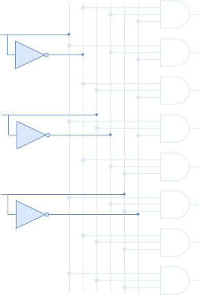
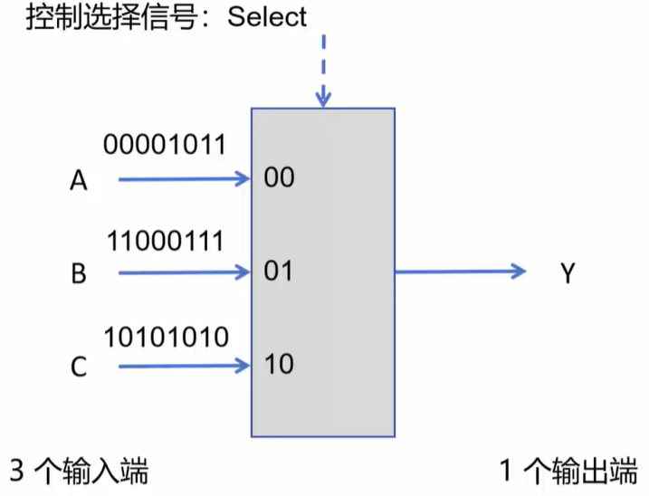
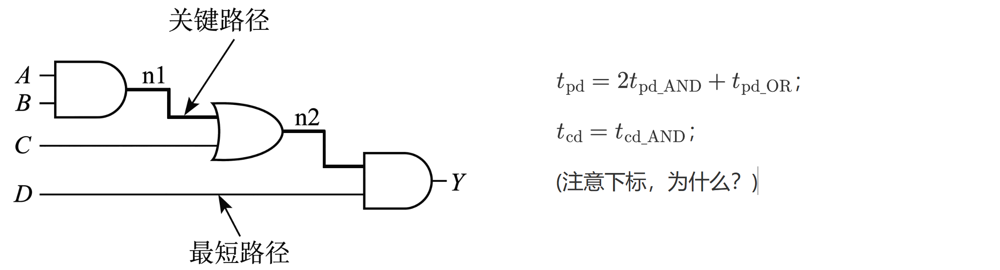
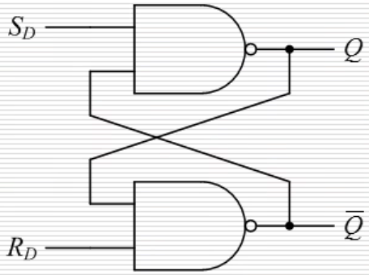
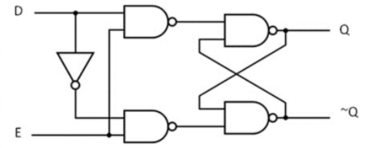

### 1. Logic Circuit Basics

> $\boxed{\text{抽象模型}}$：门电路把连续物理电压映射为离散布尔值，在输入端口接收若干二值逻辑信号，经过一定延迟后在输出端口产生一个有效的二值逻辑信号，输出由输入按特定布尔函数唯一决定；

#### 1.1. Combinational Logic Circuits

- 组合逻辑电路构建流程：根据需求列出真值表 $\to$ 写出逻辑函数主范式 $\to$ 化简主范式 $\to$ 给出组合电路图；

##### Minterm, Maxterm & Principal Normal Form

- 标准项：
  - 最小项：所有逻辑变量 (或其否定) 的合取 (e.g. $\overline{A}BC=m_{011}=m_3$)；
  - 最大项：所有逻辑变量 (或其否定) 的析取 (e.g. $\overline{A}+B+C=M_{100}=M_{4}$)；
- 范式：
  - 主析取范式 / 标准与或式：真值表结果为 1 的行，将对应最小项 $m_i$ "或" 在一起；
  - 主合取范式 / 标准或与式：真值表结果为 0 的行，将对应最大项 $M_i$ "与" 在一起；

---

##### Simplification of Logic Functions

1. 利用公式；

   - 异或公式：$\overline{B}C + B\overline{C} = B \oplus C$；
   - 同或公式：$\bar{B}\bar{C} + BC = \overline{B \oplus C}$；
   - ....(略)；

2. 卡诺图 (K-map)：

   - 使逻辑相邻的最小项 ($XY+X\overline{Y}=X$) 几何上也相邻，可直观画圈消去；

   - 每根轴对应一个变量，$n$ 个变量的卡诺图就是 $2^n$​ 大小的超立方体；3、4维卡诺图用格雷码压缩后仍几何相邻，5维以上无法在平面上直观处理；

   - 输出无关项：某些输入组合根本不会出现，或就算出现，其输出是 0 还是 1 对后续系统没有影响；

     $\to$ 用X表示这些输入组合的输出，在卡诺图中既可以当做1使用，也可以当做0使用；

   - 输入无关项：当某些输入变量确定后，输出结果随之确定，不用考察剩余的输入变量；

     $\to$ 用X表示不需要考察的输入变量，将多个输入组合合并为一个；

   - 注意：

     - 两端边界也是相邻的；
     - 可重复利用某一项，因为 $X=X+X$；
     - 一次合并必然是偶数个；

---

##### Combinational Logic Modules

1. 译码器 Decoder：

   
     
       
  
           1. 译码器 Decoder:  
           - 输入 $n$ 位地址线，输出 $2^n$ 位独热码（One-hot）。 
           - 任何时刻仅有一个输出端有效。    
       
     
       
     
              
       
 
   

   

2. 多路选择器 Multiplexer, MUX：

   

   - 控制选择信号位长 $k$ 要满足 $2^k\ge N$，$N$ 是输入端个数；

---

##### Timing

- 延时：

  - 最小延迟 $t_{cd}$：输入改变 到 输出开始改变；
  - 传播延迟 $t_{pd}$：输入改变 到 输出长期不变；

- 关键路径 最慢；最短路径 最快；

  

- 毛刺现象：输入信号改变时，到达同一逻辑门会有先后，称为竞争；竞争引起的非预期输出错误，称为冒险；表现在波形上，称为毛刺；

  - 信号变化跨越卡诺图中的圆圈时会产生毛刺 (为什么？) $\to$ 在卡诺图中增加圆圈，也就是额外增加硬件来消除毛刺；

> $\boxed{\text{抽象模型}}$：组合逻辑电路没有记忆，其**稳定输出**仅由当前输入决定，与电路历史状态无关；但输入变化后，输出不会瞬间稳定，需要经过一段**组合逻辑时延** (传播延迟) 后才形成正确的稳定输出；在这段过渡期内，输出可能暂时错误，甚至出现毛刺；

---

**End of 1.1.**

#### 1.2. Sequential Logic Circuits

##### Latch

这里是第一行文字，公式可以正常显示：$f(x) = \bar{x} + 1$。

- 这里是第二行文字，下面的独立公式块也能正常靠左排版：

$$
E = mc^2 \quad \text{与} \quad \overline{AB} = \sum_{i=1}^{n} x_i
$$

文字行数超过图片高度后，会自动在下方恢复占满整行。

1. Reset - Set 锁存器：

   

   下标 $D$ 表示低电平有效：

   $S=0,R=1$，输出置 $1$，即 $Q==1,\overline{Q}==0$；

   $S=1,R=0$，输出置 $0$，即 $Q==0,\overline{Q}==1$；

   $S=1,R=1$，输出保持；不允许 $S=0,R=0$ 的输入，既破坏输出互补，又可能让结果状态不确定；

2. 门控 D 锁存器：

   

   $E$ 输入端代表 Enable，$E=0$ 时，RS 锁存器两端输入都为 $0$，无论 $D$ 是什么，输出都保持；

   $E=1$ 时，如果 $D=1$，RS 输出置 $1$；如果 $D=0$，RS 输出置 $0$；

---

##### Register

1. D 触发器

---

**End of 1.2.**

