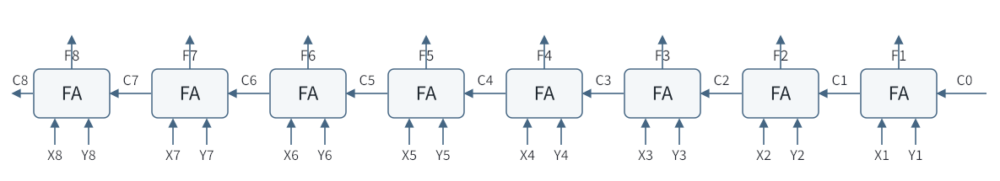
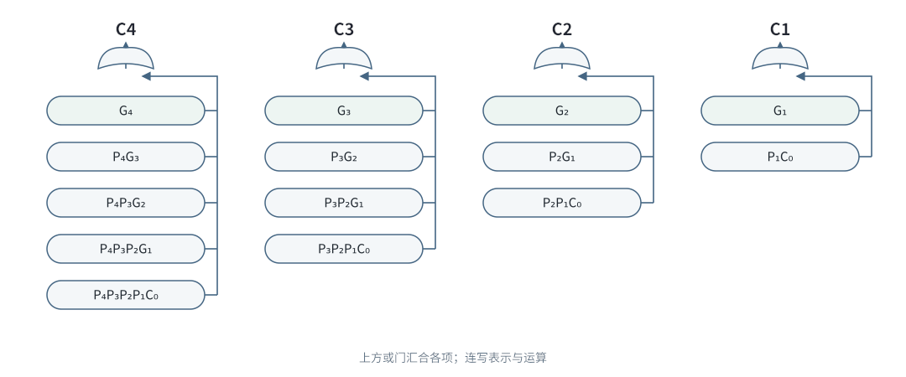
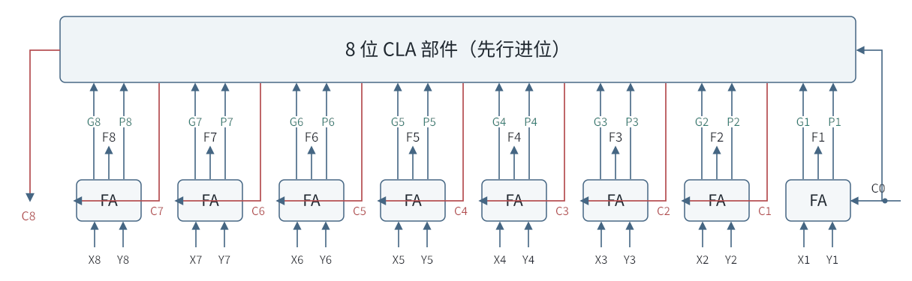
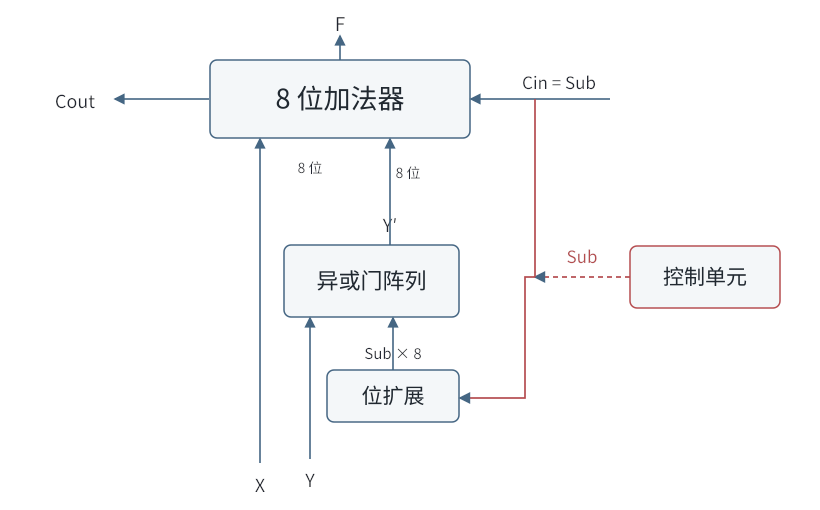

# Central Processing Unit

## 0. 理论基础

##### MIPS32 Instruction Structure

所有 MIPS32 基础指令共划分为三种**指令格式**：

- `R 型`：Register Type (寄存器型格式)，用于寄存器之间的算术逻辑运算、位移操作、乘除法以及寄存器间接跳转；

  如算术指令 (`add`, `addu`, `sub`, `subu`)、逻辑指令 (`and`, `or`, `xor`, `nor`)、移位指令 (`sll`, `srl`, `sra`, `sllv`, `srlv`, `srav`)、比较置位指令 (`slt`, `sltu`)、乘除与数据搬移指令 (`mult`, `multu`, `div`, `divu`, `mfhi`, `mflo`, `mthi`, `mtlo`)、寄存器跳转指令 (`jr`, `jalr`)、系统调用与断点陷阱 (`syscall`, `break`)；

- `I 型`：Immediate Type (立即数型格式)，将立即数计算、访存操作以及条件分支统一归入此格式；

  如立即数算术逻辑指令 (`addi`, `addiu`, `andi`, `ori`, `xori`)、立即数比较置位指令 (`slti`, `sltiu`)、高位立即数加载指令 (`lui`)、访存加载指令 (`lb`, `lh`, `lw`, `lbu`, `lhu`)、访存存储指令 (`sb`, `sh`, `sw`)、条件分支指令 (`beq`, `bne`, `bgez`, `bgtz`, `blez`, `bltz`)；

- `J 型`：Jump Type (跳转型格式)，用于大范围直接跳转；

  如无条件直接跳转指令 (`j`)、无条件直接跳转与链接指令 (`jal`)；

```
R 型: [  opcode(6)  |  rs(5)  |  rt(5)  |  rd(5)  | shamt(5) |  funct(6)  ]
I 型: [  opcode(6)  |  rs(5)  |  rt(5)  |       immediate[15:0](16)       ]
J 型: [  opcode(6)  |              target_address[25:0](26)               ]
```

> `opcode`：Operation Code (操作码，高 6 位，所有 R 型指令的 `opcode` 均为 `000000`)；
> `rs`：Register Source (第一个源操作数寄存器，5 位)；
> `rt`：Register Target (第二个源操作数寄存器或目标寄存器，5 位；在算术/逻辑/分支指令中作为源操作数，在加载指令和立即数运算指令中作为写入的目的寄存器)；
> `rd`：Register Destination (目的寄存器，5 位，仅存在于 R 型指令)；
> `shamt`：Shift Amount (移位量，5 位，用于指定移位指令常数位移大小，非移位指令中填 `0`)；
> `funct`：Function Code (功能码，6 位，在 R 型指令的 `opcode` 为 0 时用于区分具体操作)；
> `immediate`：16 位立即数或偏移量 (在算术指令中按有符号/无符号扩展，在分支指令中表示相对偏移，在访存指令中表示基地址偏移)；
> `target_address`：26 位跳转目标指令字地址 (实际跳转地址由当前 PC 高 4 位与该 26 位字段左移 2 位拼接而成：`PC[31:28] || target_address || 00`)；

> 对`target_address`的进一步解释：
> 指令按4字节对齐 $\to$ 指令地址末两位恒为0 $\to$ 字节地址右移两位转为 "字(Word)" 地址 $\to$ 低26位放入 `target_address` 字段；
> 跳转地址的高4位直接复制当前PC的高4位 (流水线架构中，指令在译码时PC已完成递增4，所以当前PC实际是跳转指令的下一跳指令的地址) $\to$ 跳转范围是与`PC+4`具有相同高 4 位的 256 MiB 地址区域；
> 假设某条`j`指令的地址是0x0040 0014，想要跳转到0x0040 0008处继续指令，那么这条`j`指令的`target_address`字段值是0x010 0002；


## 1. Single Circle Processor


```systemverilog
// ============================================================================
// 单周期 MIPS32 处理器：合并版 RTL
// ============================================================================
// 本文件将 SingleCircle_MIPS32_Processor/rtl 下的各个 SystemVerilog 模块
// 合并到一起，便于阅读、仿真或作为单一编译单元使用；
//
// 支持的指令子集：R 型 add/sub/and/or/slt/nor、lw、sw、beq、addi、j；
// 复位 rst 为低电平有效的异步复位；顶层模块为 MIPS_top；
// 注意：该文件不初始化指令存储器；测试平台可通过层次路径
//       MIPS_top.i_mem.mem[索引] 写入机器码；
// ============================================================================

// ------------------------------- 顶层 ---------------------------------------
// 一个时钟周期内完成取指、译码、执行、访存和回写；时钟上升沿更新 PC、
// 寄存器堆（如有写回）及数据存储器（如有写操作）；
module MIPS_top #(
    parameter WIDTH = 32,
    parameter DEPTH = 256
) (
    input logic clk,
    input logic rst
);
    // 取指阶段及指令字段；
    logic [WIDTH-1:0] pc_out, pc_plus_4, instruction;
    wire [5:0]  opcode     = instruction[31:26];
    wire [4:0]  rs         = instruction[25:21];
    wire [4:0]  rt         = instruction[20:16];
    wire [4:0]  rd         = instruction[15:11];
    wire [15:0] immediate  = instruction[15:0];
    wire [5:0]  funct      = instruction[5:0];
    wire [25:0] jump_field = instruction[25:0];

    // 主控制器输出的控制信号；
    logic reg_dst, alu_src, mem_to_reg, reg_write, mem_write, mem_read;
    logic branch, jump;
    logic [1:0] alu_op;

    // 数据通路中的中间结果；
    logic [4:0]       write_register;
    logic [WIDTH-1:0] read_data_1, read_data_2, sign_extended_immediate;
    logic [WIDTH-1:0] alu_input2, alu_result, mem_read_data, write_back_data;
    logic [3:0]       alu_control_signal;
    logic             zero_flag;

    // 分支与跳转地址选择相关信号；
    logic [WIDTH-1:0] branch_offset, branch_target, pc_after_branch;
    logic [WIDTH-1:0] jump_shifted, jump_address, next_pc;
    logic             pc_src;

    // PC 是时序寄存器；其余指令通路大多为组合逻辑；
    pc #(.WIDTH(WIDTH)) pc_reg (
        .clk(clk), .rst(rst), .pc_in(next_pc), .pc_out(pc_out)
    );
    pc_adder #(.WIDTH(WIDTH)) pc_plus4_adder (
        .pc(pc_out), .pc_plus_4(pc_plus_4)
    );

    // 指令存储器使用字节地址 PC，但内部数组按 32 位字索引；
    instruction_memory #(.WIDTH(WIDTH), .DEPTH(DEPTH)) i_mem (
        .address(pc_out), .instruction(instruction)
    );

    // 主控制器仅依据 opcode 决定指令大类的控制信号；
    control_unit ctrl (
        .opcode(opcode), .reg_dst(reg_dst), .alu_src(alu_src),
        .mem_to_reg(mem_to_reg), .reg_write(reg_write),
        .mem_write(mem_write), .mem_read(mem_read), .branch(branch),
        .alu_op(alu_op), .jump(jump)
    );

    // R 型回写 rd；I 型（lw、addi）回写 rt；
    mux_2x1 #(.width(5)) reg_dst_mux (
        .a(rt), .b(rd), .sel(reg_dst), .y(write_register)
    );

    // 寄存器堆有两个异步读端口和一个同步写端口；
    reg_file #(.WIDTH(WIDTH)) regs (
        .clk(clk), .rst(rst), .write_register(write_register),
        .read_register_1(rs), .read_register_2(rt), .write_data(write_back_data),
        .reg_write(reg_write), .read_data_1(read_data_1), .read_data_2(read_data_2)
    );
    sign_extend sign_ext (.in(immediate), .out(sign_extended_immediate));

    // ALU 第二操作数：寄存器 rt 的值，或符号扩展后的立即数；
    mux_2x1 #(.width(WIDTH)) alu_src_mux (
        .a(read_data_2), .b(sign_extended_immediate), .sel(alu_src), .y(alu_input2)
    );
    alu_control alu_ctrl (
        .alu_op(alu_op), .funct(funct), .alu_control(alu_control_signal)
    );
    alu #(.WIDTH(WIDTH)) alu_main (
        .a(read_data_1), .b(alu_input2), .alu_control(alu_control_signal),
        .result(alu_result), .zero(zero_flag)
    );

    // lw 组合读数据存储器；sw 在时钟上升沿写入；
    data_memory #(.WIDTH(WIDTH), .DEPTH(DEPTH)) d_mem (
        .clk(clk), .mem_write(mem_write), .mem_read(mem_read), .address(alu_result),
        .write_data(read_data_2), .read_data(mem_read_data)
    );
    // 普通运算回写 ALU 结果；lw 回写内存读出的数据；
    mux_2x1 #(.width(WIDTH)) mem_to_reg_mux (
        .a(alu_result), .b(mem_read_data), .sel(mem_to_reg), .y(write_back_data)
    );

    // beq 的目标：PC+4 + (符号扩展立即数 << 2)；只有相等时才取分支；
    shift_left2 #(.WIDTH(WIDTH)) branch_shifter (
        .in(sign_extended_immediate), .out(branch_offset)
    );
    assign branch_target = pc_plus_4 + branch_offset;
    assign pc_src = branch & zero_flag;
    mux_2x1 #(.width(WIDTH)) pc_src_mux (
        .a(pc_plus_4), .b(branch_target), .sel(pc_src), .y(pc_after_branch)
    );

    // j 指令目标：{PC+4[31:28], instr[25:0], 2'b00}；
    shift_left2 #(.WIDTH(WIDTH)) jump_shifter (
        .in({6'b0, jump_field}), .out(jump_shifted)
    );
    assign jump_address = {pc_plus_4[31:28], jump_shifted[27:0]};
    mux_2x1 #(.width(WIDTH)) jump_mux (
        .a(pc_after_branch), .b(jump_address), .sel(jump), .y(next_pc)
    );
endmodule

// ------------------------------ 算术逻辑单元 --------------------------------
// case 是硬件“选择”描述：综合工具会为每一种操作推导相应的逻辑，再用多路
// 选择网络依据 alu_control 选出结果；并不是在处理器中逐行执行软件语句；
module alu #(
    parameter WIDTH = 32
) (
    input  logic [WIDTH-1:0] a, b,
    input  logic [3:0]       alu_control,
    output logic [WIDTH-1:0] result,
    output logic             zero
);
    always_comb begin
        case (alu_control)
            4'b0000: result = a & b;                             // AND
            4'b0001: result = a | b;                             // OR
            4'b0010: result = a + b;                             // 加法器
            4'b0110: result = a - b;                             // 减法器（通常由加法器实现）
            4'b0111: result = ($signed(a) < $signed(b)) ? 32'd1 : 32'd0; // 有符号 SLT
            4'b1100: result = ~(a | b);                          // NOR
            default: result = '0;                                // 非法控制码的安全值
        endcase
    end
    assign zero = (result == '0); // beq 借此判断 a-b 是否为零
endmodule

// ALU 的二级译码：主控制器给出“运算类别”，R 型指令再由 funct 精确选择；
module alu_control (
    input  logic [1:0] alu_op,
    input  logic [5:0] funct,
    output logic [3:0] alu_control
);
    always_comb begin
        case (alu_op)
            2'b00: alu_control = 4'b0010; // lw / sw / addi：地址或结果相加
            2'b01: alu_control = 4'b0110; // beq：相减后检测 zero
            2'b10: begin
                case (funct)
                    6'b100000: alu_control = 4'b0010; // add
                    6'b100010: alu_control = 4'b0110; // sub
                    6'b100100: alu_control = 4'b0000; // and
                    6'b100101: alu_control = 4'b0001; // or
                    6'b101010: alu_control = 4'b0111; // slt
                    6'b100111: alu_control = 4'b1100; // nor
                    default:   alu_control = 4'b0000;
                endcase
            end
            default: alu_control = 4'b0000;
        endcase
    end
endmodule

// 主控制器：为已支持的 opcode 产生单周期数据通路控制信号；
module control_unit (
    input  logic [5:0] opcode,
    output logic reg_dst, alu_src, mem_to_reg, reg_write,
    output logic mem_write, mem_read, branch,
    output logic [1:0] alu_op,
    output logic jump
);
    always_comb begin
        // 先给所有信号默认值，避免组合逻辑遗漏赋值而推导出锁存器；
        reg_dst = 1'b0; alu_src = 1'b0; mem_to_reg = 1'b0; reg_write = 1'b0;
        mem_write = 1'b0; mem_read = 1'b0; branch = 1'b0; alu_op = 2'b00; jump = 1'b0;
        case (opcode)
            6'b000000: begin reg_dst = 1'b1; reg_write = 1'b1; alu_op = 2'b10; end // R 型
            6'b100011: begin // lw
                alu_src = 1'b1; mem_to_reg = 1'b1; reg_write = 1'b1;
                mem_read = 1'b1; alu_op = 2'b00;
            end
            6'b101011: begin alu_src = 1'b1; mem_write = 1'b1; alu_op = 2'b00; end // sw
            6'b000100: begin branch = 1'b1; alu_op = 2'b01; end // beq
            6'b001000: begin alu_src = 1'b1; reg_write = 1'b1; alu_op = 2'b00; end // addi
            6'b000010: jump = 1'b1; // j
            default: ; // 未支持 opcode：保持无副作用的默认控制值
        endcase
    end
endmodule

// --------------------------- 存储器与寄存器堆 -------------------------------
module data_memory #(
    parameter WIDTH = 32,
    parameter DEPTH = 256
) (
    input logic clk, mem_write, mem_read,
    input logic [WIDTH-1:0] address, write_data,
    output logic [WIDTH-1:0] read_data
);
    localparam ADDR_BITS = $clog2(DEPTH);
    logic [WIDTH-1:0] mem [0:DEPTH-1];
    // MIPS 地址为字节地址，去掉最低 2 位后得到 32 位字索引；
    wire [ADDR_BITS-1:0] word_addr = address[ADDR_BITS+1:2];
    always_ff @(posedge clk) begin
        if (mem_write) mem[word_addr] <= write_data;
    end
    assign read_data = mem_read ? mem[word_addr] : '0; // 单周期所需的组合读
endmodule

module instruction_memory #(
    parameter WIDTH = 32,
    parameter DEPTH = 256
) (
    input logic [WIDTH-1:0] address,
    output logic [WIDTH-1:0] instruction
);
    localparam ADDR_BITS = $clog2(DEPTH);
    logic [WIDTH-1:0] mem [0:DEPTH-1];
    wire [ADDR_BITS-1:0] word_addr = address[ADDR_BITS+1:2];
    assign instruction = mem[word_addr]; // 组合 ROM 式取指
endmodule

module reg_file #(
    parameter WIDTH = 32,
    parameter DEPTH = 32
) (
    input logic clk, rst,
    input logic [4:0] write_register, read_register_1, read_register_2,
    input logic [WIDTH-1:0] write_data,
    input logic reg_write,
    output logic [WIDTH-1:0] read_data_1, read_data_2
);
    logic [WIDTH-1:0] regs [0:DEPTH-1];
    // 异步低有效复位；写端口仅在时钟上升沿生效，且 $zero 不可写；
    always_ff @(posedge clk or negedge rst) begin
        if (!rst) begin
            for (int i = 0; i < DEPTH; i++) regs[i] <= '0;
        end else if (reg_write && write_register != 5'd0) begin
            regs[write_register] <= write_data;
        end
    end
    // 两个独立的组合读端口；读 $zero 始终返回 0；
    assign read_data_1 = (read_register_1 == 5'd0) ? '0 : regs[read_register_1];
    assign read_data_2 = (read_register_2 == 5'd0) ? '0 : regs[read_register_2];
endmodule

// ------------------------------- 基础单元 -----------------------------------
module mux_2x1 #(
    parameter width = 32
) (
    input logic [width-1:0] a, b,
    input logic sel,
    output logic [width-1:0] y
);
    always_comb begin
        if (sel) y = b;
        else     y = a;
    end
endmodule

// 程序计数器：保存下一条待取指令的字节地址；
module pc #(
    parameter WIDTH = 32
) (
    input logic clk, rst,
    input logic [WIDTH-1:0] pc_in,
    output logic [WIDTH-1:0] pc_out
);
    always_ff @(posedge clk or negedge rst) begin
        if (!rst) pc_out <= '0;
        else      pc_out <= pc_in;
    end
endmodule

// 顺序执行时，下一条 32 位指令地址为 PC + 4 字节；
module pc_adder #(
    parameter WIDTH = 32
) (
    input logic [WIDTH-1:0] pc,
    output logic [WIDTH-1:0] pc_plus_4
);
    assign pc_plus_4 = pc + 4;
endmodule

// 将 32 位数左移两位，用于按字对齐的分支偏移和跳转目标；
module shift_left2 #(
    parameter WIDTH = 32
) (
    input logic [WIDTH-1:0] in,
    output logic [WIDTH-1:0] out
);
    assign out = in << 2;
endmodule

// I 型指令的 16 位立即数扩展为 32 位有符号数；
module sign_extend (
    input logic [15:0] in,
    output logic [31:0] out
);
    assign out = {{16{in[15]}}, in};
endmodule

```


- 在组建CPU之前，需要假设 / 已知以下模型与抽象：

  > (1) **总线模型**：CPU 通过总线与主存 / IO设备交换信息；地址总线传输地址，数据总线传输数据，控制总线传输读、写等控制信息；写操作时 CPU 驱动数据总线，读操作时被访问部件驱动数据总线返回数据；
  >
  > (2) **组合电路模型**：组合电路的输出仅由当前输入决定，不保存内部状态；ALU 是典型的组合电路，其输入包括操作数和控制信号，输出包括运算结果及状态标志位；
  >
  > (3) **时钟同步模型**：CPU 中的状态单元由统一时钟驱动，并在规定的时钟有效边沿更新状态；相邻两个有效边沿之间构成一个时钟周期；周期内，组合电路根据当前状态产生下一状态所需的信号，并在下一有效边沿由状态单元采样并保存；
  >
  > (4) **程序与 ISA 模型**：编译器、汇编器等软件工具将程序转换为某一 ISA 下的机器指令序列；CPU 按照 ISA 的规定取指、译码并执行这些指令；

- 目的：基于门电路等基本数字逻辑组件，组建一颗能够运行给定 ISA (的子集) 的 CPU；

#### 3.1. Calculating Integer

- 计算机处理的对象本质上是有限位宽的比特模式，可将这些比特模式解释为整数并实现相应的整数运算；

##### Encode

在不至于引起歧义的情况下，二进制数，比特模式，对应的十进制自然数值混用；

1. 代数结构 (硬件角度)：

   - 计算机处理的对象局限于集合 $B_n=\{0,1,\dots,2^n-1\}$，即所有 $n$ 位比特模式的集合；

   - 加法器实现的是 $B_n$ 上的二元模 $2^n$ 加法，定义为$\forall a, b \in B_n,a \boxplus b = (a + b) \bmod 2^n$；

     $\implies$ 显然 $(B_n, \boxplus)$ 构成有限阿贝尔群，单位元为 $0$；

   - $\forall x \in B_n$，其加法逆元 $\operatorname{inv}(x) \in B_n$ 满足：$x \boxplus \operatorname{inv}(x) = 0$，易证 $\operatorname{inv}(x) = (\sim x + 1) \bmod 2^n$ 即加法逆元存在且唯一；

2. 减法转换与硬件复用：

   - 定义减法为加上减数的逆元：
     $$
     \forall a,b \in B_n, a\boxminus b \triangleq a \boxplus \operatorname{inv}(b) = (a + (\sim b + 1) \bmod {2^n}) \bmod 2^n = (a+\sim b + 1)\bmod{2^n}
     $$

   - 全加器复用：$n$ 位带进位加法器逻辑为 $\operatorname{Adder}(X, Y, C_{\text{in}}) = (X + Y + C_{\text{in}}) \bmod 2^n$；引入单比特控制信号 $\text{sub} \in \{0, 1\}$，将操作数配置为：

     (1) $X = a$；

     (2) $Y = b \oplus \text{sub}_n$ ($\text{sub}_n$ 为 $\text{sub}$ 符号位扩展至 $n$ 位的向量)；

     (3) $C_{\text{in}} = \text{sub}$；

     |   **控制信号**   | **输入 X** |    **门级输入 Y**     | **进位输入 $C_{in}$** |       **实际执行算式**       |  **最终结果**   |
     | :--------------: | :--------: | :-------------------: | :-------------------: | :--------------------------: | :-------------: |
     | $\text{sub} = 0$ |    $a$     |   $b \oplus 0 = b$    |          $0$          |   $(a + b + 0) \bmod 2^n$    | $a \boxplus b$  |
     | $\text{sub} = 1$ |    $a$     | $b \oplus 1 = \sim b$ |          $1$          | $(a + \sim b + 1) \bmod 2^n$ | $a \boxminus b$ |

3. 负数的编码及有符号数：

   - 高级语言中的负数 ($-x,x\ge0$) 编码为 $\sim x+1$ (称为**补码**)；

     易证：$inv(inv(x))=x$；因此加法器接收到 $sub$ 控制信号后，只需机械地将减数转化为其加法逆元即可；

   - 考察 $B_n$ 中最高位为 $0$ 的比特模式 (除了单位元)，可发现其加法逆元最高位均为 $1$；

     

     $\to$ 最高位为 $0$ 的比特模式只保留其自然数值含义，最高位为 $1$ 的比特模式作为加法逆元，赋予负数语义；
     
     设 $x$ 是 $B_n$ 中的比特模式，定义解码函数：
     $$
     \operatorname{Val}(x) = \begin{cases} x, & x < 2^{n-1} \\ x - 2^n, & x \ge 2^{n-1} \end{cases}
     $$
     那么可将最高位视为**符号位**，同时易得 $n$ 位比特模式的编码范围为 $[-2^{n-1},2^{n-1}-1]$；

4. 位权与符号扩展：

   - 易得比特模式 $\underbrace{10\cdots00}_n$ 对应 $-2^{n-1}\implies$ 最高位权重为 $-2^{n-1}$；同时易得其余各低位 $i$ 的位权仍为正权值 $2^i$；
   - 扩展有符号数操作为复制最高有效位，通过等比数列求和可推导其高位权和恒等坍缩，整体数值保持不变；

> `C`中整数类型的互相转换：变窄直接截断，变宽有符号符号扩展、无符号零扩展(保证有 / 无符号不变时数值也不变)，然后按照变量有 / 无符号解释该二进制串；

---

##### Adder

1. 串行进位加法器：

   - 全加器 (Full Adder)：输入为两个本位 $X_i$、$Y_i$与来自低位的进位  $C_{i-1}$，输出是本位和 $F_i$ 与向高位的进位 $C_i$；(通过列真值表与化简逻辑函数来画出电路图，略)
   - 将全加器的进位输入和输出依次连接，可得到**串行进位加法器**：

   

   - 其中每一位必须等待低位进位有效信号达到才能输出有效值，加法器的组合逻辑延迟较大；

2. 并行进位加法器：

   - 全加器中进位逻辑为：$$C_i = X_i \cdot C_{i-1} + Y_i \cdot C_{i-1} + X_i \cdot Y_i$$ 化简为：$$C_i = X_i \cdot Y_i + (X_i + Y_i) \cdot C_{i-1}$$；

     设 $G_i = X_i \cdot Y_i$，$P_i = X_i + Y_i$；得 $$C_i = G_i + P_i \cdot C_{i-1}$$；

     (进位生成信号Generate与进位传递信号Propagate)

   - 可得：$C_i = G_i + P_i G_{i-1} + P_i P_{i-1} G_{i-2} + \dots + (P_i P_{i-1} \dots P_2) G_1 + (P_i P_{i-1} \dots P_1) C_0$；

     由此可得**先行进位部件 (Carry Lookahead Unit, CLA)**：

   

   - 修改一下全加器 (添加一个与门和或门)，将其与CLA相连就可得**并行进位加法器**，大大降低了组合逻辑延迟：

   

3. 支持加减运算：引入 $Sub$ 控制信号及将减数转换为加法逆元即可，不赘述；

   

---

##### Flag Bit

1. 零标志 (Zero Flag, ZF)：

   - `或非`所有本位和 $F_i$；
   - $\text{ZF}==1$ 表明

2. 

3. 引入标志位：

   

   (2) 符号标志 (Sign Flag, SF)：最高位 (这里是 $F_8$)， 若指令表明对无符号数运算，该标志位会被丢弃；

   (3) 进位 / 借位标志 (Carry Flag, CF)：判断纯比特模式运算是否发生了进位或借位 $\to C_{in}\oplus C_{out}$；

   (4) 溢出标志 (Overflow Flag, OF)：将操作数最高位视为符号位时，判断是否溢出 $\to C_{out}\oplus C_{n-1}$；

   > 解析1：CF标志：
   >
   > 加法时，`CF=1`，有进位，即发生溢出；减法时，`CF=1`，有借位，即不够减；
   >
   > 加法时就不说了；
   >
   > 减法时，$C_{in}=1$，那么只看 $C_{out}$；对于 $a,b\in B_n=\{0,1,\dots,2^n-1\}$，$a-b=a+(\sim b+1)=a+(2^n-b)=2^n+(a-b)$；所以 $a<b,C_{out}=0$，此时 $CF=C_{in}\oplus C_{out}=1$； 
   >
   > 再次提醒：$CF$ 只能用于判断无符号整数的大小关系，因为比较的是比特模式对应的 $B_n=\{0,\dots,2^n-1\}$ 中的**无符号值**；

   > 解析2：OF标志： 
   >
   > 其实从比特模式角度看，符号溢出是不存在的，比如 $011+011=110$，本来比特模式 $110$ 就既是 $6$ 也是加法逆元 $-2$；
   > 根据之前定义的 $\operatorname{Val}(x)$ 函数，溢出充要条件为 $\operatorname{Val}(a)\pm\operatorname{Val}(b)\ne \operatorname{Val}(s)$ 可得 (具体推导逻辑略)：
   >
   > - **加法溢出（符号位逻辑）**：\(OF = (\bar{a}_{n-1}\bar{b}_{n-1}s_{n-1}) + (a_{n-1}b_{n-1}\bar{s}_{n-1})\) (同正得负 或 同负得正)
   > - **减法溢出（符号位逻辑）**：\(OF_{\text{sub}} = (\bar{a}_{n-1}b_{n-1}s_{n-1}) + (a_{n-1}\bar{b}_{n-1}\bar{s}_{n-1})\) (正减负得负，或负减正得正)
   > - **统一硬件逻辑（加减共用）**：\(OF = C_n \oplus C_{n-1}\)
   >   *（注：减法时硬件实际输入为 \(a\) 和 \(\bar{b}\)，所以符号位逻辑需交换 \(b\) 与其反码，但最终进位差逻辑不变）*

4. 利用标志位判断整数的大小关系：

   只有减法语义的标志位才能用于大小比较；

   比较比特模式 $a,b$ 本质是执行 `SUB a, b`去更新标志位；

   首先无论有无符号，只要，即 

   - 视为无符号数：

     (1) $ZF==1$，比特模式完全相同，那么 $a == b$；

     (2) $CF==1$：减法借位，$a<b$；

     (3) $CF==0$：减法不借位，$a\ge b$；

     还可结合`ZF`进一步判断，如`CF==0且ZF==0`代表 $a>b$；

   - 视为有符号数：

     (1) $ZF==1$，比特模式完全相同，那么 $Val(a) == Val(b)$；

     (2) 若 $SF\oplus OF==0$，则 $a-b\ge0$，即 $a\ge b$；

     (3) 若 $SF\oplus OF==1$，则 $a-b<0$，即 $a<b$；

     


##### Encoding Floating-Point

- IEEE 754 浮点数编码标准：

  - 首先将浮点数编码为 $(-1)^S\times1.F\times2^N$；

  - 比特模式分为`符号`、`阶码`、`尾数`三个部分；其中`{符号，尾数} = {S, F}`、而`阶码 E = N + 偏置值`；

    设 $n$ 为阶码位数，则偏置值 = $2^{n-1}-1$；

  - 注意：规划化后的浮点数小数点左边的`1`是不存储的；

- 表示范围：

  ```
  32位单精度 [ S |   阶码E(8)   |         尾数S(23)          ]
  64位双精度 [ S |      阶码E(11)      |                   尾数S(52)                      ]
  ```

> [!WARNING]
>
> 这里没懂

---

##### Storing Data

- 字节顺序 / 端序：分大小端序两种，小端低位字节存低地址，高位字节存高地址，大端序相反；
  - 网络字节序规定为大端序；
- 内存对齐：
  - 规则一：每个成员存储的起始地址 % 该成员的长度 = 0；
  - 规则二：结构体的长度也必须是最大成员长度的整数倍；

> [!WARNING]
>
> 这里不懂；
>
> “按字节编址，但存储器一次只能取出一个字；先定位字地址，因为要取出存储器的一个字，由物理地址的前n位组成，这些位分别输入行和列译码器选择存储器阵列交叉点一组位元，进行输出；列译码器的每个输出端口一一对应一组位元，这导致一次存储器访问周期，只能取出这一组位元中的全部或部分数据，在现代存储器中就是64位，如果数据跨越了列译码器的单个输出接口，那么就要进行多个存储器访问周期，通俗讲就是选择多个阵列交叉点，这称为数据跨越了内存访问边界；你说的从任意地址访问内容，是指存储器在读取特定地址的字内容后，通过字内地址，即物理地址的后几位，来读取这个字内容中的部分数据；”
>
> 可能需要主存架构知识

---

**End of 2.1.**


### 3. ISA

- Instruction-Set Architecture，指令集体系结构；指处理器支持的指令和指令的字节级编码(即**指令的语义与其物理表示方式**)；

  作用：**软件与硬件之间的接口**

  - ISA定义了机器级程序的格式和行为，包括处理器状态、指令格式，以及每条指令对状态的影响；
  - 软件侧 (编译器)：明确可用的指令集合与编码格式；
  - 硬件侧 (微架构)：指导具体执行逻辑的物理实现；

  值得一提的是，在软件看来，ISA将程序行为描述为串行执行指令；而硬件可以采取并发执行的实现，只需保证整体行为一致；

- ISA可分为 CISC(精简指令集) 与 RISC(复杂指令集) 两大类：

  - `x86 / x86-64` (CISC)：Intel、AMD等厂商采用，历史悠久、生态强大；
  - `ARM` (RISC)：常见于智能手机、平板电脑、嵌入式设备；
  - `RISC-V` (RISC)：开源免费；模块化，允许自由添加自定义指令；
  - `MIPS` (RISC)：经典的早期精简指令集架构，常见于网络交换设备、早期嵌入式系统；

---

MIPS32 Instruction Structure

- 下文主要基于 MIPS32 和 x86 展开；

  MIPS32 架构定义了 32 个 32 位通用寄存器（`$0` ~ `$31`）、程序计数器（`PC`）以及用于乘除法运算的累加器寄存器对（`HI` / `LO`）；所有基础指令长度均为 32 位，且要求 4 字节自然对齐；

---

##### MIPS32 Instruction Structure

所有 MIPS32 基础指令共划分为三种**指令格式**：

- `R 型`：Register Type (寄存器型格式)，用于寄存器之间的算术逻辑运算、位移操作、乘除法以及寄存器间接跳转；

  如算术指令 (`add`, `addu`, `sub`, `subu`)、逻辑指令 (`and`, `or`, `xor`, `nor`)、移位指令 (`sll`, `srl`, `sra`, `sllv`, `srlv`, `srav`)、比较置位指令 (`slt`, `sltu`)、乘除与数据搬移指令 (`mult`, `multu`, `div`, `divu`, `mfhi`, `mflo`, `mthi`, `mtlo`)、寄存器跳转指令 (`jr`, `jalr`)、系统调用与断点陷阱 (`syscall`, `break`)；

- `I 型`：Immediate Type (立即数型格式)，将立即数计算、访存操作以及条件分支统一归入此格式；

  如立即数算术逻辑指令 (`addi`, `addiu`, `andi`, `ori`, `xori`)、立即数比较置位指令 (`slti`, `sltiu`)、高位立即数加载指令 (`lui`)、访存加载指令 (`lb`, `lh`, `lw`, `lbu`, `lhu`)、访存存储指令 (`sb`, `sh`, `sw`)、条件分支指令 (`beq`, `bne`, `bgez`, `bgtz`, `blez`, `bltz`)；

- `J 型`：Jump Type (跳转型格式)，用于大范围直接跳转；

  如无条件直接跳转指令 (`j`)、无条件直接跳转与链接指令 (`jal`)；

```
R 型: [  opcode(6)  |  rs(5)  |  rt(5)  |  rd(5)  | shamt(5) |  funct(6)  ]
I 型: [  opcode(6)  |  rs(5)  |  rt(5)  |       immediate[15:0](16)       ]
J 型: [  opcode(6)  |              target_address[25:0](26)               ]
```

> `opcode`：Operation Code (操作码，高 6 位，所有 R 型指令的 `opcode` 均为 `000000`)；
> `rs`：Register Source (第一个源操作数寄存器，5 位)；
> `rt`：Register Target (第二个源操作数寄存器或目标寄存器，5 位；在算术/逻辑/分支指令中作为源操作数，在加载指令和立即数运算指令中作为写入的目的寄存器)；
> `rd`：Register Destination (目的寄存器，5 位，仅存在于 R 型指令)；
> `shamt`：Shift Amount (移位量，5 位，用于指定移位指令常数位移大小，非移位指令中填 `0`)；
> `funct`：Function Code (功能码，6 位，在 R 型指令的 `opcode` 为 0 时用于区分具体操作)；
> `immediate`：16 位立即数或偏移量 (在算术指令中按有符号/无符号扩展，在分支指令中表示相对偏移，在访存指令中表示基地址偏移)；
> `target_address`：26 位跳转目标指令字地址 (实际跳转地址由当前 PC 高 4 位与该 26 位字段左移 2 位拼接而成：`PC[31:28] || target_address || 00`)；

> 对`target_address`的进一步解释：
> 指令按4字节对齐 $\to$ 指令地址末两位恒为0 $\to$ 字节地址右移两位转为 "字(Word)" 地址 $\to$ 低26位放入 `target_address` 字段；
> 跳转地址的高4位直接复制当前PC的高4位 (流水线架构中，指令在译码时PC已完成递增4，所以当前PC实际是跳转指令的下一跳指令的地址) $\to$ 跳转范围是与`PC+4`具有相同高 4 位的 256 MiB 地址区域；
> 假设某条`j`指令的地址是0x0040 0014，想要跳转到0x0040 0008处继续指令，那么这条`j`指令的`target_address`字段值是0x010 0002；

---

##### Branch and Loop

1. `if` 语句；

   ```c
   if (a < b) {
       a = a + 1;
   }
   ```

   ```assembly
   # assume a int a0, b in a1
   	bge     a0, a1, .L_end       # 反向条件：如果 a >= b，跳出
       addi    a0, a0, 1            # 主体逻辑：a = a + 1
   .L_end:
   ```

   

   


寄存器组、指令格式、寻址方式；


$\text{CPU} = \text{Data Path} + \text{Control Unit}$；


单总线(多周期)处理器

所有核心的数据通路部件均连接到同一条CPU内部共享总线；

同一时刻总线只能由一个部件驱动，但是允许多个部件同时读取；

> 驱动是指锁存器锁存器锁存信号后，其输出端与总线连通，信号直接被送上总线；
>
> 读取是指总线上有信号时，信号直接到达所有部件的输入端；

> 所以ALU的一个输入端必须配备一个锁存器，输出端也必须配备锁存器
>
> 每一个部件连接到总线的输出端必须配备三态门，三态门是否导通的控制信号由控制单元给出
>
> 然后每个输入端连接总线的寄存器必须有写使能信号，否则每个下降沿都会采样当前总线信号，没有意义
>
> ALUOp也由控制单元给出
>
> 控制单元还需要给主存发出 read/write 控制信号

> MAR还要通过地址总线与主存总线相连
>
> MDR通过数据总线与~相连

状态的转换是由控制信号决定，可将控制信号的集合作为状态 (？)


单周期处理器 $\to$ 流水线；


---

### 附录： RISC-V指令集

```
R-type: [ funct7 (7)       | rs2 (5) | rs1 (5) | funct3 (3) |      rd (5)     | opcode (7) ]
S-type: [ imm[11:5] (7)    | rs2 (5) | rs1 (5) | funct3 (3) |   imm[4:0] (5)  | opcode (7) ]
B-type: [ imm[12|10:5] (7) | rs2 (5) | rs1 (5) | funct3 (3) | imm[4:1|11] (5) | opcode (7) ]
I-type: [ imm[11:0] (12)             | rs1 (5) | funct3 (3) |      rd (5)     | opcode (7) ]
U-type: [ imm[31:12] (20)                                   |      rd (5)     | opcode (7) ]
J-type: [ imm[20|10:1|11|19:12] (20)                        |      rd (5)     | opcode (7) ]
```

**1. 算术与逻辑运算指令**

- **寄存器-立即数（I-type，`opcode = 0010011`）**：
  - `ADDI`（**Add Immediate**）：$rd = rs1 + \text{sign\_extend}(imm)$
    - 示例：`addi x1, x2, 10` —— 将寄存器 `x2` 的值加上 10，结果存入 `x1`；
  - `SLTI`（**Set Less Than Immediate**）：有符号小于立即数置 1
    - 示例：`slti x1, x2, -5` —— 若 `x2` 的有符号数值小于 -5，则 `x1` 设为 1，否则设为 0；
  - `SLTIU`（**Set Less Than Immediate Unsigned**）：无符号小于立即数置 1
    - 示例：`sltiu x1, x2, 10` —— 将 `x2` 和 10 视作无符号数，若 `x2 < 10`，则 `x1` 设为 1，否则设为 0；
  - `ANDI`（**AND Immediate**）：按位与立即数
    - 示例：`andi x1, x2, 0xFF` —— 将 `x2` 的值与 `0x0FF` 进行按位与，结果存入 `x1`（保留低 8 位）；
  - `ORI`（**OR Immediate**）：按位或立即数
    - 示例：`ori x1, x2, 0x01` —— 将 `x2` 的最低位强制置 1，结果存入 `x1`；
  - `XORI`（**XOR Immediate**）：按位异或立即数
    - 示例：`xori x1, x2, -1` —— 将 `x2` 的所有位按位取反（与全 1 异或），结果存入 `x1`；
  - `SLLI`（**Shift Left Logical Immediate**）：逻辑左移立即数
    - 示例：`slli x1, x2, 3` —— 将 `x2` 逻辑左移 3 位（低位补 0），结果存入 `x1`（相当于乘以 8）；
  - `SRLI`（**Shift Right Logical Immediate**）：逻辑右移立即数
    - 示例：`srli x1, x2, 4` —— 将 `x2` 逻辑右移 4 位（高位补 0），结果存入 `x1`；
  - `SRAI`（**Shift Right Arithmetic Immediate**）：算术右移立即数
    - 示例：`srai x1, x2, 2` —— 将 `x2` 算术右移 2 位（高位复制符号位），结果存入 `x1`；
- **寄存器-寄存器（R-type，`opcode = 0110011`）**：
  - `ADD`（**Add**）：加法运算
    - 示例：`add x1, x2, x3` —— 将 `x2` 与 `x3` 的值相加，结果存入 `x1`；
  - `SUB`（**Subtract**）：减法运算
    - 示例：`sub x1, x2, x3` —— 计算 `x2 - x3`，结果存入 `x1`；
  - `SLL`（**Shift Left Logical**）：逻辑左移
    - 示例：`sll x1, x2, x3` —— 将 `x2` 左移 `x3[4:0]` 位，结果存入 `x1`；
  - `SRL`（**Shift Right Logical**）：逻辑右移
    - 示例：`srl x1, x2, x3` —— 将 `x2` 逻辑右移 `x3[4:0]` 位（高位补 0），结果存入 `x1`；
  - `SRA`（**Shift Right Arithmetic**）：算术右移
    - 示例：`sra x1, x2, x3` —— 将 `x2` 算术右移 `x3[4:0]` 位（高位补符号位），结果存入 `x1`；
  - `SLT`（**Set Less Than**）：有符号小于置 1
    - 示例：`slt x1, x2, x3` —— 若有符号数 `x2 < x3`，则 `x1` 设为 1，否则设为 0；
  - `SLTU`（**Set Less Than Unsigned**）：无符号小于置 1
    - 示例：`sltu x1, x2, x3` —— 若无符号数 `x2 < x3`，则 `x1` 设为 1，否则设为 0；
  - `AND`（**AND**）：按位与
    - 示例：`and x1, x2, x3` —— 计算 `x2` 与 `x3` 的按位与，结果存入 `x1`；
  - `OR`（**OR**）：按位或
    - 示例：`or x1, x2, x3` —— 计算 `x2` 与 `x3` 的按位或，结果存入 `x1`；
  - `XOR`（**XOR**）：按位异或
    - 示例：`xor x1, x2, x3` —— 计算 `x2` 与 `x3` 的按位异或，结果存入 `x1`；

**2. 高位立即数与地址构造（U-type）**

- `LUI`（**Load Upper Immediate**，`opcode = 0110111`）：加载 20 位高位立即数至高 20 位，低 12 位补 0
  - 示例：`lui x1, 0x12345` —— 将 `0x12345000` 加载到寄存器 `x1`；
- `AUIPC`（**Add Upper Immediate to PC**，`opcode = 0010111`）：将 20 位高位立即数加至当前 PC
  - 示例：`auipc x1, 0x10` —— 将 `0x10000` 加上当前指令的 PC 地址，结果存入 `x1`；

**3. 内存访问指令（Load / Store）**

- **加载指令（I-type，`opcode = 0000011`）**：
  - `LB`（**Load Byte**）：加载 8 位字节并进行符号扩展
    - 示例：`lb x1, 0(x2)` —— 读取内存地址 `x2 + 0` 处的 1 字节数据，符号扩展后存入 `x1`；
  - `LBU`（**Load Byte Unsigned**）：加载 8 位字节并进行零扩展
    - 示例：`lbu x1, 1(x2)` —— 读取内存地址 `x2 + 1` 处的 1 字节数据，高位补 0 存入 `x1`；
  - `LH`（**Load Halfword**）：加载 16 位半字并进行符号扩展
    - 示例：`lh x1, 2(x2)` —— 读取内存地址 `x2 + 2` 处的 2 字节数据，符号扩展后存入 `x1`；
  - `LHU`（**Load Halfword Unsigned**）：加载 16 位半字并进行零扩展
    - 示例：`lhu x1, 4(x2)` —— 读取内存地址 `x2 + 4` 处的 2 字节数据，高位补 0 存入 `x1`；
  - `LW`（**Load Word**）：加载 32 位全字
    - 示例：`lw x1, 8(x2)` —— 读取内存地址 `x2 + 8` 处的 4 字节数据，完整存入 `x1`；
- **存储指令（S-type，`opcode = 0100011`）**：
  - `SB`（**Store Byte**）：将低 8 位字节写入内存
    - 示例：`sb x1, 0(x2)` —— 将寄存器 `x1` 的最低 1 字节写入内存地址 `x2 + 0`；
  - `SH`（**Store Halfword**）：将低 16 位半字写入内存
    - 示例：`sh x1, 2(x2)` —— 将寄存器 `x1` 的最低 2 字节写入内存地址 `x2 + 2`；
  - `SW`（**Store Word**）：将 32 位全字写入内存
    - 示例：`sw x1, 4(x2)` —— 将寄存器 `x1` 的 4 字节完整写入内存地址 `x2 + 4`；

**4. 控制流跳转与分支**

- **无条件跳转**：
  - `JAL`（**Jump and Link**，J-type，`opcode = 1101111`）：跳转并将下一条指令地址（PC + 4）存入目标寄存器
    - 示例：`jal x1, 0x100` —— 将返回地址存入 `x1`（通常作为函数返回链接），并跳转至 `PC + 0x100` 处执行；
  - `JALR`（**Jump and Link Register**，I-type，`opcode = 1100111`）：寄存器基址跳转并将下一条指令地址存入目标寄存器
    - 示例：`jalr x0, 0(x1)` —— 从寄存器 `x1` 存储的地址返回（将返回地址存入 `x0` 即丢弃返回地址，实现函数返回 `ret`）；
- **条件分支（B-type，`opcode = 1100011`）**：
  - `BEQ`（**Branch if Equal**）：相等则跳转
    - 示例：`beq x1, x2, label` —— 若 `x1 == x2`，则跳转至 `label` 标号处；
  - `BNE`（**Branch if Not Equal**）：不相等则跳转
    - 示例：`bne x1, x2, label` —— 若 `x1 != x2`，则跳转至 `label` 标号处；
  - `BLT`（**Branch if Less Than**）：有符号小于则跳转
    - 示例：`blt x1, x2, label` —— 若有符号数 `x1 < x2`，则跳转至 `label`；
  - `BGE`（**Branch if Greater than or Equal**）：有符号大于等于则跳转
    - 示例：`bge x1, x2, label` —— 若有符号数 `x1 >= x2`，则跳转至 `label`；
  - `BLTU`（**Branch if Less Than Unsigned**）：无符号小于则跳转
    - 示例：`bltu x1, x2, label` —— 若无符号数 `x1 < x2`，则跳转至 `label`；
  - `BGEU`（**Branch if Greater than or Equal Unsigned**）：无符号大于等于则跳转
    - 示例：`bgeu x1, x2, label` —— 若无符号数 `x1 >= x2`，则跳转至 `label`；

**5. 内存屏障与环境控制（I-type）**

- `FENCE`（**Fence**，`opcode = 0001111`）：内存与 I/O 访问顺序同步屏障
  - 示例：`fence iorw, iorw` —— 确保该指令之前的所有设备输入输出及内存读写操作完全完成后，才执行其后的读写操作；
- `ECALL`（**Environment Call**，`opcode = 1110011`）：环境调用（系统调用）
  - 示例：`ecall` —— 触发环境调用异常，切换到高特权级（如 OS 内核态）处理系统调用；
- `EBREAK`（**Environment Break**，`opcode = 1110011`）：环境断点（调试器捕获）
  - 示例：`ebreak` —— 触发断点异常，将控制权交给调试器（如 GDB）；

| **寄存器** | **ABI 名称** |                 **描述**                 | **保存约定 (Saver)** |
| :--------: | :----------: | :--------------------------------------: | :------------------: |
|    `x0`    |    `zero`    |   硬连线常数 0（写入无效，读取恒为 0）   |          —           |
|    `x1`    |     `ra`     |        返回地址 (Return Address)         |        Caller        |
|    `x2`    |     `sp`     |          栈指针 (Stack Pointer)          |        Callee        |
|    `x3`    |     `gp`     |        全局指针 (Global Pointer)         |          —           |
|    `x4`    |     `tp`     |        线程指针 (Thread Pointer)         |          —           |
|    `x5`    |     `t0`     |       临时寄存器 / 备用链接寄存器        |        Caller        |
|    `x6`    |     `t1`     |                临时寄存器                |        Caller        |
|    `x7`    |     `t2`     |                临时寄存器                |        Caller        |
|    `x8`    | `s0` / `fp`  |   保存寄存器 / 帧指针 (Frame Pointer)    |        Callee        |
|    `x9`    |     `s1`     |                保存寄存器                |        Callee        |
|   `x10`    |     `a0`     |          函数参数 0 / 返回值 0           |        Caller        |
|   `x11`    |     `a1`     |          函数参数 1 / 返回值 1           |        Caller        |
|   `x12`    |     `a2`     |                函数参数 2                |        Caller        |
|   `x13`    |     `a3`     |                函数参数 3                |        Caller        |
|   `x14`    |     `a4`     |                函数参数 4                |        Caller        |
|   `x15`    |     `a5`     |                函数参数 5                |        Caller        |
|   `x16`    |     `a6`     |                函数参数 6                |        Caller        |
|   `x17`    |     `a7`     | 函数参数 7 / 环境变量 (ECALL 系统调用号) |        Caller        |
|   `x18`    |     `s2`     |                保存寄存器                |        Callee        |
|   `x19`    |     `s3`     |                保存寄存器                |        Callee        |
|   `x20`    |     `s4`     |                保存寄存器                |        Callee        |
|   `x21`    |     `s5`     |                保存寄存器                |        Callee        |
|   `x22`    |     `s6`     |                保存寄存器                |        Callee        |
|   `x23`    |     `s7`     |                保存寄存器                |        Callee        |
|   `x24`    |     `s8`     |                保存寄存器                |        Callee        |
|   `x25`    |     `s9`     |                保存寄存器                |        Callee        |
|   `x26`    |    `s10`     |                保存寄存器                |        Callee        |
|   `x27`    |    `s11`     |                保存寄存器                |        Callee        |
|   `x28`    |     `t3`     |                临时寄存器                |        Caller        |
|   `x29`    |     `t4`     |                临时寄存器                |        Caller        |
|   `x30`    |     `t5`     |                临时寄存器                |        Caller        |
|   `x31`    |     `t6`     |                临时寄存器                |        Caller        |


