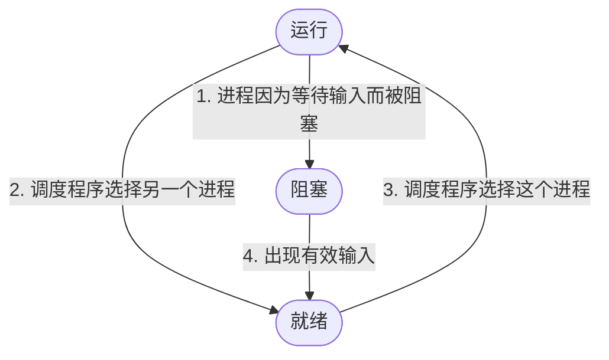

# Operating System

>Author: Jay Wei (GitHub: JayWei-git | Email: jaywei0610@163.com) — Please let me know if you spot any errors. 
>
>(Last Updated: 2026-07-26)

基于Linux、RISC-V和XV6-RISCV，不涉及具体硬件架构，只描述硬件行为及软件逻辑，从而理解计算机系统；

### 0. Introduction

- 在进程看来，操作系统就是一组API (syscalls)；

---

**End of 0.**


## Part One: Virtualization

### 1. Virtualizing CPU

#### 1.1. Exceptional Control Flow (ECF)

##### NCF v.s. ECF

- CPU 正常情况下按照程序计数器 (PC) 顺序执行指令 (jump/call/return 等普通控制流改变指令仍属于 NCF)，这称为 **Normal Control Flow**；

  当发生某个事件，使 CPU 暂时停止当前程序，转而执行异常处理程序 (Exception Handler)，就发生了 **Exceptional Control Flow (ECF)**；

- ECF 是现代操作系统实现：系统调用、中断、虚拟内存、进程切换、信号 的基础机制；


----

##### CPU Perspective

- CPU看来，Exception 的来源可以分为两类：

  1. **Instruction Event (指令事件)**：当前执行的指令导致某种事件 (同步，Synchronous)；
  2. **External Event (外部事件)**：来自 CPU 外部硬件 (异步发生，Asynchronous)；

- CPU处理流程 (x86)：

  1.  事件发生，CPU 根据异常来源确定 (或接收)异常向量，(若此时为Ring3则切换到 Ring0并切换内核栈)，自动保存RIP, CS, RFLAGS (若发生特权级切换，还保存RSP, SS)，剩余寄存器由 Handler 保存；

  2.  根据异常向量索引 IDT，获得 Handler 入口地址，跳转到 Exception Handler；
  3.  异常处理程序返回，根据异常类型决定下一步 (重新执行当前指令 / 下一条指令 / 终止)；

  > 异常向量可由操作系统与硬件架构共同定义，如除零指令产生的异常向量为X，那么操作系统必须在初始化时将 Handler 地址填入 IDT[X]；

---

##### Four Types of Exception

- 根据CPU对异常的处理方式，CSAPP 将其划分为四类：**中断 (Interrupt)**、**陷阱 (Trap)**、**故障 (Fault)** 和 **终止 (Abort)**；

  | Class         | Source (外部 or 指令)                | Async / Sync | Return Behavior            |
  | ------------- | ------------------------------------ | ------------ | -------------------------- |
  | **Interrupt** | 外部 I/O 设备                        | 异步         | 下一条指令                 |
  | **Trap**      | (有意为之的) 指令 (如系统调用)       | 同步         | 下一条指令                 |
  | **Fault**     | 指令 (如缺页异常、除零指令)          | 同步         | 重新执行当前指令或终止程序 |
  | **Abort**     | 硬件检测到严重错误 (Double Fault 等) | 同步         | 终止程序                   |

1. Interrupt (中断)

   - 由 CPU 芯片外部的硬件设备发出的电气信号引发，如Timer、Keyboard、Disk、Network Card；
   - CPU 在每条指令执行周期的末尾检测中断引脚 (Interrupt Pin)；若检测到信号，从总线读取异常号并执行对应 Handler；
   - 异步发生；与当前执行哪条指令无关；当前指令执行完成之后才响应中断；

2. Trap (陷阱)

   - 程序主动产生的异常，由特殊指令触发，如：

     ```c
     syscall  // 系统调用
     int 0x80 // 软中断
     ```

   - 在用户态与内核态之间提供受控的系统调用接口；

   - 同步发生；属于程序设计的一部分；处理结束返回下一条指令；

3. Fault (故障)

   - CPU 在执行指令过程中检测到的问题，潜在地可被 Exception Handler 修正；如 Page Fault；
   - 修复成功，重新执行导致故障的指令；修复失败终止进程；
   - 同步发生；处理程序可能修复错误；修复成功后重新执行当前指令；

4. Abort (终止)

   - 硬件或系统检测到不可逆转的数据损坏或严重硬件故障，若 Handler 无法恢复异常，通常终止当前程序或直接终止系统；
   - 同步发生；无法恢复；不会返回原程序；

---

**End of 1.1.**


#### 1.2. Process Scheduling

##### Program v.s. Process

- Program 是存储在磁盘上的可执行文件，由文本代码经编译和链接得到；
- Program 被加载到内存并开始执行 $\to$ Process，包括：
  1. CPU 上下文：PC、栈指针、通用寄存器、标志寄存器、浮点寄存器、SIMD寄存器；
  2. 虚拟地址空间：或者说页表 (Linux还有mm_struct、VMA)，包括代码段、数据段、堆、栈；
  3. 操作系统资源：fd，socket，管道，信号...；
  4. 管理信息 (记录在PCB里)：PID、调度优先级、工作目录、环境变量；

---

##### Process State



---

**End of 1.2.**


#### 1.3. Unix Process Management APIs

#### 1.4. Process Scheduling

进程调度的本质是什么？kill进程到底kill了什么？

#### 1.5 Process Isolation and Context Switching 

#### 1.6 Inter-Process Communication (IPC) 

#### 1.7 Threads and Concurrency


### 2. Virtualizing Memory


## Part Two: Concurrency

多处理器 / 多核心 不懂；

## Part Three: Persistence
